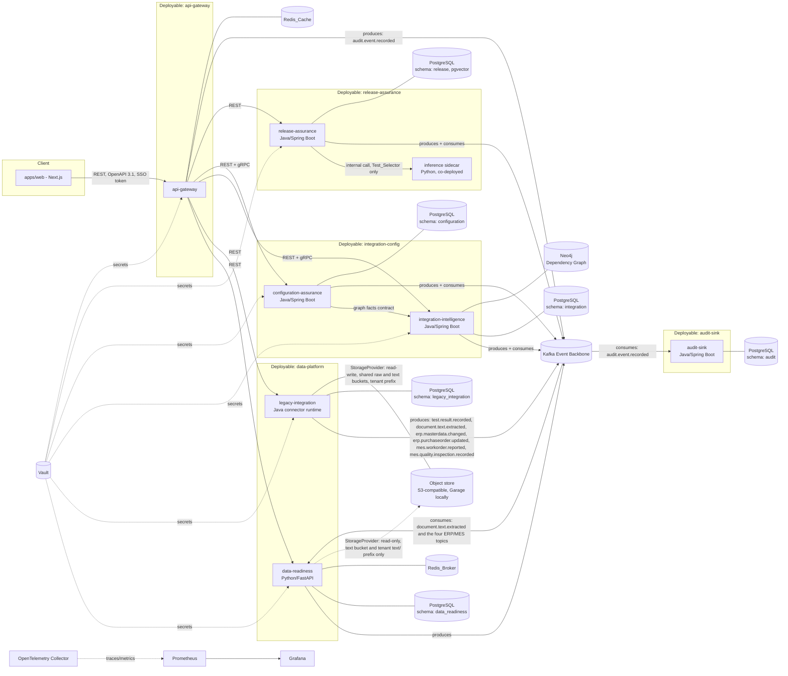
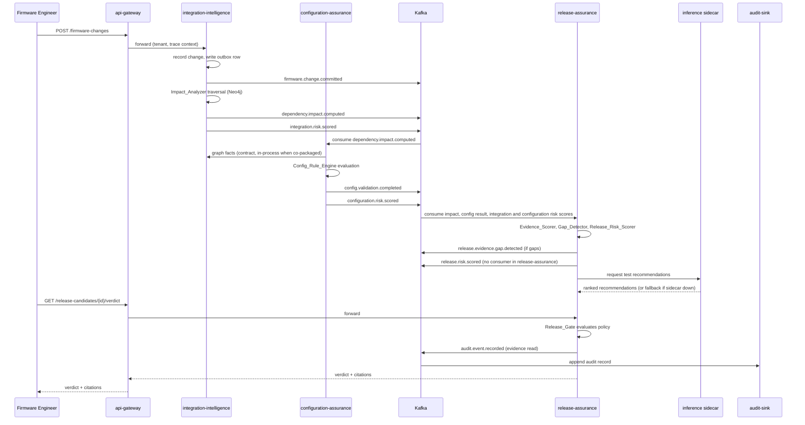
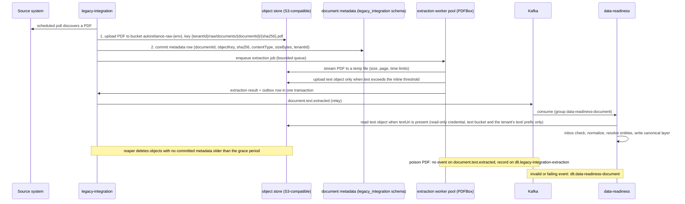
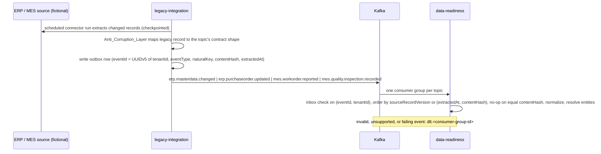

# Design Document

## Overview

AutoReliance AI Phase 1 delivers the shared platform foundation and the release wedge. The platform answers one question: "Has this automotive software or hardware change been adequately validated, what risks remain, and what evidence supports releasing it?"

Phase 1 contains five problem modules. Each module is its own **bounded context** with its own PostgreSQL schema and its own versioned contracts. Together with the gateway and the audit sink there are seven bounded-context directories, packaged into **five deployables** (see "Deployable Topology"). The platform also has a Kafka backbone, a web application, and a local development environment.

| Bounded context | Directory | Language | Module | Schema | Deployable |
|---|---|---|---|---|---|
| `data-readiness` | `services/data-readiness/` | Python / FastAPI | Data Readiness (4) | `data_readiness` | `data-platform` |
| `legacy-integration` | `services/legacy-integration/` | Java / Spring Boot (connector runtime) | Legacy Integration (8) | `legacy_integration` | `data-platform` |
| `integration-intelligence` | `services/integration-intelligence/` | Java / Spring Boot | Integration Intelligence (1) | `integration` (+ Neo4j, sole accessor) | `integration-config` |
| `configuration-assurance` | `services/configuration-assurance/` | Java / Spring Boot | Configuration Assurance (6) | `configuration` | `integration-config` |
| `release-assurance` | `services/release-assurance/` (+ `inference-sidecar/`) | Java / Spring Boot + Python sidecar | Release Assurance (2) | `release` (pgvector) | `release-assurance` |
| `api-gateway` | `services/api-gateway/` | Java / Spring Cloud Gateway | Edge: SSO, RBAC, tenant derivation, tracing, audit query | none (Redis_Cache for token and rate-limit cache) | `api-gateway` |
| `audit-sink` | `services/audit-sink/` | Java / Spring Boot | Immutable audit record store | `audit` | `audit-sink` |
| `apps/web` | `apps/web/` | Next.js, React, TypeScript, Tailwind CSS | Release readiness views | none (calls gateway only) | built separately |

Decisions retained from earlier approvals and the binding decisions of 2026-11-25 (ADR-001 to ADR-024, recorded in "Decision Log / ADRs"):

- **Five deployables, seven bounded-context directories.** Every "all five Phase 1 services" Definition-of-Done statement is read as "all five Phase 1 modules, packaged as five deployables". The full ten-context topology remains the target for Phases 2 to 4.
- **Steering is authoritative.** `.kiro/steering/*.md`, `AGENTS.md`, `DEPENDENCIES.lock.md`, and `validation.md` override this document where they conflict (Req 26).
- **Stack versions** (`tech.md`): Java 21, Spring Boot 4.1.x (4.1.3 verified), Spring Cloud 2025.1.x "Oakwood" (2025.1.5 verified, minimum 2025.1.2), Spring Framework 7, Jackson 3 as the default JSON mapper, Python 3.12, FastAPI, PostgreSQL 16, Neo4j 5.x Community Edition (no multi-database, so tenancy is label-based), Apache Kafka 3.x. Exact versions are pinned in `DEPENDENCIES.lock.md` (ADR-006).
- **Jackson 3 is the default mapper (ADR-006).** Spring Boot 4 serializes with Jackson 3 (package root `tools.jackson`; the `com.fasterxml.jackson.annotation` annotations keep their old package). No service depends on Jackson 2 `ObjectMapper` behavior, and no module imports `com.fasterxml.jackson.databind`. Envelope, API response, and event serialization tests assert the mapper in use is the Jackson 3 `JsonMapper`.
- **Libraries beyond the brief, approved with conditions (ADR-003, versions updated by ADR-006):** Spring Cloud Gateway 5.0.x (pin the release-train BOM 2025.1.x), Flyway for Java and Alembic for Python (never one cross-runtime tool), Spring Vault (`spring-vault-core` pinned explicitly to 4.1.2, ADR-010) for Java and hvac for Python, openapi-generator-cli and openapi-typescript (CI regenerates clients and fails on any diff), and buf (mandatory breaking-change check). ADR-012 adds the AWS SDK for Java v2 (`software.amazon.awssdk:s3`), boto3, and a digest-pinned Garage image for local development (ADR-013).
- **Kustomize for Kubernetes packaging, Helm deferred (ADR-007).** `platform/k8s/` is plain manifests organized as Kustomize `base/` and `overlays/dev` and `overlays/staging`. Helm is approved for Phase 2+ only, with the trigger recorded under "Kubernetes packaging".
- **Legacy data is a one-way event flow (ADR-008, ADR-011).** `legacy-integration` discovers documents, extracts text in a bounded worker pool, and publishes `document.text.extracted`; it also publishes ACL-translated ERP and MES records on four domain topics (`erp.masterdata.changed`, `erp.purchaseorder.updated`, `mes.workorder.reported`, `mes.quality.inspection.recorded`). `data-readiness` consumes all five. There is no combined record topic. Data paths are Kafka-only; the only synchronous HTTP between the two contexts is the read-only `/admin/*` cache read of the layout read-back, under the data-path rule in "Data paths and admin paths" (ADR-021, ADR-024).
- **PDF bytes live in an S3-compatible object store (ADR-012, ADR-013, ADR-014, ADR-018, ADR-019, ADR-020, ADR-021, ADR-022).** AWS S3 or another S3-compatible service in the cloud, Ceph RGW on-prem in production, Garage locally and only locally (digest-pinned; SeaweedFS runs as a digest-pinned CI smoke-test container, ADR-020, and is the approved dev-backend alternative that does not run in dev unless the ADR-019 switch trigger is met; MinIO is not approved, ADR-013), behind a `StorageProvider` port. PostgreSQL holds metadata and the object URI only. The default layout is two shared buckets per environment, `autoreliance-raw-{env}` and `autoreliance-text-{env}`, with the tenant as the first key prefix (`{tenantId}/raw/...` and `{tenantId}/text/...`) (ADR-018). Raw and text are separate buckets because they have different reader sets: the object store's bucket-level permissions keep `data-readiness` off the raw bucket on every backend. Tenant isolation inside a bucket is enforced by prefix-scoped IAM or bucket policies on AWS S3 and Ceph RGW; Garage cannot scope by prefix, so local development relies on the adapter prefix check for tenant separation (known dev-only limitation, see "Isolation mechanism and findings"). A dedicated bucket pair per tenant is an opt-in exception with a documented approval path (ADR-018). The adapter prefix check is defence in depth everywhere. Objects are uploaded before the metadata commit, and a scheduled reaper deletes orphans. Production encrypts with per-tenant SSE-KMS keys and a startup guard refuses to start without the per-tenant key strategy (ADR-015).
- **Single-replica scheduling in Phase 1 (ADR-009).** `legacy-integration` uses Spring `@Scheduled` and runs exactly one replica. `data-readiness` uses one Celery beat process, separate from worker replicas. No ShedLock, redbeat, or Quartz.
- **Domain-prefixed risk topics (ADR-001).** The flat `risk.score.computed` topic is replaced by `integration.risk.scored`, `configuration.risk.scored`, and `release.risk.scored`. The approved `config.validation.completed` event is kept.
- **Redis is split by role in production (ADR-002).** One broker instance and one cache instance. Local development uses one instance with `noeviction`.
- **Scoring does not depend on the sidecar (ADR-004).** The sidecar uses scikit-learn and xgboost for coverage analysis and test ranking only. `langgraph` is deferred to Phase 2.
- **Build tool is Maven** for Java services (`pom.xml`), matching the repository's test hook and keeping exact `<version>` pins (Req 26.4).
- **One dead-letter topic per consumer group**, named `dlt.<consumer-group-id>` (Req 13.4, 17.5).
- **Vault runs inside `platform/docker-compose.yml`** in dev server mode, pre-seeded with a transit key per seed tenant, a KV version 2 mount (required so the layout read-back can read `lastModified` and version from KV v2 metadata) for connector credentials, the Redis connection strings, and the object-store credentials (Req 20.2, 23.1, 27.2). Java services reach Vault through `spring-vault-core` 4.1.2 (ADR-010).
- **Garage runs inside `platform/docker-compose.yml`** as the local S3-compatible object store (ADR-013), referenced by digest (`dxflrs/garage:v2.6.0@sha256:4b5a318f...`), never `latest`. A one-shot bootstrap job creates exactly two buckets for the dev environment, `autoreliance-raw-dev` and `autoreliance-text-dev` (seed tenants are key prefixes, not buckets), and two least-privilege access keys: a read-write key on both buckets for `legacy-integration`, and a read-only key on the text bucket only for `data-readiness`. Garage has no SSE, no bucket policies, and no prefix-scoped grants, so local development runs key strategy `none`, relies on the two keys for the raw/text reader-set separation, and cannot enforce cross-tenant isolation at the store (ADR-018, known dev-only limitation). Garage stays the dev backend (ADR-019); do not change the docker-compose image without recording a new dated decision. `platform/docker-compose.yml` does not exist yet, so task 1.2 creates the Garage service to the requirements in "Local Garage service requirements".
- **Named dev limitation, SeaweedFS smoke test, approval trigger, layout caching (ADR-020, ADR-021).** In dev on Garage, raw-versus-text separation is enforced by the store (separate buckets, keys scoped to buckets), but tenant-within-text isolation is not: the adapter tenant-prefix check is the only barrier. On AWS S3 and Ceph RGW the prefix-scoped IAM policy is the barrier and the adapter check is defence in depth; the adapter check never replaces store-level isolation in production. SeaweedFS runs as a digest-pinned CI container for a smoke test of prefix-scoped isolation, never as release evidence; it is also the approved dev-backend alternative (not running in dev) under the ADR-019 switch trigger. The dedicated-bucket exception has one approver (platform owner) in Phase 1 and two (platform owner and security) from Phase 2 when a second engineer or security reviewer joins. The per-tenant layout value in Vault is read once at adapter initialization and cached, so a layout change takes effect after a controlled restart.
- **Performance targets**: `integration-intelligence` impact traversal completes within 2 s p95 on a 10,000-node graph (Req 5.6); gRPC configuration validation completes within 500 ms p95 for a 100-ECU snapshot (Req 7.6).
- **All seed data is fictional** and labeled as such in both storage and UI (Req 23.3).

## Research Summary

Findings that shaped this design, with sources:

- **Transactional outbox** is the standard way to guarantee "write state and publish event, both or neither" (Req 17.7) without a distributed transaction: the event row is written in the same DB transaction as the state change, and a relay delivers it to Kafka at least once. See [microservices.io: Transactional Outbox](https://microservices.io/patterns/data/transactional-outbox.html).
- **Idempotent consumers** pair at-least-once delivery with an inbox table keyed by `(eventId)`, written in the same transaction as the resulting state change (Req 17.1, 17.2, 17.4).
- **PostgreSQL row-level security** reads a per-session setting (`app.tenant_id`) set with `SET LOCAL` inside each transaction, so pooled connections never leak tenant context. A policy comparing `tenant_id = current_setting('app.tenant_id', true)::uuid` returns zero rows when the setting is absent, as long as `FORCE ROW LEVEL SECURITY` is set (Req 15.5). See [PostgreSQL 16 docs, Row Security Policies](https://www.postgresql.org/docs/current/ddl-rowsecurity.html).
- **Neo4j tenancy without Enterprise multi-database**: every node carries a mandatory `tenantId` property and a `Tenant_<id>` label; every Cypher query is generated with that constraint injected (Req 15.3, 4.3).
- **OpenTelemetry context propagation**: W3C `traceparent`/`tracestate` are injected into Kafka record headers by the OTel Kafka instrumentation, so one trace can span HTTP, Kafka, and gRPC. See [OpenTelemetry: Context Propagation](https://opentelemetry.io/docs/concepts/context-propagation/).
- **Kafka partitioning** by key `"{tenantId}:{canonicalId}"` gives per-entity ordering within one tenant (Req 13.10, 17.3).
- **Hash-chained audit log**: each row stores `recordHash = SHA-256(prevRecordHash || canonicalFieldBytes)` per tenant chain (Req 16.7).
- **Redis eviction policies**: `noeviction` makes Redis refuse writes when memory is full instead of deleting keys, which is what a job broker needs, while `allkeys-lru` evicts least recently used keys, which suits a cache. Mixing both on one instance means one policy is wrong for one of the workloads. See [Redis key eviction](https://redis.io/docs/latest/develop/reference/eviction/) and the [Celery Redis broker notes](https://docs.celeryq.dev/en/stable/getting-started/backends-and-brokers/redis.html).
- **Spring Cloud release train**: the Spring Cloud 2025.1 (Oakwood) train lists Spring Boot 4.1.x and 4.0.x as supported, with Spring Cloud Gateway 5.0.x and Spring Cloud Vault 5.0.x. The 2025.1.5 BOM on Maven Central is built against Spring Boot 4.0.10, and its release post says it is compatible with Boot 4.0, so the 4.1 pairing is checked at task 1.4. See the [Spring Cloud supported versions table](https://github.com/spring-cloud/spring-cloud-release/wiki/Supported-Versions) and the [2025.1.5 release post](https://spring.io/blog/2026/11/20/spring-cloud-2025-1-5-has-been-released/).
- **Spring Boot support windows**: Spring Boot 3.5 left open-source support on 30 June 2026 (the [3.5.16 release post](https://spring.io/blog/2026/06/25/spring-boot-3-5-16-available-now/) calls it the last OSS release of 3.5). Secondary sources report Spring Boot 4.0 OSS support ending 31 December 2026 and 4.1 ending 31 July 2027 (see [endoflife.date](https://endoflife.date/spring-boot)). Spring Boot 4.1.3 is the latest 4.1.x patch on Maven Central on 2026-11-25. Spring Boot 4.2.0 also exists and is not selected.
- **Spring Boot 4.1 managed versions** (from `spring-boot-dependencies` 4.1.3 on Maven Central): Spring Framework 7.0.11, Flyway 12.4.0, Spring Kafka 4.1.3 with kafka-clients 4.2.2, Neo4j Java driver 6.1.0, grpc-java 1.84.1, Spring gRPC 1.1.2, Testcontainers 2.0.5, Jackson 3 BOM 3.1.8 with Jackson 2 BOM 2.21.8 kept for annotations. Boot 4 requires Java 17 or later and runs on Java 21.
- **buf breaking-change detection** compares the working tree against a Git reference, which enforces "never mutate `v1`" mechanically. See [buf breaking](https://buf.build/docs/breaking/overview/).
- **Spring Boot 4.1.3 manages Flyway 12.4.0** in `spring-boot-dependencies`; Flyway needs the separate `flyway-database-postgresql` module for PostgreSQL, and Boot 4 uses `spring-boot-starter-flyway` for auto-configuration. See [spring-boot-dependencies 4.1.3](https://repo1.maven.org/maven2/org/springframework/boot/spring-boot-dependencies/4.1.3/spring-boot-dependencies-4.1.3.pom).
- **Spring Vault**: `spring-vault-core` has no 5.0.x release (5.0.x is Spring Cloud Vault, which the platform does not use). The user decided on 4.1.2 (ADR-010). The [4.1.2 release notes](https://github.com/spring-projects/spring-vault/releases/tag/4.1.2) confirm the Spring Framework 7.0.11 and Spring Data 2026.0.3 upgrades, which are the versions the Spring Boot 4.1.3 BOM manages, a fix for concurrent failed certificate rotations overwriting a pending retry, and the replacement of the platform-default charset with explicit charsets. The Spring Boot BOM does not manage `spring-vault-core`, so the version is explicit in each manifest, and it overrides the 4.0.x version that the Spring Cloud 2025.1.x BOM manages through Spring Cloud Vault. See [spring-vault-core on Maven Central](https://repo1.maven.org/maven2/org/springframework/vault/spring-vault-core/).
- **Object storage for PDFs**: the AWS SDK for Java v2 S3 client and boto3 accept an endpoint override, so one adapter serves AWS S3, Ceph RGW, Garage, and SeaweedFS. For S3-compatible stores the client sets checksum calculation and validation to when-required, because SDK 2.30+ and boto3 1.36+ send flexible CRC checksums by default that some stores reject. See the [AWS data-integrity change](https://docs.aws.amazon.com/sdkref/latest/guide/feature-dataintegrity.html) and the [AWS SDK for Java v2 2.30.0 discussion](https://github.com/aws/aws-sdk-java-v2/discussions/5802). Production SSE-KMS lets a deployment choose a key per tenant. Garage supports SSE-C only and SeaweedFS has no SSE-KMS in this design, so local dev uses no server-side encryption ([Garage S3 compatibility](https://garagehq.deuxfleurs.fr/documentation/reference-manual/s3-compatibility/)). Content was rephrased for compliance with licensing restrictions.
- **Garage and SeaweedFS access model (checked 2026-11-25)**: Garage has no S3 bucket policies and no prefix-scoped grants. Permissions are per access key per bucket (read, write, owner), per the [Garage S3 compatibility page](https://garagehq.deuxfleurs.fr/documentation/reference-manual/s3-compatibility/) and its [quick start](https://garagehq.deuxfleurs.fr/documentation/quick-start/). A single bucket with `raw/` and `text/` prefixes therefore cannot make one key read-only on `text/` only. SeaweedFS supports bucket-scoped and path-scoped actions ([S3 credentials](https://github.com/seaweedfs/seaweedfs/wiki/S3-Credentials)), and Ceph RGW and AWS S3 support bucket policies. Because raw and text have different reader sets, the design keeps them in separate buckets on every backend, where a bucket-level grant works everywhere (ADR-014, retained by ADR-018). Tenant separation inside each bucket is a key prefix (ADR-018). MinIO is not approved (archived; ADR-013). Content was rephrased for compliance with licensing restrictions.
- **Garage prefix scoping is a feature request, not a capability (checked 2026-11-25, supports ADR-020)**: the Garage tracker has an issue titled "Bucket permissions - allow granting only sub-folder" ([Deuxfleurs Garage issue 1212](https://git.deuxfleurs.fr/Deuxfleurs/garage/issues/1212)). The page I could read is a design discussion about how Garage permissions could model prefixes and IAM-style policies; it shows the capability is being discussed, not shipped. I could not read the issue's open or closed state or its first post (the Gitea API returned no fields), so the issue is cited by title only. A community tool is reported to state "Garage grants are per-bucket, NOT per-prefix (F-007), so a shared bucket with key-prefixes would be a silent hole." That quote and the F-007 finding ID were provided by the user, and I could not locate the source by web search: user-provided reference, not independently verified. The quote is reproduced as given and is not extended.
- **SeaweedFS IAM has prefix conditions and known bugs (checked 2026-11-25, supports ADR-020)**: SeaweedFS implements an IAM policy engine that evaluates `s3:prefix` conditions, which the cross-tenant test needs. The engine has had defects in exactly this area: [seaweedfs issue 9788](https://github.com/seaweedfs/seaweedfs/issues/9788) (verified: `ListObjectsV2` with `?prefix=` returned AccessDenied for a valid bucket-level `s3:ListBucket` policy; the issue is closed on GitHub, so a fixed release exists but the fix version was not checked), and a published [security advisory](https://github.com/seaweedfs/seaweedfs/security/advisories/GHSA-qmx6-fpcw-q3xg) that a bucket policy was not enforced on POST Object uploads (seen as a search snippet only; the advisory text and affected versions were not read). These bugs are why the SeaweedFS run is a smoke test and not the release gate. Content was rephrased for compliance with licensing restrictions.
- **S3 bucket quota and pricing (checked 2026-11-25, supports ADR-018)**: AWS raised the default general purpose bucket quota from 100 to 10,000 per account, and any customer can request an increase up to 1 million buckets. The first 2,000 buckets are free and a small monthly fee applies above that. Confirmed in the [AWS announcement of 14 Nov 2024](https://aws.amazon.com/about-aws/whats-new/2024/11/amazon-s3-up-1-million-buckets-per-aws-account), the [S3 bucket creation guide](https://docs.aws.amazon.com/AmazonS3/latest/userguide/create-bucket-overview.html), and the [S3 quotas page](https://docs.aws.amazon.com/AmazonS3/latest/userguide/Quotas.html). The announcement text confirms the 2,000-bucket free tier and the fee above it but does not state the fee amount, so no price is recorded in this design. Two buckets per tenant reach 10,000 buckets at 5,000 tenants (arithmetic, not an AWS statement). Content was rephrased for compliance with licensing restrictions.
- **SeaweedFS buckets and memory (checked 2026-11-25, background to the ADR-019 switch trigger)**: each S3 bucket is a SeaweedFS collection with its own dedicated volumes, and the volume server's default in-memory index costs roughly 20 bytes per file, with a leveldb index option that reduces memory. The cost per file is a per-file index cost, so many small files are the memory concern. The per-bucket cost is the dedicated volumes (the default growth allocates several writable volumes per collection), so many small buckets are also disadvantaged. See the [SeaweedFS Optimization wiki](https://github.com/seaweedfs/seaweedfs/wiki/Optimization) and [seaweedfs PR 9270](https://github.com/seaweedfs/seaweedfs/pull/9270). Content was rephrased for compliance with licensing restrictions.
- **NetworkPolicy** is enforced at L3/L4 (pod and namespace selectors, IP blocks, ports) and cannot match HTTP paths, and it only takes effect when the cluster CNI enforces it. The cache routes are therefore isolated by a dedicated management port, not by path. See the [Kubernetes NetworkPolicy documentation](https://kubernetes.io/docs/concepts/services-networking/network-policies/).
- **Kustomize** is built into `kubectl` (`kubectl kustomize`, `kubectl apply -k`), so bases and overlays need no extra tool. See the [Kubernetes Kustomize task](https://kubernetes.io/docs/tasks/manage-kubernetes-objects/kustomization/).
- **Single-instance scheduling**: Spring `@Scheduled` and Celery beat both fire on every instance that runs them, so two replicas run each job twice. This is why Phase 1 fixes one replica and one beat process (ADR-009). See [Celery periodic tasks](https://docs.celeryq.dev/en/stable/userguide/periodic-tasks.html), which states that only one beat should run.
- **PDFBox memory**: PDFBox can keep parsed streams in memory or in a temporary-file-backed cache. A temp-file-only cache plus a size, page, and time limit per document bounds heap use for hostile or oversized PDFs. The extraction worker streams the PDF from the object store to a temp file and does not hold the bytes on the heap. See the [Apache PDFBox FAQ](https://pdfbox.apache.org/3.0/faq.html).
- **ASAM MDF / DBC decoding**: `asammdf` and `cantools` are pure-Python libraries that fit the `data-readiness` language choice (Req 2.3).
- **Property-based testing libraries**: Python side uses `Hypothesis`; Java side uses `jqwik`.

Content from external pages was paraphrased for compliance with licensing restrictions.

## Architecture



### Event flow: firmware change to release verdict



### Event flow: document discovery to canonical layer (ADR-008)



No arrow in this flow is an HTTP call between the two contexts. The object store is shared infrastructure, not a context; `data-readiness` reads only text objects under the tenant's `text/` prefix in the text bucket, through its own read-only credential and adapter, and never the PDF. The store itself rejects a read of the raw bucket with that credential on every backend (ADR-014, ADR-018).

### Event flow: ERP and MES records to the canonical layer (ADR-011)



Each topic has its own AsyncAPI file and payload schema. There is no combined record topic.

### Deployable Topology

Phase 1 packages seven bounded-context directories into five deployables. The table is the approved topology (ADR-005).

| Deployable | Bounded contexts packaged | Runtime |
|---|---|---|
| `data-platform` | `data-readiness` + `legacy-integration` | Python (FastAPI) + Java connector-runtime module |
| `integration-config` | `integration-intelligence` + `configuration-assurance` | Java / Spring Boot |
| `release-assurance` | `release-assurance` | Java / Spring Boot + Python inference sidecar (co-deployed container) |
| `api-gateway` | none (shared foundation) | Spring Cloud Gateway |
| `audit-sink` | none (shared foundation) | Spring Boot (Java 21). Runtime chosen in ADR-005 |

Rules that apply to every deployable:

1. **Own schema per context.** Each bounded context keeps its own PostgreSQL schema and its own database login role, even inside a shared deployable. A shared deployable opens one datasource per context, so a context cannot read another context's tables (Req 21.1).
2. **Own contracts per context.** Each context keeps its own versioned OpenAPI, AsyncAPI, and protobuf files (Req 13.12).
3. **Contract calls inside a deployable.** Inside a deployable, a cross-context call goes through the same contract as if the contexts were separate services. For two Java contexts in one JVM (`integration-config`), the caller depends on an interface generated from the contract (for example `GraphFactsClient`) and the deployable wires an in-process adapter behind it. A gRPC or REST adapter implements the same interface for a split deployment. The two cross-runtime contexts in `data-platform` (Python `data-readiness` and Java `legacy-integration`) make no service-initiated synchronous HTTP call to each other for any data-plane operation (ADR-008, ADR-024). The only synchronous HTTP between them is the read-only `/admin/*` cache read of the layout read-back, from `legacy-integration` to `data-readiness` (ADR-021, ADR-024). They exchange data only through Kafka events (`document.text.extracted`, `erp.masterdata.changed`, `erp.purchaseorder.updated`, `mes.workorder.reported`, and `mes.quality.inspection.recorded`, all produced by `legacy-integration` and consumed by `data-readiness`). Kafka events always travel through Kafka, even between contexts in one deployable.
4. **Splitting later is a deployment change.** Moving a context into its own deployable means changing the packaging under `platform/` and swapping the in-process adapter for the network adapter. Context code, schemas, and contracts do not change.
5. **Independence.** Each deployable starts and passes its health check alone with only PostgreSQL, Kafka, and Vault running (Req 21.4). Contexts in a shared deployable also start independently of each other through per-context health groups, so a failing context reports unhealthy without hiding the healthy one.
6. **Phases 2 to 4.** The full ten-context topology from the brief remains the target. Phase 1 does not create directories, contracts, or packaging for Phase 2 to 4 contexts.
7. **Replica constraint.** `legacy-integration` runs exactly one replica and `data-readiness` runs exactly one Celery beat process in Phase 1 (see "Scheduler ownership"). The Kustomize base fixes both and the overlays may not change them.

### Cross-context call matrix

Every cross-context interaction in Phase 1. A cell names the mechanism and the contract. "none" means no direct interaction exists.

| Caller / source | data-readiness | legacy-integration | integration-intelligence | configuration-assurance | release-assurance | audit-sink |
|---|---|---|---|---|---|---|
| **data-readiness** | n/a | none (no HTTP client and no events from data-readiness to it; it only answers the `/admin/*` cache read of the next row) | event `vehicle.identity.resolved` | event `vehicle.identity.resolved` | none | event `audit.event.recorded` |
| **legacy-integration** | events `document.text.extracted`, `erp.masterdata.changed`, `erp.purchaseorder.updated`, `mes.workorder.reported`, `mes.quality.inspection.recorded` (Kafka only; no data-plane HTTP). Admin-path exception: read-only `GET /admin/v1/layout-cache/{tenantId}` on the `admin-cache` port (ADR-021, ADR-024, "Layout read-back") | n/a | none | none | event `test.result.recorded` | event `audit.event.recorded` |
| **integration-intelligence** | none | none | n/a | events `dependency.impact.computed`, `integration.risk.scored` | events `dependency.impact.computed`, `integration.risk.scored` | event `audit.event.recorded` |
| **configuration-assurance** | none | none | gRPC/in-process graph facts (`autoreliance.integration.v1`) | n/a | events `config.validation.completed`, `configuration.risk.scored` | event `audit.event.recorded` |
| **release-assurance** | none | none | none | none | n/a (sidecar over internal HTTP) | event `audit.event.recorded` |
| **api-gateway** | REST route | REST route | REST/gRPC route | REST/gRPC route | REST route | event `audit.event.recorded` |

The independence tests assert the `data-readiness` / `legacy-integration` cells: neither service holds a client, base URL, or OpenAPI operation for the other, and each starts and processes its own work while the other is stopped. The tests allow exactly one HTTP client that targets another bounded context: the registry-driven layout cache client in `legacy-integration` (a single class that can call only `GET /admin/v1/layout-cache/{tenantId}` on registered processes) and the `getLayoutCache` operation in `contracts/openapi/admin.yaml`. A repository test fails when any other HTTP client in any service targets another bounded context. With `data-readiness` stopped, `legacy-integration` still discovers, extracts, and publishes; only the read-back answers 503.

### Data paths and admin paths (ADR-024)

The rule, recorded verbatim in `security.md`:

> Data paths are Kafka-only. No service-initiated synchronous HTTP exists between bounded contexts for data-plane operations (extraction, ingest, query, mutation). Admin paths under /admin/* are the sole exception: they may use synchronous HTTP between services for read-only diagnostics, gated by platform-operator role and audited. Any admin-path HTTP failure returns 503 to the caller; no fallback, no cached value.

Scope: gateway-to-service request routing is not service-initiated, and the protobuf/gRPC contracts already in this design (configuration validation and graph facts) are gRPC under the platform brief's integration rule and are not "synchronous HTTP" under this rule; they are unchanged. The inference sidecar belongs to the `release-assurance` context, so the Test_Selector call to it is inside one bounded context.

Two controls guard the one admin-path exception, and both are required: **Role gate answers who; NetworkPolicy answers from where. Both required.** The role gate is the `platform-operator` check of "Operator surface". The NetworkPolicy is described under "Internal management port and NetworkPolicy" in "Layout read-back".

### Scheduler ownership (ADR-009)

| Cadence | Owner | Mechanism |
|---|---|---|
| Connector polling and document discovery | `legacy-integration` | Spring `@Scheduled`, one replica |
| `legacy-integration` outbox relay | `legacy-integration` | Spring `@Scheduled`, one replica |
| Ingest and transform cadence (normalization sweeps, data quality report refresh) and `data-readiness` outbox relay | `data-readiness` | Celery beat (one process) enqueues tasks, Celery worker replicas run them |

Phase 1 deployment constraints:

- `legacy-integration` runs exactly one replica. Its Kubernetes Deployment uses `replicas: 1` and `strategy: Recreate`, so a rollout never runs two pods at once.
- `data-readiness` runs exactly one Celery beat process, in its own workload (`data-readiness-beat`, `replicas: 1`, `strategy: Recreate`), separate from the Celery worker and API workloads, which may scale.
- The Phase 1 design does not add ShedLock, `celery-redbeat`, or Quartz.
- Scheduled jobs in `integration-config`, `release-assurance`, and `audit-sink` are limited to the outbox relay, which selects pending rows with `FOR UPDATE SKIP LOCKED` and publishes at least once, so a second instance does not corrupt state. Those deployables are not covered by the single-replica constraint.

**Migration trigger.** When either `legacy-integration` or `data-readiness` needs more than one replica, replace `@Scheduled` in `legacy-integration` with a PostgreSQL advisory lock (`pg_try_advisory_lock`) or Kafka-driven triggers, and replace single-beat Celery in `data-readiness` with a locked beat scheduler. Until the trigger fires, the single-replica constraint stays and the Kustomize replica test enforces it.

### Directory structure

Directories stay per bounded context under `services/`, as required by `structure.md`. The five deployables are packaging units defined under `platform/`.

```
apps/web/
services/
  data-readiness/                  Python, app/data_readiness/main.py
  legacy-integration/              Java, src/main/java/com/autoreliance/legacyintegration/
  integration-intelligence/        Java, src/main/java/com/autoreliance/integrationintelligence/
  configuration-assurance/         Java, src/main/java/com/autoreliance/configurationassurance/
  release-assurance/               Java, src/main/java/com/autoreliance/releaseassurance/
    inference-sidecar/             Python, app/release_assurance/main.py
  api-gateway/                     Java, src/main/java/com/autoreliance/apigateway/
  audit-sink/                      Java, src/main/java/com/autoreliance/auditsink/
libs/                              shared Java and Python libraries
contracts/
  openapi/  asyncapi/  proto/
platform/
  docker-compose.yml               local environment, one Redis (noeviction), Garage (digest-pinned) with a bootstrap job that creates the two shared dev buckets
  deployables/
    data-platform/                 Dockerfile(s), compose fragment, health-group config
    integration-config/            Maven assembly module, Dockerfile, compose fragment
    release-assurance/             Dockerfile(s) incl. sidecar container, compose fragment
    api-gateway/                   Dockerfile, compose fragment
    audit-sink/                    Dockerfile, compose fragment
  k8s/                             Kustomize (ADR-007), no Helm in Phase 1
    base/
      data-platform/               data-readiness-api, data-readiness-consumer (Kafka consumers and storage adapter; serves the admin-cache port), data-readiness-worker, data-readiness-beat (replicas 1, Recreate), legacy-integration (replicas 1, Recreate; serves the admin-cache port), networkpolicy-admin-cache.yaml
      integration-config/          one Deployment
      release-assurance/           Deployment with sidecar container
      api-gateway/                 Deployment
      audit-sink/                  Deployment
      redis-broker/                noeviction, append-only persistence
      redis-cache/                 allkeys-lru
    overlays/
      dev/                         kustomization.yaml: patches for resource limits and replicas only
      staging/                     kustomization.yaml: patches for resource limits and replicas only
  terraform/
```

### Repository and service layout

`<context>` in a Java package has no hyphens; in a Python package hyphens become underscores.

| Context | Path | Entrypoint and code root | Contracts |
|---|---|---|---|
| `data-readiness` | `services/data-readiness/` | `app/data_readiness/main.py` (FastAPI) | `contracts/openapi/data-readiness.yaml`, `contracts/asyncapi/data-readiness.yaml` (an index that references the `receive` operations in the five per-topic files below, and defines `vehicle.identity.resolved`; it does not redefine those topics) |
| `legacy-integration` | `services/legacy-integration/` | `src/main/java/com/autoreliance/legacyintegration/` | `contracts/openapi/legacy-integration.yaml` (operator endpoints only; no operation called by `data-readiness`), `contracts/asyncapi/legacy-integration.yaml` (defines `test.result.recorded` and `dlt.legacy-integration-extraction`, and references the `send` operations in the five per-topic files below), plus the topic files `contracts/asyncapi/document.text.extracted.yaml`, `erp.masterdata.changed.yaml`, `erp.purchaseorder.updated.yaml`, `mes.workorder.reported.yaml`, and `mes.quality.inspection.recorded.yaml` |
| `integration-intelligence` | `services/integration-intelligence/` | `src/main/java/com/autoreliance/integrationintelligence/` | `contracts/openapi/integration-intelligence.yaml`, `contracts/asyncapi/integration-intelligence.yaml`, `contracts/proto/integration-intelligence/` (graph facts), plus the topic file `contracts/asyncapi/integration.risk.scored.yaml` |
| `configuration-assurance` | `services/configuration-assurance/` | `src/main/java/com/autoreliance/configurationassurance/` | `contracts/openapi/configuration-assurance.yaml`, `contracts/asyncapi/configuration-assurance.yaml`, `contracts/proto/configuration-assurance/` (package `autoreliance.configuration.v1`), plus `contracts/asyncapi/configuration.risk.scored.yaml` |
| `release-assurance` | `services/release-assurance/` | `src/main/java/com/autoreliance/releaseassurance/` | `contracts/openapi/release-assurance.yaml`, `contracts/asyncapi/release-assurance.yaml`, plus `contracts/asyncapi/release.risk.scored.yaml` |
| inference sidecar | `services/release-assurance/inference-sidecar/` | `app/release_assurance/main.py` (FastAPI) | `contracts/openapi/release-assurance-sidecar.yaml` (internal, not aggregated into the gateway) |
| `api-gateway` | `services/api-gateway/` | `src/main/java/com/autoreliance/apigateway/` | `contracts/openapi/api-gateway.yaml`, `contracts/asyncapi/api-gateway.yaml`, aggregate `contracts/openapi/gateway.yaml` |
| `audit-sink` | `services/audit-sink/` | `src/main/java/com/autoreliance/auditsink/` | `contracts/openapi/audit-sink.yaml` (health only), `contracts/asyncapi/audit-sink.yaml` |

The three risk topics and the five `legacy-integration` topics (`document.text.extracted`, `erp.masterdata.changed`, `erp.purchaseorder.updated`, `mes.workorder.reported`, `mes.quality.inspection.recorded`) have one AsyncAPI file each, named for the topic. Each context that produces or consumes events also keeps its `contracts/asyncapi/<context>.yaml`, which covers every other topic it touches. The per-topic files hold both the producer `send` operation and the permitted `receive` operations, so each of these topics is defined in exactly one place. The per-context files for `legacy-integration` and `data-readiness` reference the per-topic operations with external `$ref` and never redefine the topics (the hook `verify-contract.sh` needs the per-context files to exist).

### API standards (`api-standards.md`)

- **REST base path** `/api/v1/<context>/` with `<context>` one of `data-readiness`, `legacy-integration`, `integration-intelligence`, `configuration-assurance`, `release-assurance`, `audit` (Req 12.1). Exception: operator routes under `/admin/*` (see "Operator surface"), versioned as `/admin/v1/<resource>/{tenantId}`.
- **Success envelope** `{ "data": ..., "meta": { "traceId", "tenantId" } }`. The `tenantId` comes from the authenticated principal (Req 12.9). List responses add `meta.nextCursor` (assumption: `api-standards.md` fixes only `traceId` and `tenantId`, so the cursor extension is documented in the OpenAPI components).
- **Errors** are RFC 9457 `application/problem+json` with `type`, `title`, `status`, `detail`, `instance`, and the extension members `correlationId` and `traceId`. A cross-tenant 404 uses the same body as a missing entity (Req 12.10, 15.4).
- **Pagination** is cursor-only: `?cursor=<opaque>&limit=<int>`. Cursors are opaque, tenant-bound, and signed. Offset and page parameters are rejected with 400.
- **gRPC**: package `autoreliance.<context>.v1`, so `autoreliance.configuration.v1` for `configuration-assurance` and `autoreliance.integration.v1` for `integration-intelligence`. Every request message has a `tenant_id` field. Breaking changes need a `v2` package; `v1` is never mutated. CI enforces this with `buf lint` and `buf breaking --against .git#branch=main` on every `contracts/proto/` change (Req 13.11, 14.6).
- **Kafka**: topics are `<domain>.<entity>.<action>` in past tense. Two documented naming exceptions exist (Req 13.3, 13.4, 13.17): the `dlt.<consumer-group-id>` dead-letter topics, and the four-segment topic `mes.quality.inspection.recorded`, approved as written in ADR-011. The CI topic-name lint rule (task 2.1) accepts exactly these two exceptions and no others.
- **Envelope extension `sourceSystem`**: the five `legacy-integration` topics add a required top-level `sourceSystem` field to the standard envelope. `api-standards.md` does not list this field. It is an approved extension (ADR-011) limited to those five topics; every other topic uses the standard six-field envelope. The CI envelope check compares each file-local envelope with the shared envelope plus this one declared extension.

### Internal principal and tenant trust (`security.md`)

No service trusts a tenant ID supplied by a client, and no internal endpoint trusts a bare `X-Tenant-Id` header (Req 15.10, 15.11).

- The gateway validates the SSO token, then mints a short-lived Internal_Principal (signed JWT; signing key held in Vault, rotated, public keys distributed to services). It carries `sub`, roles, `tenantId`, `traceId`, and expiry.
- Every bounded context verifies the signature, expiry, and audience, and takes the tenant from the verified principal. `X-Tenant-Id`, if present, is informational and must equal the principal's tenant, otherwise the call fails with 403 Problem_Details and an audit event.
- For gRPC, the principal travels in call metadata. A server interceptor verifies it and compares `request.tenant_id` with the principal's tenant, returning `PERMISSION_DENIED` on mismatch (Req 7.9). In-process calls between contexts in one deployable carry the same verified principal object, and the receiving context re-checks the tenant.
- Kafka consumers compare the envelope `tenantId` with their authorized tenants (Req 15.6).
- For `/admin/*` the principal is a platform-operator principal with no `tenantId`, plus an explicit `targetTenantId` taken from the validated path. A service never reads `targetTenantId` as the caller's tenant, and a tenant-scoped service endpoint still rejects any call whose principal has no tenant, unless the route is an `/admin/*` route (Req 15.12).
- The shared tenancy library (task 4.4) provides the verifier, the gRPC interceptor, and the HTTP filter.

### Operator surface: `/admin/*` (ADR-023)

Tenant-facing routes never carry a tenant ID in the path. The single exception is the operator surface under `/admin/*`, which exists so the platform owner can act on a named tenant (for example, read back a tenant's cached storage layout).

- **Role.** `platform-operator` is a seventh RBAC role, distinct from the six tenant roles (release manager, firmware engineer, configuration engineer, data engineer, auditor, tenant administrator). A platform-operator principal is not tenant-scoped: its Internal_Principal carries no `tenantId`, and it holds no tenant role.
- **Gateway gate.** Requests to `/admin/*` from a principal without the platform-operator role are rejected at the gateway before reaching any service. Tenant-scoped principals are also rejected on `/admin/*`. The rejection is HTTP 403 `application/problem+json` and publishes `audit.event.recorded`.
- **Target tenant.** For `/admin/*` the `targetTenantId` comes from the path. The gateway validates its format (lowercase UUID) and that the tenant exists in the tenant registry (unknown tenant: 404, identical body to a missing entity). It is never treated as the caller's tenant. Services receive it as an explicit `targetTenantId` field next to the operator principal, and never as the principal's tenant. The shared tenancy library (task 4.4) exposes it through a separate accessor, so code that reads "the caller's tenant" cannot receive it by mistake.
- **Audit.** Every `/admin/*` call emits `audit.event.recorded` with the standard envelope and the payload `{ operatorPrincipal, targetTenantId, action, result, occurredAt }`. The event is written to the outbox before the response is returned, for allowed and for rejected calls (a rejected call has `result: denied`). The envelope `tenantId` of that event is the target tenant, and the operator principal is the separate `operatorPrincipal` field.
- **Routes.** Admin routes are versioned immediately after the `/admin/` prefix: `/admin/v1/<resource>/{tenantId}`. Phase 1 has two contracted operations, both in `contracts/openapi/admin.yaml`: (1) `GET /admin/v1/layout/{tenantId}`, the aggregate read-back, read-only, owned by `legacy-integration` and routed by the gateway; (2) `GET /admin/v1/layout-cache/{tenantId}`, internal only, served by every process that caches the layout and not routed by the gateway to external callers. See "Layout read-back" below. No route returns a credential or key ARN.
- **Envelope and errors.** Admin routes keep the `{ "data", "meta" }` envelope and `application/problem+json` errors. Because the operator is not tenant-scoped, `meta.tenantId` is `null` and `meta.targetTenantId` carries the target (recorded in `api-standards.md`).
- **Contract.** Every route whose path starts with `/admin/` declares the `platform-operator` security scheme and the `x-audit-event-required: true` extension (defined in `api-standards.md`, enforced by the OpenAPI lint rule of task 2.4).
- **Base path.** `/admin/*` is an exception to the `/api/v1/<context>/` base-path rule. Admin routes are versioned `/admin/v1/<resource>/{tenantId}`; tenant routes remain `/api/v1/<context>/`. The two namespaces are intentionally distinct: tenant routes are customer-facing and gated by tenant principal; admin routes are operator-facing and gated by platform-operator role. Versioning either namespace does not affect the other.
- **Phase 2 trigger (verbatim).** "If the operator surface exceeds roughly 10 routes or if the platform owner is no longer the sole operator, move /admin/* to a separate gateway listener or subdomain. Role gating on a shared listener is correct for Phase 1; blast-radius reduction is Phase 2."
- **Phase 2 route.** `POST /admin/v1/layout/{tenantId}/refresh` is approved under the same exception (same role gate, audit, and tests) and is not implemented in Phase 1.

#### Layout read-back (ADR-021, ADR-023)

`GET /admin/v1/layout/{tenantId}` is the aggregate read-back. It reports every place the tenant's storage layout lives, so the operator can verify the onboarding service level. It is contracted in `contracts/openapi/admin.yaml` (OpenAPI 3.1.0).

- **Sources.** (1) Vault: the current value of `kv/tenants/<tenantId>/storage/layout`, with `lastModified` (KV v2 metadata `updated_time`) and `version` (KV v2 metadata `current_version`). The `kv` mount must be KV version 2 (task 1.2). (2) Every process that caches the layout. In this spec the caches are the StorageProvider adapter inside `legacy-integration` (Java) and the StorageProvider adapter inside `data-readiness` (Python). Within the `data-platform` deployable these are separate processes (containers), so each serves its own `GET /admin/v1/layout-cache/{tenantId}`. Explicit process identifiers: `legacy-integration/storage-adapter` and `data-readiness/storage-adapter`. The `data-readiness` process that runs the Kafka consumers and its Storage_Provider adapter (workload `data-readiness-consumer`) serves `GET /admin/v1/layout-cache/{tenantId}` and is the only `data-readiness` process that holds the cache. If Phase 2 splits that process, each resulting process that holds a cache exposes its own cache endpoint and registers with the aggregate in the same PR.
- **Response.** The user's example, recorded verbatim (this is the `data` member of the `{ data, meta }` envelope; `"acme"` is illustrative, the seed tenants are fictional UUIDs):

```json
{
  "tenantId": "acme",
  "vault": { "value": "dedicated", "lastModified": "...", "version": 7 },
  "caches": [
    { "process": "data-readiness", "value": "dedicated", "vaultVersion": 7, "loadedAt": "..." },
    { "process": "storage-adapter", "value": "shared", "vaultVersion": 6, "loadedAt": "..." }
  ],
  "consistent": false,
  "recommendation": "restart storage-adapter to load layout v7"
}
```

- **Mapping of the example to real processes.** The example's `data-readiness` is `data-readiness/storage-adapter` (the Python adapter). The example's `storage-adapter` is `legacy-integration/storage-adapter` (the Java read-write adapter inside `legacy-integration`). The contract uses the explicit identifiers. Each cache entry carries `vaultVersion` (the Vault KV v2 version it loaded; null for the default `shared` layout with no Vault entry); `vaultVersion` is what enables the "layout v7" recommendation string, because the recommendation names the Vault version the stale process must load, for example `restart legacy-integration/storage-adapter to load layout v7`. Each cache entry and the Vault object may also carry `reason`, `approvalRef`, and `approvedAt` (null for `shared`), which keeps the earlier requirement that the read-back shows the reason and approval reference. Neither a credential nor a key ARN is ever returned.
- **Consistency rule.** `consistent` is true only when every registered cache has `value` equal to `vault.value` and `vaultVersion` equal to `vault.version`. `recommendation` names every process that does not match and the layout version to load; when `consistent` is true it states that no restart is needed. A tenant with no Vault entry is the default `shared` layout: `vault.version` is null and a cache matches when it reports `shared` and a null `vaultVersion`.
- **Cache endpoint.** `GET /admin/v1/layout-cache/{tenantId}` exists in every process that caches the layout (`legacy-integration` and `data-readiness`). It is internal only: it is served on the dedicated internal management port `admin-cache` (8081/TCP), not on the primary listener; the gateway has no route to it for external callers, and it is not part of the gateway aggregate (`x-internal-only`). It is still contracted in `admin.yaml` with the same `platformOperator` role gate and `x-audit-event-required: true`. It is read-only, returns only the layout the process loaded at initialization and when, performs no Vault or storage call, and carries no document or ingest payload. If the endpoint cannot complete a call (for example the adapter is not initialized or the audit outbox write fails) it returns 503 Problem_Details, with no cached value. Each HTTP call emits an `audit.event.recorded` event (`action: layout-cache.read`) through the process's own outbox.
- **Internal call.** The aggregate in `legacy-integration` reads its own cache in-process and calls the `data-readiness` cache endpoint over HTTP. The call carries the operator's signed Internal_Principal (audience `data-readiness`, with the explicit `targetTenantId` and no principal tenant) and propagates `traceparent`, so the cache endpoint verifies the role and audience exactly like any `/admin/` route. The aggregate handler reads Vault (data and KV v2 metadata) with a read-only policy on `kv/data/tenants/*/storage/layout` and `kv/metadata/tenants/*/storage/layout`. The aggregate calls the cache endpoint on the `admin-cache` port of each registered process.
- **Registration rule (verbatim).** "Any process that caches layout must register its cache with the aggregate read-back, or the SLA cannot be verified. When Phase 2 adds a caching layer, that layer must be added to the aggregate in the same PR."
- **Registration is concrete.** A static registry file, `platform/layout-cache-registry.yaml`, lists every cache as `{ process, baseUrl, timeoutMs }` (Phase 1: the two entries above, `timeoutMs: 2000`). The aggregate reads the registry at startup and iterates it; it holds no other list. A StorageProvider adapter constructor takes its `processId` and refuses to build when that id is not on the registry. A repository test enumerates every instantiation site of a StorageProvider adapter class (Java and Python) and fails if the owning process is not on the registry or if a registry entry has no cache endpoint.
- **Fail closed.** The aggregate reads Vault and all registered caches in parallel, each with a 2 s timeout. If any registered cache endpoint is unreachable, times out, or returns an error or a malformed body, or Vault cannot be read, the aggregate returns HTTP 503 `application/problem+json` whose `detail` and `unreachableProcesses` member name the unreachable process (or `vault`). It never reports `consistent: true` on partial data and never returns a partial `caches` list as a success. Any admin-path HTTP failure returns 503 to the caller, with no fallback and no cached value.
- **Vault reads (ADR-021, ADR-024).** Two distinct rules apply. (1) Storage adapters never read Vault per request: they read the layout once at initialization and serve from the cache. (2) The `/admin/v1/layout/{tenantId}` handler reads Vault on invocation, which is operator-triggered and low-frequency and is acceptable. The ban in (1) applies to the adapters, not to the operator surface.
- **Data-path rule applied.** The call from `legacy-integration` to `data-readiness` is the admin-path exception of the rule in "Data paths and admin paths": read-only, gated by the platform-operator role, audited, and carrying no document or ingest payload. A test asserts that the cache endpoint accepts only `GET`, carries no request body and no document, text, or ingest field in its response, and returns 503 on its own failure.
- **Internal management port and NetworkPolicy.** NetworkPolicy is L3/L4 and cannot match HTTP paths, so the cache routes are served on a dedicated internal management port, `admin-cache` (8081/TCP), in every process that serves them (`legacy-integration` and `data-readiness-consumer`). The manifest `platform/k8s/base/data-platform/networkpolicy-admin-cache.yaml` (`networking.k8s.io/v1`, `policyTypes: Ingress`) selects pods labelled `app.kubernetes.io/part-of: data-platform` with `app.kubernetes.io/component` in (`legacy-integration`, `data-readiness-consumer`) and allows ingress on `admin-cache` only from (a) pods labelled `app.kubernetes.io/part-of: data-platform` and `app.kubernetes.io/component: legacy-integration` in the same namespace (`autoreliance`; the aggregate caller) and (b) pods labelled `app.kubernetes.io/component: api-gateway` in the namespace labelled `kubernetes.io/metadata.name: autoreliance-gateway` (the operator gateway). The policy restricts only the `admin-cache` port: because selecting a pod isolates it for all ingress, a second ingress rule re-admits ports 1-8080 and 8082-65535 from any source, so other ports keep their existing traffic. A default-deny policy is not part of this change. **Role gate answers who; NetworkPolicy answers from where. Both required.** The cluster CNI must enforce NetworkPolicy; that is a requirement of the test cluster, not a new dependency.

### Redis Topology

Redis has two jobs in Phase 1 and the two jobs need opposite eviction behavior (ADR-002).

| Use | Owner | Instance (production) | `maxmemory-policy` | Data of record |
|---|---|---|---|---|
| Celery broker for ingestion background jobs (MDF decoding, ingest and transform cadence, outbox relay polling), with one Celery beat process | `data-readiness` | `redis-broker` | `noeviction` | No. PostgreSQL holds all durable state |
| Token validation cache and rate-limit counters | `api-gateway` | `redis-cache` | `allkeys-lru` | No |

**Production.** Two Redis instances run as separate deployments under `platform/k8s/base/` (`redis-broker`, `redis-cache`). Each has its own Redis ACL user. `data-readiness` receives only the broker credentials and `api-gateway` receives only the cache credentials. The two connection strings are distinct and are read from Vault paths `kv/platform/redis/broker` and `kv/platform/redis/cache` (Req 27.2). A deployment check fails if both strings resolve to the same host and port.

**Local development.** `platform/docker-compose.yml` runs one Redis with `maxmemory-policy noeviction`. Both connection strings still exist in Vault and point at the one instance, using Redis logical database 0 for the broker and 1 for the cache, so no code path assumes the two are the same. Because the single instance never evicts, the cache cannot rely on eviction (Req 27.4, 27.5).

**Key rules.**
- Every key written to the Redis_Cache has an explicit TTL. The gateway never calls `SET` without `EX`/`PX`, enforced by a single cache wrapper class that has no TTL-less method.
- Token cache key: `gw:tok:v1:{tenantClaim}:{expEpoch}:{sha256(token)}`. The tenant claim and expiry are read from the unverified token only to build the key. The cached value is the previously verified result (tenant, roles, expiry). On a hit, the gateway compares the verified tenant in the value with the tenant claim in the key, and discards the entry and revalidates on any mismatch. A bare token string is never a key. TTL is `min(token remaining lifetime, 300 s)`.
- Rate-limit key: `gw:rl:v1:{tenantId}:{principalId}:{windowStartEpoch}` with TTL equal to the window length plus a 5 s margin.
- Celery broker keys are managed by Celery and have no TTL. They are the reason the broker instance is `noeviction`. Celery's result backend is not used; task outcomes are written to PostgreSQL.
- On a cache write error (for example the single local instance reaching `maxmemory`), the gateway treats it as a cache miss, validates the token with the identity provider, increments an error metric, and does not fail the request (Req 27.7).

### Kubernetes packaging (ADR-007)

`platform/k8s/` holds plain Kubernetes manifests organized with Kustomize: `base/` has one directory per deployable plus `redis-broker` and `redis-cache`, and `overlays/dev` and `overlays/staging` each have a `kustomization.yaml` that references the base and patches only resource limits and replica counts. Overlays contain no copy of a base manifest. The `data-platform` base `kustomization.yaml` must include `networkpolicy-admin-cache.yaml` (task 1.6). Kustomize is built into `kubectl`, so it adds no dependency (`kubectl kustomize <dir>` renders an overlay, `kubectl apply -k <dir>` applies it).

Two workloads are exempt from overlay replica patches: `legacy-integration` and `data-readiness-beat` stay at `replicas: 1` with `strategy: Recreate` in every overlay (ADR-009).

**Helm trigger.** Helm is approved for Phase 2+ and is not used in Phase 1. Introduce Helm when the deployable count exceeds six, or when the overlays need to differ from the base by more than resource limits and replicas (for example per-environment templated config, conditional resources, or values shared across many manifests). Until a trigger fires, no `Chart.yaml` or `values.yaml` exists in the repository.

### CI Pipeline

GitHub Actions jobs:

1. **Contract diff.** Validates each context's producers and consumers against `contracts/asyncapi`, gateway routes against `contracts/openapi`, gRPC services against `contracts/proto`, and runs Pact tests for each synchronous pair (Req 14.1 to 14.3). An AsyncAPI check also asserts the three risk topic files share no schema, `release-assurance` has no `receive` operation on `release.risk.scored`, and each risk file's inline envelope equals `contracts/asyncapi/common/envelope.yaml`.
2. **buf.** On every `contracts/proto/` change, runs `buf lint` and `buf breaking --against .git#branch=main` (Req 14.6).
3. **Client drift.** On every `contracts/openapi/` change, runs openapi-generator-cli for the Java and Python clients and openapi-typescript for the web client, then fails on any `git diff` (Req 14.7).
4. **Dependency pins.** Runs the pin check and ledger cross-check (Req 26.4, 26.5), and fails on a direct `com.fasterxml.jackson.databind` import in any Java module (ADR-006).
5. **Kustomize build.** Runs `kubectl kustomize` on `platform/k8s/overlays/dev` and `platform/k8s/overlays/staging`, fails on a build error, asserts `legacy-integration` and `data-readiness-beat` render with `replicas: 1`, and fails when an overlay contains a raw copy of a base manifest (ADR-007, ADR-009).
6. **Unit and integration tests.** Unit tests for every rule engine and scoring function, and Testcontainers integration tests for PostgreSQL, Neo4j, and Kafka (Req 14.5).

Any divergence fails the build and reports the diverging contract and element (Req 14.4).

## Event Catalog

Every event uses the envelope `{ eventId, eventType, version, tenantId, occurredAt, payload }`. W3C `traceparent` and `tracestate` travel in Kafka record headers. The partition key is `{tenantId}:{canonicalId}`.

| Topic | Producer | Consumers (consumer group) | Contract file | Phase 1 status |
|---|---|---|---|---|
| `vehicle.identity.resolved` | `data-readiness` | `integration-intelligence` (`integration-intelligence-identity`), `configuration-assurance` (`configuration-assurance-identity`) | `data-readiness.yaml` | brief catalog |
| `firmware.change.committed` | `integration-intelligence` | `integration-intelligence` (`integration-intelligence-change`) | `integration-intelligence.yaml` | brief catalog |
| `dependency.impact.computed` | `integration-intelligence` | `integration-intelligence` (`integration-intelligence-impact`), `configuration-assurance` (`configuration-assurance-impact`), `release-assurance` (`release-assurance-evidence`) | `integration-intelligence.yaml` | brief catalog |
| `config.validation.completed` | `configuration-assurance` | `release-assurance` (`release-assurance-evidence`) | `configuration-assurance.yaml` | Phase 1 extension, approved |
| `integration.risk.scored` | `integration-intelligence` | `release-assurance` (`release-assurance-evidence`) | `integration.risk.scored.yaml` | Phase 1 extension (ADR-001) |
| `configuration.risk.scored` | `configuration-assurance` | `release-assurance` (`release-assurance-evidence`) | `configuration.risk.scored.yaml` | Phase 1 extension (ADR-001) |
| `release.risk.scored` | `release-assurance` | none in Phase 1. `release-assurance` must not subscribe | `release.risk.scored.yaml` | Phase 1 extension (ADR-001) |
| `test.result.recorded` | `legacy-integration` (CI connectors) | `release-assurance` (`release-assurance-evidence`) | `legacy-integration.yaml` | brief catalog |
| `document.text.extracted` | `legacy-integration` (extraction worker pool) | `data-readiness` (`data-readiness-document`) | `document.text.extracted.yaml` | Phase 1 extension (ADR-008, ADR-012). Document specific, not generalised. Envelope extension `sourceSystem` |
| `erp.masterdata.changed` | `legacy-integration` (ERP connector through the Anti_Corruption_Layer) | `data-readiness` (`data-readiness-erp-masterdata`) | `erp.masterdata.changed.yaml` | Phase 1 extension (ADR-011). Envelope extension `sourceSystem` |
| `erp.purchaseorder.updated` | `legacy-integration` (ERP connector) | `data-readiness` (`data-readiness-erp-purchaseorder`) | `erp.purchaseorder.updated.yaml` | Phase 1 extension (ADR-011). Envelope extension `sourceSystem` |
| `mes.workorder.reported` | `legacy-integration` (MES connector) | `data-readiness` (`data-readiness-mes-workorder`) | `mes.workorder.reported.yaml` | Phase 1 extension (ADR-011). Envelope extension `sourceSystem` |
| `mes.quality.inspection.recorded` | `legacy-integration` (MES connector) | `data-readiness` (`data-readiness-mes-quality`) | `mes.quality.inspection.recorded.yaml` | Phase 1 extension (ADR-011). Four-segment name approved as a naming exception. Envelope extension `sourceSystem` |
| `release.evidence.gap.detected` | `release-assurance` | none in Phase 1 | `release-assurance.yaml` | brief catalog |
| `audit.event.recorded` | every context that audits, via its outbox | `audit-sink` (`audit-sink`) | `audit-sink.yaml` | brief catalog |
| `dlt.<consumer-group-id>` | the owning consumer | operations tooling | per consuming context | naming exception |

Dead-letter topics: `dlt.integration-intelligence-identity`, `dlt.integration-intelligence-change`, `dlt.integration-intelligence-impact`, `dlt.configuration-assurance-identity`, `dlt.configuration-assurance-impact`, `dlt.release-assurance-evidence`, `dlt.audit-sink`, `dlt.data-readiness-document`, `dlt.data-readiness-erp-masterdata`, `dlt.data-readiness-erp-purchaseorder`, `dlt.data-readiness-mes-workorder`, `dlt.data-readiness-mes-quality`, and `dlt.legacy-integration-extraction`. The last one is not a consumer-group topic: it receives a record for each document that the `legacy-integration` extraction worker could not extract (poison PDF), carrying the canonical document ID, `objectStoreUri`, `contentSha256`, a failure reason (`corrupt`, `encrypted`, `too-large`, `too-many-pages`, `timeout`, `text-too-large`), the attempt count, and no document bytes. It follows the same `dlt.<name>` naming exception.

**Document flow rules (ADR-008).**
- `document.text.extracted` is produced by `legacy-integration` only after the PDF object (and the text object, when the text is large) has been uploaded and the metadata row, the extraction result row, and the outbox row have committed in one transaction (upload-then-commit). `version` 1. Partition key `{tenantId}:{canonicalDocumentId}`.
- Envelope: the base envelope plus the source-ingestion extension (ADR-016, ADR-017): `sourceSystem`, `naturalKey` (`<sourceSystem>|<SOURCE_DOC_KEY>`, built by the connector), `contentHash` (the PDF SHA-256, equal to `payload.contentSha256`), and `extractedAt`. There is no `sourceRecordVersion`, because documents are content addressed. Payload: `canonicalDocumentId`, `objectStoreUri` (`s3://autoreliance-raw-{env}/{tenantId}/raw/documents/{canonicalDocumentId}/{contentSha256}.pdf`; a tenant with a dedicated bucket pair uses the bucket `autoreliance-raw-{env}-{tenantId}` and the same key), `contentSha256`, `mediaType`, `sizeBytes`, `pageCount`, exactly one of `extractedText` (inline) or `textUri` (`s3://autoreliance-text-{env}/{tenantId}/text/documents/{canonicalDocumentId}/{textSha256}.txt`; dedicated layout bucket `autoreliance-text-{env}-{tenantId}`), `textSha256`, `textSizeBytes`, `extractorVersion`. The tenant in the key prefix (and in the bucket name under the dedicated layout) must equal the envelope `tenantId`. A JSON Schema pattern cannot compare a URI segment with an envelope field, so this equality is a producer check and a consumer-side validation, covered by contract-test fixtures and a consumer test (a mismatch routes the event to the DLT with an audit event).
- **Inline-text threshold.** Text is inline only when its UTF-8 size is at most 65,536 bytes (64 KiB). The setting `extraction.text.inline-max-bytes` is configurable between 0 and 65,536 and defaults to 65,536; the contract ceiling is 65,536 and a producer refuses a higher setting. The topic's `max.message.bytes` is 262,144, so inline messages stay far below the Kafka limit. Above the threshold the worker uploads the text to the object store (upload-then-commit) and the event carries `textUri`, `textSha256`, and `textSizeBytes` and no `extractedText`. The contract expresses this as a `oneOf` over the two shapes, with `extractedText` limited to 65,536 characters and the byte limit enforced through `textSizeBytes`.
- **Idempotency key:** `(tenantId, canonicalDocumentId, contentSha256)`. The producer derives `eventId` as a UUIDv5 of that key, and a unique index on the same triple in `legacy_integration.document_extraction` blocks a second row. Re-extracting the same document ID with the same bytes therefore republishes the same `eventId` or nothing, and the `data-readiness` inbox (keyed by `eventId` and `tenantId`) collapses it to no additional effect. Revised bytes produce a new `contentSha256`, a new key, and a new event for the same document ID.

**ERP and MES topic rules (ADR-011).**
- The four topics `erp.masterdata.changed`, `erp.purchaseorder.updated`, `mes.workorder.reported`, and `mes.quality.inspection.recorded` replace the earlier combined record topic, which no longer exists. Each has its own AsyncAPI 3.0 file, its own payload schema, and no shared ERP or MES payload schema.
- Each envelope is the source-ingestion envelope: `eventId`, `eventType`, `version`, `tenantId`, `occurredAt`, and `payload` from the base envelope, plus `sourceSystem`, `naturalKey`, `contentHash`, `extractedAt`, and an optional `sourceRecordVersion`. The extension fields are limited to the five `legacy-integration` topics and are recorded in `api-standards.md` (ADR-017).
- **Partition keys.** `{tenantId}:{naturalKey}` for all four, using the raw connector-built natural key and not a hash of it. All versions of one source record in one tenant therefore stay in one partition and ordered. A raw key can be read in a Kafka tool, and no second hashing step exists that two producers could implement differently. The canonical identifier does not exist yet at publication, because `data-readiness` assigns it, so the natural key is the ordering key. The key is at most 512 characters.
- **Idempotency.** The producer derives `eventId` as a UUIDv5 of `(tenantId, eventType, naturalKey, contentHash, extractedAt)`. Each consumer group keeps an inbox keyed by `(eventId, tenantId)`, so a Kafka redelivery of the same message has no additional effect. The consumer's idempotency key is `eventId`, never `naturalKey` or `contentHash`. Ordering of versions of one record follows "Source key strategy".
- **Consumer groups and dead-letter topics.** Each topic has its own consumer group in `data-readiness` and its own dead-letter topic: `data-readiness-erp-masterdata`, `data-readiness-erp-purchaseorder`, `data-readiness-mes-workorder`, and `data-readiness-mes-quality`, with `dlt.<consumer-group-id>` for each. One group per topic keeps a failing topic from blocking the others and keeps lag and DLT counts per topic.
- **Anti_Corruption_Layer note.** Payloads hold only stable contract fields in fictional-domain terms (for example `partNumber`, `supplierCode`, `workOrderNumber`, `vin`, `defectCode`). The ACL maps each legacy record into this shape before the outbox write, so no raw legacy field name, code table, or type leaks into a contract. A change in a legacy model changes the ACL mapping and not the contract. `vin` and the installed-software triple are source identifiers that only `data-readiness` resolves to Canonical_IDs.
- **Naming exception.** `mes.quality.inspection.recorded` has four segments. `api-standards.md` requires `<domain>.<entity>.<action>`. The name is approved as written (ADR-011) and joins the `dlt.` names as a documented exception. `document.text.extracted` has three segments, matches the rule, and is not an exception. It is recorded in `api-standards.md` as a document-specific topic that must not be generalised.

### Source key strategy

The four ERP and MES topics identify a source record without a platform-assigned ID, because `data-readiness` assigns Canonical_IDs after publication (ADR-016).

- **Fields.** All sit in the envelope next to `sourceSystem`: `naturalKey` (required), `contentHash` (required), `extractedAt` (required), `sourceRecordVersion` (optional). `sourceRecordVersion` is present only when the source system provides a record version, and a connector sets it consistently per `(sourceSystem, topic)`: always or never.
- **`naturalKey`.** Built by the connector from named source columns, never supplied by the source. Segments are trimmed, case-preserved, and percent-encoded for `|` and `%`, and an empty segment makes the ACL reject the record. Column names are fictional and mapped by the ACL.

  | Topic | Composition |
  |---|---|
  | `erp.masterdata.changed` (part) | `<sourceSystem>\|part\|<MATERIAL_NO>\|<PLANT_CD>` |
  | `erp.masterdata.changed` (supplier) | `<sourceSystem>\|supplier\|<VENDOR_NO>\|<COMPANY_CD>` |
  | `erp.purchaseorder.updated` | `<sourceSystem>\|<PO_NO>` |
  | `mes.workorder.reported` | `<sourceSystem>\|<PLANT_CD>\|<WO_NO>` |
  | `mes.quality.inspection.recorded` | `<sourceSystem>\|<PLANT_CD>\|<INSPECTION_ID>` |

- **`contentHash`.** SHA-256, lowercase hex, of the RFC 8785 (JSON Canonicalization Scheme) form of the ACL-mapped `payload` object, UTF-8 encoded. The envelope is not hashed. The contracts use only strings, integers, booleans, arrays, and objects (no floating-point numbers), so the shared library implements the canonical form itself (object keys sorted by UTF-16 code units, no insignificant whitespace, minimal string escapes, integers in decimal) and adds no third-party dependency. A cross-language test with fixed vectors proves the Java and Python implementations produce the same hash.
- **`extractedAt`.** RFC 3339 timestamp set by the connector when the record was extracted.
- **Ordering of versions of one `naturalKey`.** The consumer keeps one state row per `(tenantId, topic, naturalKey)` holding `(sourceRecordVersion?, extractedAt, contentHash)`. For an incoming event `e` and stored state `s`:
  1. If `e.contentHash == s.contentHash`, the event is a no-op.
  2. Else if both carry `sourceRecordVersion` and the versions differ, the higher version wins.
  3. Else the later `extractedAt` wins.
  4. Else (equal `extractedAt`, which also covers equal versions with different content) the larger `contentHash` wins, compared as lowercase hex strings.

  For a stream with uniform `sourceRecordVersion` presence per `(sourceSystem, topic)` this is the total order `(sourceRecordVersion, extractedAt, contentHash)`, or `(extractedAt, contentHash)` without versions, so every delivery order converges to the same state. A stream that mixes presence is a connector defect: the consumer applies step 3 and increments the metric `source_version_mixed`. Equal versions with different content increment `source_version_conflict`.
- **Connector side.** The connector keeps the last published `contentHash` per `(tenantId, topic, naturalKey)` and publishes nothing for an unchanged record. Because `extractedAt` is part of `eventId`, a record that changes from content A to B and back to A produces a new event for the second A and is applied, which an `eventId` without `extractedAt` would have dropped as a duplicate. A pure re-extraction of an unchanged record publishes nothing, and an unexpected duplicate is a no-op by rule 1.
- **Consumer idempotency key** is `eventId`. The contentHash no-op rule is an ordering rule on stored state, not the idempotency mechanism.

**Operator audit payload (ADR-023).** Every `/admin/*` call produces an `audit.event.recorded` Event, produced by `api-gateway`, whose payload carries `operatorPrincipal`, `targetTenantId`, `action`, `result` (`allowed`, `denied`, or `error`), and `occurredAt` in addition to the standard audit fields. The envelope `tenantId` is the `targetTenantId`, so the audit sink stores the record in the chain of the tenant that was acted on, and the operator principal is carried separately in the `operatorPrincipal` field. No file `contracts/asyncapi/audit-sink.yaml` or `api-gateway.yaml` exists yet, so the payload is defined when task 2.1 creates them.

Phase 2 to 4 event names are reserved in the catalog with no producers or consumers (Req 24.5).

**Risk topic rules (ADR-001).**
- The three risk topics have no shared payload schema. Each file defines its own payload, citation, and factor schemas. Each requires `score` between 0 and 100 and a non-empty `citations` array.
- `integration.risk.scored` and `configuration.risk.scored` carry `estimate: true` and `requiresHumanReview: true`. `release.risk.scored` carries `decisionSupportOnly: true`, because the release risk score is a deterministic function of the Release_Projection and not a model estimate.
- `release-assurance` consumes `integration.risk.scored` and `configuration.risk.scored` and produces `release.risk.scored`. It has no `receive` operation and no Kafka subscription on `release.risk.scored`. This is enforced by an AsyncAPI check in CI and by an integration test that lists the consumer group's actual subscriptions.
- `configuration.risk.scored` contains a risk score derived from the configuration validation result: per-rule factors with status, weight, and contribution, the rule-set version, and citations to the rule results that produced the score.

## Components and Interfaces

### API Gateway (`api-gateway`)

- Spring Cloud Gateway (release-train BOM pinned in the ledger). Validates SSO (OIDC) tokens, maps claims to the RBAC roles in Req 12.8, derives `tenantId` from the validated token, and attaches an Internal_Principal to every downstream call. Any tenant value in the body, path, or query of a tenant-facing route is discarded (Req 12.5), and a tenant-facing route that carries a tenant ID in its path is rejected (Req 12.16). The one exception is `/admin/*` ("Operator surface" above): requests to `/admin/*` from a principal without the platform-operator role, including every tenant-scoped principal, are rejected at the gateway before reaching any service, and an allowed call passes the path's `targetTenantId` downstream as a target-tenant field and not as the principal's tenant (Req 12.13 to 12.15). The gateway therefore knows seven roles: the six tenant roles and `platform-operator`. The Redis_Cache holds token validation results and rate-limit counters under the key rules in "Redis Topology". It uses no other Redis.
- Routes `/api/v1/<context>/**` to the owning context, wraps no data itself, and returns downstream envelopes unchanged. Gateway-originated errors (401, 403, 413, 504) are `application/problem+json` (Req 12.10).
- Starts or continues an OpenTelemetry trace per request and injects `traceparent` into downstream HTTP and gRPC calls (Req 12.6, 19.1).
- Returns 401 (no or invalid token), 403 plus `audit.event.recorded` (role check fails), 504 plus correlation ID (downstream timeout), 413 (payload too large).
- Serves the OpenAPI 3.1 aggregate from `contracts/openapi/gateway.yaml`, composed from each context's `contracts/openapi/<context>.yaml` at build time.
- Owns the `GET /audit` query endpoint: scopes results to the caller's tenant and emits an `audit.event.recorded` event for the query (Req 16.5).

### Data Readiness (`data-readiness`)

Components: `Ingestion_Pipeline`, `Entity_Resolver`.

- **Ingestion_Pipeline**: `POST /ingest/{sourceType}` stores the raw payload unchanged with ingestion timestamp, then runs a normalizer per entity type that writes a normalized row and a lineage row (`raw_id -> normalized_id`). Schema-invalid records go to a dead-letter table and processing continues (Req 2.5). A source-record hash (tenant, source system, natural key) is unique-indexed, so resubmission is an idempotent upsert (Req 2.6).
- CAN log ingestion decodes MDF4 files with `asammdf` using the submitted DBC via `cantools` (Req 2.3). PDF ingestion is event-driven (ADR-008, ADR-012): a `document.text.extracted` consumer (group `data-readiness-document`, inbox keyed by `(eventId, tenantId)`, `dlt.data-readiness-document`) stores the extracted text linked to the canonical document ID and `objectStoreUri`, normalizes it, runs the Entity_Resolver over the identifiers found in the text, and writes to the canonical layer in one transaction (Req 2.4). When the event carries `textUri` instead of inline text, the consumer reads the text object through its own read-only `StorageProvider` adapter (boto3 against the S3-compatible endpoint) with the credential for the event tenant, checks that the bucket is the text bucket that the tenant's layout resolves to (`autoreliance-text-{env}`, or `autoreliance-text-{env}-{event tenantId}` for a dedicated tenant) and that the key starts with `{event tenantId}/text/`, and verifies `textSha256` before use; a mismatch routes the event to the DLT. `data-readiness` never calls `legacy-integration`, never reads the PDF object, and holds no PDF bytes. Four ERP and MES consumers (ADR-011), one consumer group and one `dlt.<consumer-group-id>` each (`data-readiness-erp-masterdata`, `data-readiness-erp-purchaseorder`, `data-readiness-mes-workorder`, `data-readiness-mes-quality`), feed the translated records into the normalization and Entity_Resolver path. Each is idempotent on `(eventId, tenantId)` and orders versions of one `naturalKey` by the rules in "Source key strategy". `POST /ingest/{sourceType}` remains the entry point for gateway clients only.
- **Entity_Resolver**: resolves VIN to `Canonical_Vehicle`, (part number, supplier batch) to `Canonical_Component_Instance`, (ECU, firmware version, calibration ID) to `Canonical_Software_Artifact`, and (vehicle, ECU set, firmware set, region) to `Canonical_Configuration_Snapshot`. Resolution is a deterministic upsert keyed by `(tenantId, entityType, sourceIdentifierHash)` (Req 1.5). Missing or malformed identifiers cause rejection with a stored reason and no event (Req 1.7). A multi-match is flagged `ambiguous` and withholds the event (Req 1.8).
- On successful resolution, an outbox row is written with the canonical entity update; the relay publishes `vehicle.identity.resolved` carrying only the `Canonical_ID`, entity type, and tenant ID (Req 1.6, 1.9).
- **Background jobs and scheduling**: MDF decoding, ingest and transform cadence tasks, and outbox relay polling run as Celery tasks on the Redis_Broker (`noeviction`). Exactly one Celery beat process enqueues the periodic tasks, in its own workload apart from the worker replicas (ADR-009). Task state is not a system of record.
- **Layout cache endpoint**: the process that holds the `data-readiness` Storage_Provider adapter serves the internal-only, read-only `GET /admin/v1/layout-cache/{tenantId}` on the `admin-cache` port (see "Layout read-back"). That process, the one that runs the Kafka consumers and holds the Storage_Provider adapter (workload `data-readiness-consumer`), is the only `data-readiness` process that holds the cache. It returns the layout value and the Vault version the adapter loaded at initialization and the load time, performs no Vault or storage call, and carries no document or ingest payload.
- Migrations use Alembic.

### Legacy Integration (`legacy-integration`)

Components: `Connector_Framework`, `Anti_Corruption_Layer`, `Sample_Connector`, document discovery and extraction worker pool.

- **Connector_Framework**: a Java library defining `Connector { configure(), testConnection(), extract(checkpoint) -> (records, newCheckpoint), onRunComplete() }`. Runs are triggered by Spring `@Scheduled` (one replica only, ADR-009) and by an operator endpoint, with run state in the `legacy_integration` schema. Checkpoints are stored per connector and tenant; restart resumes from the last stored checkpoint, and the natural-key idempotent upsert in `data-readiness` prevents duplicates even when extraction re-reads rows (Req 3.3). Connection failures retry with exponential backoff up to a configured maximum, recording connector name and tenant ID on final failure (Req 3.4). Credentials are fetched from Vault through Spring Vault at run time and never written to config, logs, or events (Req 3.5). On run completion the framework writes an `audit.event.recorded` outbox row with connector name, tenant ID, record counts, and outcome (Req 3.7).
- **Anti_Corruption_Layer**: a per-connector mapping module invoked before any record leaves `legacy-integration`; it is the only place legacy field names and types are known (Req 3.2). Each ERP or MES record is mapped into the stable payload shape of exactly one topic (`erp.masterdata.changed`, `erp.purchaseorder.updated`, `mes.workorder.reported`, or `mes.quality.inspection.recorded`) and written through the `legacy-integration` outbox with a deterministic `eventId` (ADR-011). No raw legacy field name, code, or type appears in a contract. There is no HTTP call to `data-readiness`.
- **Sample_Connector**: implements `Connector` against the fictional ERP/MES `Seed_Data` tables. The Azure DevOps and Jenkins connectors, where configured, publish `test.result.recorded` through the `legacy-integration` outbox (Req 3.6, 3.8).
- **Document discovery and extraction (ADR-008)**: `legacy-integration` is the trigger. A Spring `@Scheduled` discovery job (single replica, ADR-009) finds PDFs in a configured source, computes `contentSha256`, assigns the stable `canonicalDocumentId` (UUIDv5 of tenant, source system, and source document key, which is the `documentId`), uploads the bytes to the object store through the `StorageProvider` (see "PDF object storage"), and then commits the metadata row. It then enqueues an extraction job. Apache PDFBox runs only in a dedicated, bounded worker pool, never on HTTP request threads or on the scheduler thread; the worker streams the PDF from the object store to a temp file. On success the worker uploads the text object when the text exceeds the inline threshold, then writes the `document_extraction` row and an outbox row in one transaction, and the relay publishes `document.text.extracted`. On a poison PDF (corrupt, encrypted, over a limit, or timed out) the worker records the failure, publishes nothing on `document.text.extracted`, and publishes a record on `dlt.legacy-integration-extraction` after the attempt limit. Extraction is idempotent on `(tenantId, canonicalDocumentId, contentSha256)`; a rediscovery of the same bytes finds the existing `document_extraction` row and publishes nothing new.

  **PDF object storage (ADR-012, ADR-013, ADR-014, ADR-015).** PDF bytes and large extracted text live in an S3-compatible object store: AWS S3 or another S3-compatible service in the cloud, Ceph RGW on-prem in production, and Garage in `platform/docker-compose.yml` for local development and tests. SeaweedFS is the approved local alternative, used only when the ADR-019 switch trigger fires (configure only one dev backend). MinIO is not approved. PostgreSQL holds metadata and the object URI only. No PDF bytes are ever stored in a `bytea` column, a large object, or a mounted volume.

  - **Port and adapters.** `legacy-integration` and `data-readiness` access storage through a `StorageProvider` port with the operations `put`, `get`, `head`, `delete`, and `listOlderThan(role, cutoff)`. Every operation takes a `tenantId` and a bucket role (`raw` or `text`), and one key builder derives the bucket name and key from the tenant's resolved storage layout (`shared` or `dedicated`). The layout is a per-tenant configuration value, not a separate code path: the resolver returns a `(bucket, keyPrefix)` pair and everything else in the adapter is identical. The S3-compatible adapter is the only Phase 1 adapter: AWS SDK for Java v2 in `legacy-integration` (read-write), boto3 in `data-readiness` (read-only, text bucket only). The backend is deploy-time configuration (endpoint, region, path-style flag, and per-tenant credentials read from Vault, never from files or images), so the same adapter code serves AWS S3, Ceph RGW, Garage, and SeaweedFS, and the same code path runs in production and locally. A test double of the port is allowed in unit tests only.
  - **Bucket and key layout (ADR-018, replaces the per-tenant layout of ADR-014).** Default `shared` layout: two buckets per environment, `autoreliance-raw-{env}` for original PDFs and `autoreliance-text-{env}` for large extracted text. The tenant is the first key segment: `{tenantId}/raw/documents/{documentId}/{sha256}.pdf` in the raw bucket and `{tenantId}/text/documents/{documentId}/{textSha256}.txt` in the text bucket. `{env}` is 2 to 8 lowercase letters or digits and `{tenantId}` is the lowercase UUID. The event's `objectStoreUri` is `s3://<bucket>/<key>`. `{documentId}` equals `canonicalDocumentId`. Raw and text stay separate buckets because their reader sets differ (only `legacy-integration` reads raw; `data-readiness` reads text), and a bucket-level grant is the one control that every backend supports.
  - **Dedicated bucket exception path (opt-in, ADR-018).** A tenant gets its own bucket pair, `autoreliance-raw-{env}-{tenantId}` and `autoreliance-text-{env}-{tenantId}` (at most 63 characters, the S3 limit), only when its contract requires physical isolation, separate cost allocation, or a retention or immutability profile that a prefix cannot express (for example Object Lock or a separate lifecycle or replication target). The key inside a dedicated bucket keeps the same form, `{tenantId}/{role}/documents/...`, so the key builder, the event contract, and the metadata columns are unchanged and only the bucket name differs. The path is:
    1. The tenant administrator requests the exception in writing, naming one of three reasons: `physical-isolation`, `cost-allocation`, or `retention-profile`.
    2. The platform owner approves (the user, in Phase 1; the platform owner is the single approver) and records a dated decision in `docs/decisions/` and an approval reference. **Phase 2 trigger (ADR-021):** when a second engineer or a security reviewer joins the project, the exception path requires two approvers, the platform owner and security. No two-approver workflow, field, or task exists in Phase 1 and none is to be built until that trigger fires.
    3. The tenant registry entry (stored in Vault at `kv/tenants/<tenantId>/storage/layout`, so `legacy-integration` and `data-readiness` resolve the same value; the path is tenant-scoped and is never `kv/storage/layout/<tenantId>`) gets `storage.layout: dedicated`, `storage.layout.reason`, `storage.layout.approval-ref`, and an approval date. A `dedicated` entry without a reason and an approval reference is a configuration error and `legacy-integration` refuses to start. A tenant with no `storage.layout` value is `shared`. No code path or environment default selects `dedicated`.
    4. A provisioning job (`storage-provision`, run by an operator, packaged with the `legacy-integration` image, using an admin credential from Vault at `kv/platform/storage/admin` that the service itself never holds) creates the bucket pair, the tenant's bucket-scoped policies, and the two Vault credentials, idempotently, and publishes `audit.event.recorded` through the `legacy-integration` outbox with the tenant, reason, approval reference, and bucket names. Because the layout is cached (see "Layout caching" below), the provisioning procedure ends with a controlled restart or rollout of every deployable that holds a storage adapter (`data-platform`, which contains `legacy-integration` and `data-readiness`), and the exception is not in effect until that rollout completes.
    5. In Phase 1 the exception path may set `dedicated` only for a tenant with zero stored objects (an onboarding-time choice). A layout change for a tenant that has stored objects is refused with a clear error, fails closed, and records an audit event, until the migration path of "Tenant storage onboarding and layout change" exists. A migration also needs its own dated decision.
    The reaper, the metadata columns (`object_bucket`, `text_object_bucket`), the conformance suite, and the `data-readiness` consumer resolve the bucket through the same layout resolver.

    **Layout caching (ADR-021).** The per-tenant layout value is read from Vault once, at adapter initialization, and held in memory. The adapter never reads Vault on the request path. Consequences: (1) a layout setting, such as a dedicated bucket pair chosen for a new tenant at onboarding through the exception path, takes effect only after the adapter is re-initialized by a restart or rollout of the affected deployables, which the provisioning procedure includes; (2) a tenant that was onboarded after the adapter initialized is unknown to the cached registry, and a request for an unknown tenant is refused (fail closed) until the adapter is re-initialized, because guessing `shared` for an unknown tenant could write into the wrong location; (3) the layout flag is not a secret, but it is stored beside the tenant's storage credentials, which are, so the Vault policy for `kv/tenants/<tenantId>/storage/*` stays read-only for the services and the layout value is never logged together with a credential. A test asserts that the Vault mock call count does not change across N requests and that the cached layout is used (task 7.7).
  - **Isolation mechanism and findings (ADR-014, amended by ADR-018).** Two controls are separate. (1) The rule that `data-readiness` cannot read raw PDFs is a bucket-level control, enforced by the object store on every backend, including Garage. (2) Tenant isolation inside a shared bucket is a prefix-level control, enforced by the object store only on backends that support prefix-scoped permissions. The adapter check is mandatory defence in depth on every backend and is the only tenant control on Garage. Access-control model per backend, from the official documentation (checked 2026-11-25):

    | Backend | Permission model | Prefix scoping inside a bucket | Role in this design |
    |---|---|---|---|
    | Garage (local default) | Per access key per bucket: read, write, owner. No bucket policies, no ACL writes | Not supported | Dev and CI default. Enforces control 1 only |
    | SeaweedFS (CI test container; approved dev-backend alternative, not running in dev) | IAM policy engine with prefix conditions; identity actions such as `Read:bucket/prefix/*` | Supported, with known bugs in prefix handling (see ADR-020) | CI smoke-test container (ADR-020). Approved dev-backend alternative under the ADR-019 switch trigger, not running in dev. Not authoritative proof of isolation and never release evidence |
    | Ceph RGW (production on-prem) | Bucket policies and per-user grants | Supported | Production. Enforces controls 1 and 2 |
    | AWS S3 | IAM and bucket policies | Supported | Production. Enforces controls 1 and 2 |

    **Production policies (AWS S3 and Ceph RGW).** Each tenant has two credentials, held in Vault at `kv/tenants/<tenantId>/storage/legacy-integration` and `kv/tenants/<tenantId>/storage/data-readiness` (static keys in Phase 1, as before). The `legacy-integration` policy allows `s3:GetObject`, `s3:PutObject`, and `s3:DeleteObject` on `arn:aws:s3:::autoreliance-raw-{env}/{tenantId}/raw/*` and on `arn:aws:s3:::autoreliance-text-{env}/{tenantId}/text/*`, and allows `s3:ListBucket` on each bucket with the condition `StringLike` on `s3:prefix` equal to `{tenantId}/raw/*` or `{tenantId}/text/*` (needed by the reaper). It has no owner right and no bucket-management right. The `data-readiness` policy allows only `s3:GetObject` on `arn:aws:s3:::autoreliance-text-{env}/{tenantId}/text/*`, with no list, write, or delete permission and no statement that names the raw bucket. A request for tenant A's object made with tenant B's credential, and a `GetObject` on any raw-bucket key made with the `data-readiness` credential, are therefore denied by the store (403). Ceph RGW uses the equivalent bucket policy or user policy. Under the dedicated layout the same policies are written against the tenant's own buckets. Per-tenant credentials multiply the principals the account must hold, so check the identity quotas of the chosen backend before onboarding many tenants (not verified in this change).

    **Local development on Garage (named dev limitation, ADR-020).** Precisely stated: (a) raw-versus-text separation is preserved on every backend, including Garage, because raw and text are separate buckets and Garage scopes keys to buckets; (b) tenant-within-text isolation is NOT enforced by Garage's access control in dev, and the adapter's tenant-prefix check is the only barrier there; (c) on AWS S3 and Ceph RGW the prefix-scoped IAM policy is the barrier and the adapter check is defence in depth, and the adapter check is never claimed to replace store-level isolation in production. Garage grants read, write, and owner per key per bucket and cannot scope by prefix, so the dev environment has exactly two keys: a read-write key on both buckets for `legacy-integration` and a read-only key on the text bucket only for `data-readiness`. The store enforces control 1 (the `data-readiness` key gets 403 on the raw bucket) and cannot enforce control 2: the `data-readiness` key can read every tenant's `text/` prefix, and the `legacy-integration` key can read and write every tenant's prefixes. In dev the per-tenant Vault paths `kv/tenants/<tenantId>/storage/<context>` all hold the same two keys, so the adapter resolves credentials the same way in every environment. Cross-tenant separation in dev rests on the adapter prefix check. This is a weaker guarantee than the earlier decision (ADR-014 required the store to deny tenant B's credential for tenant A's object) and is accepted only for local development and CI, not for staging or production.

    **Where the storage-layer cross-tenant test runs.** The store-level test that tenant B's credential is denied tenant A's object cannot pass on Garage under the shared layout, and it is not skipped silently. The conformance suite reads a declared backend capability (`prefixPolicies: true|false`). On Garage with the shared layout the store-level isolation test stays "not applicable" (never "passed"), and two explicit tests run in its place:
    1. **Gap test**, named `garage_shared_layout_cross_tenant_gap_is_documented`: a raw S3 client that bypasses the adapter, holding the dev credential that stands for tenant B, reads a tenant A object in the shared text bucket and the test asserts the read SUCCEEDS. The test carries a comment that a failure means Garage gained prefix scoping and this limitation (and the `prefixPolicies` flag) must be revisited, so a change in Garage behavior fails loudly and not silently.
    2. **Mitigation test**: the same read for the same tenant A object, made through the `StorageProvider` adapter as tenant B, fails with 403 or 404 because the adapter refuses it (a recording HTTP client sees zero requests, or the store call is refused).

    The store-level cross-tenant test runs for real in these places: (a) against Garage with the dedicated layout, because bucket-level grants separate a dedicated tenant from every other tenant; (b) as the authoritative pre-production check against Ceph RGW and AWS S3 with the prefix-scoped policies above; (c) in CI against a digest-pinned SeaweedFS `GenericContainer` as a smoke test only (ADR-020). The SeaweedFS run is not the authoritative proof of prefix-scoped isolation. A green SeaweedFS run is never release evidence, and the Release_Gate and the pre-production checklist must not accept it in place of the S3 and Ceph RGW runs. If the SeaweedFS digest cannot be verified, the smoke test is recorded as BLOCKED and never as PASSED.

    Credentials in Phase 1 are static, long-lived keys. Short-lived per-request credentials (STS or session policies) are deferred to Phase 2 and recorded in `validation.md`. The adapter resolves the credential from the tenant of the verified principal or event, with a bounded in-memory cache. The adapter's own check refuses any operation whose bucket is not the one the tenant's layout resolves to for the requested role, or whose key does not start with `{tenantId}/{role}/`, before any request is sent.
    **Scale note.** The shared layout needs two buckets per environment regardless of the tenant count. Dedicated pairs are the exception and count against the account bucket quota (see the bucket quota research bullet).
  - **Encryption and the startup guard (ADR-015).** Production encrypts each object with a per-tenant SSE-KMS key. The key ARN of a tenant is held in Vault at `kv/tenants/<tenantId>/storage/kms` and sent as the SSE-KMS key id on `put`; the adapter does not rely on a bucket default. SSE-C is not used, because it needs the client to send key material on every request. Two settings control this in `legacy-integration`: `storage.encryption.mode` (`sse-kms` or `none`) and `storage.encryption.key-strategy` (`per-tenant`, `shared`, or `none`). Local development runs `none` and `none`, because Garage and SeaweedFS provide no SSE-KMS (Garage supports SSE-C only). Under the `prod` profile a startup guard refuses to start when any one of these holds: (a) the KMS key ARN of any tenant in the tenant registry cannot be resolved from Vault, (b) the KMS endpoint is unreachable at startup (a `DescribeKey` call per tenant key with a short timeout fails), or (c) `storage.encryption.mode` is not `sse-kms` or `storage.encryption.key-strategy` is not `per-tenant`. The guard fails closed: any exception while evaluating a condition counts as a refusal and the process exits non-zero. After startup, a `put` for a tenant whose key cannot be resolved fails and writes no object, so no object is ever written unencrypted under `prod`. The `data-readiness` role needs decrypt permission on the tenant key to read text objects; it never writes.
  - **Metadata in PostgreSQL.** `legacy_integration.document` holds `documentId`, `tenantId`, `objectKey`, `contentSha256`, `contentType`, `sizeBytes`, `sourceSystem`, `sourceDocumentKey`, and timestamps. `document_extraction` holds the extraction state and, for large text, `textObjectKey`, `textSha256`, and `textSizeBytes`.
  - **Upload-then-commit.** The writer uploads the object first and then commits the metadata row. For the extraction result the worker uploads the text object (when needed), then commits the `document_extraction` row and the `document.text.extracted` outbox row in one database transaction. If the upload succeeds and the commit fails, the object is an orphan. If the commit succeeds, the object exists, because the upload was acknowledged first and S3-compatible stores give read-after-write consistency for new objects. Keys include the content digest, so a retry after a failed commit overwrites the same object with the same bytes.
  - **Orphan reaper.** A Spring `@Scheduled` job in `legacy-integration` (single replica, ADR-009; no ShedLock) lists, for each tenant in the tenant registry, the objects under that tenant's `{tenantId}/raw/` and `{tenantId}/text/` prefixes (in the shared buckets, or in the tenant's dedicated buckets) that are older than `storage.reaper.grace-period` (default `PT24H`) through `listOlderThan`, and deletes each object that no committed `document.object_key` or `document_extraction.text_object_key` row references. It deletes one object per call with `DeleteObject`, because `DeleteObjects` requires a checksum header that the when-required setting does not send. It never deletes an object younger than the grace period or one with a committed row, and it logs each deletion and counts it with a Prometheus counter. A Testcontainers Garage test with an injectable clock covers it.
  - **Phase 1 limits on the store.** Two shared buckets per environment (names derived from `{env}`, not configured), plus a dedicated pair only for an approved exception tenant. The adapter itself calls no versioning, object-lock, or bucket-policy API, because Garage does not implement them; bucket policies and prefix-scoped IAM are written by provisioning, outside the adapter, on AWS S3 and Ceph RGW. Lifecycle and retention rules for PDFs are outside Phase 1 (a retention or immutability profile is a reason to use the dedicated exception).
  - **S3 compatibility points the adapter handles (ADR-013).** (1) Path-style addressing on every backend; the adapter never relies on virtual-host-style names. (2) A configurable region string: `garage` for Garage (its `s3_region` setting), the real region for AWS S3. (3) Checksum behavior: AWS SDK for Java v2 2.30 and later and boto3 1.36 and later send flexible checksums (CRC, `aws-chunked` trailers) by default, which some S3-compatible stores reject. Both clients are built with request checksum calculation and response checksum validation set to when-required (Java: `requestChecksumCalculation(WHEN_REQUIRED)` and `responseChecksumValidation(WHEN_REQUIRED)` on the `S3Client` builder; Python: `Config(request_checksum_calculation='when_required', response_checksum_validation='when_required', s3={'addressing_style': 'path'})`). Whether Garage v2.6.0 accepts the default checksums was not established from its documentation; the setting is applied everywhere and the conformance suite confirms it. Integrity is checked by the application: the adapter computes SHA-256 before `put` and verifies it after `get`. (4) `DeleteObject` only, never `DeleteObjects`. (5) No bucket or object ACL headers and no bucket policy calls, because Garage lacks them and SeaweedFS requires extra rights when an ACL header is sent. (6) No versioning, object-lock, or tagging calls. (7) `ListObjectsV2` with `LastModified` for `listOlderThan`. (8) The SSE headers are sent only when key strategy is `per-tenant`. (9) Read-after-write for a new object is assumed by upload-then-commit and is asserted by the conformance suite. If a backend rejects any of these, the adapter design is changed and not the image.
  - **Adapter conformance suite (task 7.9).** One adapter test suite, implemented in Java for the read-write adapter and in Python for the read-only adapter, covers `put`, `get`, `head`, `delete`, `listOlderThan`, SHA-256 verification, tenant bucket and key refusal, store-level cross-tenant denial, and store-level denial of the `data-readiness` credential on the raw bucket. The suite is parameterized by storage layout (`shared` and `dedicated`) and by a declared backend capability (`prefixPolicies`), and the same adapter code, with only configuration differing, must pass it under both layouts. It runs against Garage in CI on every change to an adapter, using a `GenericContainer` with the digest-pinned image and the bootstrap commands below (shared layout against the two dev buckets, and dedicated layout against a bucket pair that the test creates for a fictional exception tenant). On Garage with the shared layout the store-level cross-tenant test is reported not applicable by the capability flag. The cross-tenant test runs for real in CI against a SeaweedFS `GenericContainer` with path-scoped identities (test container only; image digest recorded in the ledger when resolved) and under the dedicated layout on Garage. The suite also runs against Ceph RGW and AWS S3 with prefix-scoped policies as a documented pre-production check against staging buckets, configured only through the backend settings.
  - **Local Garage service requirements (task 1.2).** `platform/docker-compose.yml` does not exist yet. Task 1.2 creates the Garage service to these requirements:
    - Image `dxflrs/garage:v2.6.0@sha256:4b5a318fc9fe2fbec5d3af590eeafe05d83492e6411266fa0b9e215c20264013` (ledger row, ADR-013), never a bare tag or `latest`.
    - Config file `platform/garage/garage.toml`, mounted at `/etc/garage.toml`: `replication_factor = 1`, metadata and data directories on named volumes, `[s3_api]` with `s3_region = "garage"` and `api_bind_addr = "[::]:3900"`, `[admin]` with `api_bind_addr = "[::]:3903"`, the web endpoint disabled. The RPC secret and admin token are not committed; they come from the untracked `.env` template or Vault dev through the environment, as the Garage documentation allows (task 1.2 confirms the variable names for v2.6.0).
    - Command `/garage server --single-node` (available since Garage v2.3.0). `--default-bucket` is not used, because the two buckets are created explicitly by the bootstrap job.
    - Ports: S3 API 3900 published to the host for local tools and tests; RPC 3901 and the admin API 3903 reachable on the compose network only.
    - Healthcheck: `/garage status` run inside the container (the image has no shell or curl; task 1.2 confirms the form that works).
    - One-shot `garage-bootstrap` job, idempotent, started after Garage is healthy and after the Vault init job. It reuses the pinned Garage image's `/garage` binary as the administration CLI against the running node, so it adds no other image. It creates exactly two buckets for the dev environment, `autoreliance-raw-dev` and `autoreliance-text-dev` (the seed tenants are key prefixes and get no bucket), imports the two keys generated by the Vault init job (`legacy-integration` and `data-readiness`; Garage's key id format is checked against its documentation), grants the `legacy-integration` key read and write on both buckets, and grants the `data-readiness` key read on the text bucket only. The Vault init job writes the same two keys under each seed tenant's `kv/tenants/<tenantId>/storage/<context>` path. The compose bootstrap never creates a dedicated bucket pair; the conformance suite creates its own in its own container.
    - Named volumes for metadata and data, a memory limit, and no `latest` tag.
    - SeaweedFS is not configured in compose while the ADR-019 switch trigger is unmet. It runs as a digest-pinned CI container for the smoke test (ADR-020). See "Local object-store backend (ADR-019, extended by ADR-020)" below.
    - Do not change the docker-compose image without recording a new dated decision. A CI digest check (task 1.4) fails when the Garage image reference in compose differs from the ledger row.

  **Local object-store backend (ADR-019, extended by ADR-020).** Garage is the current dev backend, pinned by digest. SeaweedFS is the approved dev-backend alternative and does not run in dev until the ADR-019 switch trigger is met (dev seed data above about 50 GB of small PDFs, or measurable small-file ingest lag in local dev; neither has been met as of 2026-11-25). The trigger is intentional optionality, not a plan to switch, and ADR-020 does not withdraw it. Any actual switch still needs a new dated decision, a compose change, and a ledger update. SeaweedFS currently runs as a CI test container for the cross-tenant smoke test, pinned as `chrislusf/seaweedfs:4.55@sha256:7ca46aeae2f223b37e5d91593c17ab37738eec6df6ab69b48a0487f7643342b9`. Ceph RGW remains production on-prem only.

  **Extraction limits (all configurable, defaults shown, each covered by a test).**

  | Setting | Default | Behavior at the limit |
  |---|---|---|
  | `extraction.pool.max-size` | 2 worker threads | At most 2 PDFs are parsed at once. |
  | `extraction.queue.capacity` | 50 jobs | When full, the discovery job stops enqueueing and retries on the next tick, so no unbounded memory growth. |
  | `extraction.max-pdf-bytes` | 26,214,400 (25 MiB) | Rejected before parsing, reason `too-large`, goes to the DLT. |
  | `extraction.max-pages` | 500 | Rejected after the page count is read, reason `too-many-pages`. |
  | `extraction.per-document-timeout` | 60 s | Parse is interrupted and the job fails, reason `timeout`. |
  | `extraction.max-text-bytes` | 16,777,216 (16 MiB) | Text above this fails, reason `text-too-large`. |
  | `extraction.text.inline-max-bytes` | 65,536 (64 KiB, contract ceiling) | Text up to this UTF-8 size is inline in `extractedText`. Larger text up to `extraction.max-text-bytes` is uploaded to the object store and published as `textUri` with `textSha256`. |
  | `storage.reaper.grace-period` | `PT24H` | The reaper deletes only unreferenced objects older than this. |
  | `extraction.max-attempts` | 2 | After the second failed attempt the document goes to `dlt.legacy-integration-extraction`. |
  | Container memory limit | 1 GiB (`limits.memory` in the Kustomize base), JVM `-XX:MaxRAMPercentage=60` | Heap about 600 MiB. PDFBox uses a temp-file-only stream cache, so the per-document heap budget is 128 MiB. Worst case is 2 workers x 128 MiB = 256 MiB, which fits the heap with room for the rest of the service. The temp directory is an `emptyDir` with a 512 MiB `sizeLimit`. |

  Encrypted PDFs are not decrypted; they fail with reason `encrypted`.
- Migrations use Flyway.

### Integration Intelligence (`integration-intelligence`)

Components: `Dependency_Graph` (Neo4j), `Impact_Analyzer`, `Risk_Predictor`, graph facts API.

- Consumes `vehicle.identity.resolved` through an idempotent, inbox-backed consumer keyed by `(eventId, tenantId)`. Applies creates and updates to Neo4j nodes labeled by entity type plus `Tenant_<id>`, with a `tenantId` property on every write and read (Req 4.1, 4.3, 15.3). A per-entity version on the node makes an incoming event with a version less than or equal to the stored version a no-op, giving the same end state as in-order delivery (Req 4.4, 17.3). An event referencing an unknown `Canonical_ID` is held in a retry buffer until the referent arrives or an attempt limit is reached, then routed to `dlt.integration-intelligence-identity` (Req 4.5).
- **Impact_Analyzer**: on `firmware.change.committed`, runs a bounded-depth Cypher traversal (`depends-on`, `communicates-with`, `calibrated-by`, `installed-on`) from the changed artifact, collecting every reached node with its path and depth. A configurable `maxDepth` stops traversal and marks the result `truncated: true` if the frontier was not empty (Req 5.5). The traversal is read-only, so repeating it on an unchanged graph returns an identical affected set (Req 5.8). A missing artifact returns `404` and publishes no event (Req 5.7). Indexed lookups on `(tenantId, canonicalId)` and a capped depth meet the 2 s p95 target at 10,000 nodes (Req 5.6), validated by a seeded load test.
- **Risk_Predictor**: on `dependency.impact.computed`, computes a weighted score (0 to 100) from factors such as affected-node count, criticality tags, and historical defect correlation (a seed-data-backed lookup table in Phase 1). Each factor stores its weight and the supporting graph entity or Evidence_Item IDs (Req 6.2). The function is monotonic in the affected-entity set because it composes only non-negative per-factor contributions (Req 6.3). Missing factor inputs are marked `unavailable` and lower confidence, not the score (Req 6.4). Every result carries `estimate: true` and `requiresHumanReview: true` (Req 6.5). The result is published as `integration.risk.scored` through the outbox with the score, confidence, factors, citations, and model version (Req 6.6).
- **Graph facts API**: a versioned read-only contract, `contracts/proto/integration-intelligence/graph_facts.proto` (package `autoreliance.integration.v1`, request carries `tenant_id`), that returns the graph neighborhood of a configuration snapshot in one query. `configuration-assurance` uses it so that only this context holds Neo4j credentials (Req 7.11, 21.3). It is the only synchronous cross-context call into this context.
- Migrations use Flyway.

### Configuration Assurance (`configuration-assurance`)

Components: `Config_Rule_Engine`, `Configuration_Risk_Scorer`.

- Consumes `vehicle.identity.resolved` for configuration snapshots and `dependency.impact.computed` events that list a snapshot as affected, through inbox-backed consumers (consumer groups `configuration-assurance-identity` and `configuration-assurance-impact`).
- **Config_Rule_Engine**: evaluates a `Canonical_Configuration_Snapshot` against the tenant's enabled rule set (hardware revision compatibility, firmware dependency satisfaction, protocol compatibility, regional validity, calibration presence, programming readiness). Each rule is a pure function `(snapshot, graphFacts) -> pass | fail | not-evaluable`. `graphFacts` comes from the `GraphFactsClient` interface, which is bound to an in-process adapter in the `integration-config` deployable and to a gRPC adapter in a split deployment. Missing required data yields `not-evaluable`, never `pass` (Req 7.5). The rule set is versioned on every change and each result records the version (Req 7.8). On completion, `config.validation.completed` is published with snapshot ID, overall status, and failed rule IDs (Req 7.4).
- **Configuration_Risk_Scorer**: after a validation result is stored, computes a configuration risk score (0 to 100) as a sum of non-negative per-rule contributions: zero for `pass`, the rule weight for `fail`, and the rule weight times a configured not-evaluable factor for `not-evaluable`, capped at 100. Confidence falls by a fixed step for each not-evaluable rule. Every score carries `estimate: true`, `requiresHumanReview: true`, the rule-set version, per-rule factors, and citations to the rule result IDs. It is published as `configuration.risk.scored` through the same outbox transaction as the validation result (Req 7.10).
- **gRPC endpoint**: `contracts/proto/configuration-assurance/config_validation.proto`, package `autoreliance.configuration.v1`. The request message carries `tenant_id`; a server interceptor verifies the Internal_Principal from call metadata and rejects a mismatch with `PERMISSION_DENIED` and an audit event (Req 7.9). The endpoint answers within 500 ms p95 for a 100-ECU snapshot by loading the neighborhood through one graph facts call (Req 7.6).
- Rule tests use JUnit 5 and AssertJ with one test per validation rule. Migrations use Flyway.

### Release Assurance (`release-assurance`)

Components: `Evidence_Scorer`, `Gap_Detector`, `Release_Risk_Scorer`, `Test_Selector`, `Release_Gate`, inference sidecar.

**Release definition and isolation rules (`AGENTS.md`).** A release is the tuple (ECU set, firmware versions, calibration IDs, test evidence). `release_candidate` stores the first three and links the fourth through `evidence_item`. Evidence sufficiency is scored 0 to 100, and a score below the tenant's `sufficiencyThreshold` blocks release (Req 9.10, 11.9). Every score cites the test results and the coverage gaps that produced it (Req 9.6).

`release-assurance` never calls another service synchronously to compute a score or verdict (Req 9.11). It consumes Kafka events and maintains the Release_Projection, the set of `release_candidate`, `evidence_item`, `evidence_gap`, `release_policy`, and score rows in its own schema. Impact, configuration result, and both upstream risk scores arrive as events and are read from the projection.

- Consumes `test.result.recorded`, `dependency.impact.computed`, `config.validation.completed`, `integration.risk.scored`, and `configuration.risk.scored` idempotently (inbox keyed by event ID, consumer group `release-assurance-evidence`), storing each as an `Evidence_Item` (Req 8.1, 8.2). It has no subscription to `release.risk.scored` (Req 8.7). Duplicates collapse to one item per event ID (Req 8.3); out-of-order delivery keeps the item with the highest `(version, occurrenceVersion)` pair (Req 8.4). Schema-invalid events go to `dlt.release-assurance-evidence` (Req 8.5). Each stored item links the available commit, firmware build, and test run IDs (Req 8.6).
- **Evidence_Scorer**: recomputes a 0 to 100 sufficiency score whenever an `Evidence_Item` is stored or the candidate changes, from the tenant's release policy (affected-entity test coverage, configuration validation status, evidence recency). The score is a sum of non-negative per-category contributions, so adding a passing item that newly covers an uncovered affected entity cannot decrease it (Req 9.7). A failed covering item does not count (Req 9.8), and a passing item on a non-affected entity contributes nothing (Req 9.9). Every score carries the contributing item IDs, the open gap IDs, and the policy rule IDs (Req 9.6). The scorer is a pure function over the Release_Projection and calls nothing outside the service (Req 9.11).
- **Gap_Detector**: for each affected entity with no sufficient covering item, records an `Evidence_Gap` and publishes `release.evidence.gap.detected` on first detection (Req 9.3, 9.4). Later covering evidence closes the gap and records the closing item (Req 9.5).
- **Release_Risk_Scorer**: a pure function over the Release_Projection, run whenever the sufficiency score, the open gaps, or a consumed risk score changes. It computes a 0 to 100 release risk score as a sum of non-negative contributions from the sufficiency shortfall, open gaps weighted by policy, and the latest integration and configuration risk scores. An unavailable input contributes zero and is listed in the payload. It attaches citations to the Evidence_Items, gaps, and score that produced it, and publishes `release.risk.scored` through the outbox (Req 9.12). Because nothing in `release-assurance` consumes that topic, a publish cannot trigger another computation.
- **Test_Selector**: for a candidate with open gaps, calls the co-deployed Python inference sidecar with the gap list and dependency-impact context. The sidecar returns a ranked list, each entry tagged with the gap it addresses, supporting historical results or paths, and `"aiGenerated": true` (Req 10.1 to 10.3). If the sidecar times out or returns 5xx, `release-assurance` falls back to a deterministic ranking from `Impact_Analyzer` output and marks the response `"fallback": true` (Req 10.4). For fixed inputs the sidecar is deterministic (fixed seeds), so repeated calls return the same ranking (Req 10.5). Recommendations are filtered against the tenant's registered test catalog (Req 10.6).
- **Release_Gate**: evaluates the tenant's release policy against the current sufficiency score, open gaps, the latest integration risk score, the latest configuration risk score, and the latest configuration validation result, returning `approve`, `conditional`, or `block`. Any open gap flagged `blocking` forces `block` (Req 11.2), and a score below the policy's `sufficiencyThreshold` also forces `block` (Req 9.10, 11.9). The verdict embeds the score, gap list, both risk scores, config result, and the Evidence_Item citations (Req 11.3). Verdicts are stored with inputs and policy version, and `audit.event.recorded` is published on issuance (Req 11.4). A human decision is stored separately with user identity, timestamp, and rationale (Req 11.5). The verdict text states the result is decision support and never implies certification (Req 11.6). An unavailable policy-required input makes the verdict `block` and lists the input (Req 11.7). The gate is a pure function of `(score, gaps, integrationRisk, configurationRisk, configResult, policyVersion)` (Req 11.8).
- Migrations use Flyway.

**Inference sidecar ML scope in Phase 1 (ADR-004).** The sidecar is a co-deployed container of the `release-assurance` deployable and is part of the same bounded context. It uses:
- **scikit-learn** for coverage analysis: a seeded similarity model over historical test-to-entity coverage that proposes which registered tests would cover an open gap.
- **xgboost** for risk scoring: a seeded gradient-boosted model that estimates the failure likelihood of each candidate test given the impacted entities, used to rank recommendations.

Neither output feeds the evidence-sufficiency score, the gap detection, the Release_Gate verdict, or the `release.risk.scored` score (Req 10.9). Only `Test_Selector` calls the sidecar, so scoring and the verdict work with the sidecar stopped (Req 10.7, `AGENTS.md`). All randomness is seeded, models are loaded from fixture files in tests, and unit tests make no live model call (Req 10.8). There is no agent orchestration in Phase 1, and `langgraph` is deferred to Phase 2.

### Audit Sink (`audit-sink`)

- Spring Boot (Java 21), schema `audit`. Consumes `audit.event.recorded` idempotently (unique constraint on event ID) and appends to an insert-only table; `REVOKE UPDATE, DELETE` at the database role level plus application checks (Req 16.3, 16.4, 16.8).
- Each row stores `recordHash = SHA-256(prevRecordHash || canonicalBytes)` chained per tenant (Req 16.7).
- If `audit-sink` or Kafka is unavailable when a context needs to record an evidence-read audit event, the publishing context holds the evidence response until the audit event is durably written to its local outbox (Req 16.6).
- Migrations use Flyway.

### Event Backbone and Contract Registry

- `contracts/asyncapi/` defines every topic before any producer or consumer is implemented (Req 13.1, 13.3, 13.4). The shared envelope lives in `contracts/asyncapi/common/envelope.yaml`. The three risk topic files each carry a file-local copy of the envelope so they stay self-contained, and CI asserts the copies equal the shared file (Req 13.13).
- `contracts/proto/<context>/*.proto` defines gRPC services in package `autoreliance.<context>.v1` before implementation (Req 13.2, 13.11).
- Producers validate against their AsyncAPI schema before publishing and refuse on failure (Req 13.6); consumers validate on receipt and route invalid or unsupported-version events to their dead-letter topic (Req 13.7, 13.9).
- Kafka topics are keyed by `"{tenantId}:{canonicalId}"` (Req 13.10).

### Web Application (`apps/web`)

- Calls only `api-gateway` (Req 12.2). The typed client is generated with openapi-typescript from `contracts/openapi/gateway.yaml` and drift-checked in CI. Views: firmware change detail (impact, configuration result, verdict), evidence-gap list with recommended tests, citation drill-down, AI-generated and decision-support labels on every AI output, loading states, and gateway error plus correlation ID display (Req 22.1 to 22.6).

### Tenant storage onboarding and layout change (ADR-021, ADR-022)

**Tenant onboarding runbook.** Because the per-tenant layout is read once at adapter initialization and cached (ADR-021), onboarding a tenant needs a rollout. The runbook lives in `docs/runbooks/tenant-onboarding.md` (task 7.13).

1. Provision `kv/tenants/<tenantId>/storage/layout` + credentials + KMS key.
2. Trigger the next rollout (automatic on merge, or explicit `kubectl rollout restart` if the pipeline does not auto-deploy).
3. Verify via `/admin/v1/layout/<tenantId>` read-back or a smoke ingest.
4. Confirm the tenant is served.

- **Owner of the step 2 rollout trigger:** the platform owner (the user, in Phase 1), consistent with the single-approver rule of ADR-021.
- SLA: 4 business hours from Vault provisioning to verified serving, during platform owner working hours. Vault writes outside business hours are deferred to the next business day. Owner: platform owner (Phase 1). Revisit trigger: when a second engineer or on-call rotation is established (Phase 2), replace with an on-call SLA and a documented escalation path.
- **Verification in Phase 1 (step 3 uses either method):** (a) the smoke ingest: after the rollout, ingest one fictional labeled document for the new tenant through the normal flow, assert that the object lands in the bucket and key that the tenant's layout resolves to, and assert that the tenant is served. Task 7.13 scripts this check against a newly onboarded seed tenant. The smoke ingest stays in the runbook and is not removed. (b) the read-only aggregate read-back `GET /admin/v1/layout/{tenantId}` (task 7.15), which reports the Vault value (with `lastModified` and version) and the layout cached by every registered process (`legacy-integration/storage-adapter` and `data-readiness/storage-adapter`), each with `loadedAt`, plus `consistent` and a `recommendation` that names the process to restart. The read-back is approved under the `/admin/*` exception (ADR-023, "Operator surface" and "Layout read-back"). The smoke ingest stays as the alternative verification method; it proves the end-to-end flow, while the read-back proves that no cache is stale.

**Layout change is a three-phase operation (ADR-021).**

> Changing a tenant's layout is a three-phase operation:
>  (a) Dual-write window: adapter writes new objects to both old and new layout; reads fall back to old layout if new is empty.
>  (b) Background migration: operator-driven job copies historical objects from old to new and verifies SHA-256 hashes.
>  (c) Flag flip and decommission: after migration verifies, flip the flag; old path becomes read-only, then deleted after the retention window.
> Flipping the flag without migration is data loss for the first enterprise tenant. Do not implement the flag flip path in Phase 1 without the migration path.

**Phase 1 reconciliation with the exception path.** The exception path (task 7.12) provisions a dedicated bucket pair and sets the layout entry. To keep the three-phase rule intact, the exception path may set `dedicated` in Phase 1 only for a tenant with zero stored objects (an onboarding-time choice, where no data needs migrating). A layout change for a tenant with stored objects is refused with a clear error, fails closed, and records an audit event, until the migration path exists. Phase 1 builds only scaffolding for the migration path (tasks 7.12, 7.14, and 7.16): the dual-write port, a migration job skeleton with the SHA-256 verification contract, the decommission and read-only state model, and the refusal guard (task 7.12). The scaffolding fails closed: a stub that is called refuses or fails with an explicit error and never silently does nothing, and no flag flip is implemented.

**Phase 2 refresh trigger (ADR-022).**

> Replace read-once-at-startup with an explicit POST /admin/v1/layout/<tenantId>/refresh endpoint that re-reads only that tenant's layout from Vault after the operator verifies migration. The endpoint is the Phase 2 upgrade. It is not a TTL and does not operate on a timer.

The conditions that trigger this upgrade are: tenant count exceeds 20, or onboarding cadence exceeds what the current rollout frequency can support. `POST /admin/v1/layout/{tenantId}/refresh` is approved under the same `/admin/*` exception as the read-back (same platform-operator role gate, same audit event, same four tests) and is documented here only. It is not implemented in Phase 1, and no task builds it.

**Phase 1 restriction on dedicated bucket pairs (confirmed by the user).** A dedicated bucket pair is allowed in Phase 1 only at onboarding, for a tenant with no stored objects. Moving an existing tenant that has data is the three-phase migration path and is Phase 2. The restriction is enforced in two places and not only in `storage-provision`: (1) `storage-provision` refuses the change (task 7.12); (2) each storage adapter checks at initialization. When a tenant's layout entry says `dedicated` and the tenant has stored objects under the old (shared) layout, the adapter refuses to serve that tenant, fails closed, records an audit event, and does not fall back to the old layout silently. The `legacy-integration` adapter detects stored objects from its committed `document` and `document_extraction` rows and a one-key listing of the tenant's `{tenantId}/raw/` and `{tenantId}/text/` prefixes in the shared buckets. The `data-readiness` adapter has no list permission, so it checks its own `document_extraction` rows for the tenant. Tests are in tasks 7.7 and 7.12.

Dedicated bucket pairs are allowed in Phase 1 only at onboarding, for a tenant with no stored objects. The adapter must fail closed if a layout change is attempted on a tenant that has any objects under the old layout. The error message must name the Phase 2 migration path as the resolution. Documented constraint without adapter enforcement is not acceptable.

The adapter-side refusal (tasks 7.7 and 7.12) returns the stable error code `LAYOUT_CHANGE_REQUIRES_MIGRATION` and a message that names the Phase 2 three-phase migration path (dual-write window, verified background migration, flag flip and decommission; ADR-022) as the resolution. Tests assert the code and the message content. The same code and message are used by `storage-provision`.

## Data Models

### Canonical entities (PostgreSQL, `data_readiness` schema)

```
canonical_vehicle(canonical_id PK, tenant_id, vin_hash, model_year, trim, plant, build_date, version)
canonical_component_instance(canonical_id PK, tenant_id, part_number, supplier_batch, version)
canonical_software_artifact(canonical_id PK, tenant_id, ecu, firmware_version, calibration_id, version)
canonical_configuration_snapshot(canonical_id PK, tenant_id, vehicle_id, ecu_set, firmware_set, region, version)
raw_record(id PK, tenant_id, source_system, payload_bytes, ingested_at)
normalized_record(id PK, tenant_id, raw_record_id FK, entity_type, canonical_id, natural_key_hash UNIQUE(tenant_id, source_system, natural_key_hash))
dead_letter_ingestion(id PK, tenant_id, source_system, payload_bytes, errors, created_at)
document_extraction(id PK, tenant_id, canonical_document_id, object_store_uri, content_sha256, extracted_text NULLABLE, text_uri NULLABLE,
                    text_sha256, source_event_id, created_at, UNIQUE(tenant_id, canonical_document_id, content_sha256))
                    -- written by the document.text.extracted consumer; holds no PDF bytes. extracted_text is extracted text, not a PDF
source_record_state(tenant_id, topic, natural_key, source_record_version NULLABLE, extracted_at, content_hash, updated_at, PK(tenant_id, topic, natural_key))
                    -- one row per source record for the four ERP/MES consumers: the winning (sourceRecordVersion?, extractedAt, contentHash) per "Source key strategy"
inbox_event(event_id PK, tenant_id, consumer_group, processed_at)
outbox(id PK, tenant_id, aggregate_id, event_type, payload, created_at, published_at NULLABLE)
```

### Legacy integration (PostgreSQL, `legacy_integration` schema)

```
connector_checkpoint(connector_name PK, tenant_id PK, checkpoint_value, updated_at)
connector_run(id PK, tenant_id, connector_name, started_at, finished_at, record_counts, outcome)
document(document_id PK, tenant_id, object_bucket, object_key, content_sha256, content_type, size_bytes, source_system, source_document_key,
         discovered_at, committed_at, UNIQUE(tenant_id, document_id, content_sha256))
         -- metadata only. The PDF bytes are in the object store at the tenant's raw bucket (autoreliance-raw-<env>, or autoreliance-raw-<env>-<tenant_id> for a dedicated tenant), object_key = <tenant_id>/raw/documents/<document_id>/<content_sha256>.pdf.
         -- The row is inserted only after the object upload succeeded (upload-then-commit). document_id equals canonicalDocumentId.
document_extraction(id PK, tenant_id, document_id FK, content_sha256, status, failure_reason NULLABLE, attempts, extractor_version,
                    page_count, text_sha256 NULLABLE, text_size_bytes NULLABLE, text_object_bucket NULLABLE, text_object_key NULLABLE,
                    event_id, started_at, finished_at, UNIQUE(tenant_id, document_id, content_sha256))
                    -- status: queued | running | extracted | failed. The unique triple is the idempotency key.
                    -- text_object_bucket and text_object_key are set only when the text exceeds the inline threshold: bucket autoreliance-text-<env> (or autoreliance-text-<env>-<tenant_id> for a dedicated tenant), key <tenant_id>/text/documents/<document_id>/<text_sha256>.txt
source_record_published(tenant_id, topic, natural_key, content_hash, source_record_version NULLABLE, published_at, PK(tenant_id, topic, natural_key))
                    -- the last contentHash the connector published per source record; an unchanged record publishes nothing
outbox(id PK, tenant_id, aggregate_id, event_type, payload, created_at, published_at NULLABLE)
```

### Dependency Graph (Neo4j, `integration-intelligence`)

```
(:Ecu|:FirmwareVersion|:CalibrationFile|:Sensor|:CloudService {canonicalId, tenantId, version})
  -[:DEPENDS_ON|:COMMUNICATES_WITH|:CALIBRATED_BY|:INSTALLED_ON]->
(:Ecu|:FirmwareVersion|:CalibrationFile|:Sensor|:CloudService)
```

Every node additionally carries label `Tenant_<tenantId>`. Constraint: `(tenantId, canonicalId)` unique per label.

### Integration intelligence (PostgreSQL, `integration` schema)

```
firmware_change(id PK, tenant_id, artifact_canonical_id, previous_version, new_version, created_at)
impact_result(id PK, tenant_id, firmware_change_id, truncated, created_at)
integration_risk_score(id PK, tenant_id, firmware_change_id, score, confidence, model_version, factors, citations, created_at)
inbox_event(event_id PK, tenant_id, consumer_group, processed_at)
outbox(id PK, tenant_id, aggregate_id, event_type, payload, created_at, published_at NULLABLE)
```

### Configuration assurance (PostgreSQL, `configuration` schema)

```
config_validation_result(id PK, tenant_id, snapshot_canonical_id, rule_set_version, overall_status, created_at)
config_validation_rule_result(id PK, tenant_id, result_id FK, rule_id, status, offending_entities, missing_data)
configuration_risk_score(id PK, tenant_id, validation_result_id FK, score, confidence, model_version, citations, created_at)
rule_set(version PK, tenant_id, definition_json, activated_at)
inbox_event(event_id PK, tenant_id, consumer_group, processed_at)
outbox(id PK, tenant_id, aggregate_id, event_type, payload, created_at, published_at NULLABLE)
```

### Release evidence (PostgreSQL, `release` schema, pgvector enabled)

```
release_candidate(id PK, tenant_id, software_artifact_id, ecu_set, firmware_versions, calibration_ids, status, policy_version)
release_policy(version PK, tenant_id, definition_json, sufficiency_threshold, activated_at)  -- threshold 0..100; below it blocks release
evidence_item(id PK, tenant_id, release_candidate_id, source_event_id UNIQUE(tenant_id, source_event_id),
              type, version, occurrence_version, result, covers_entity_id, embedding VECTOR(1536) NULLABLE,
              commit_id, firmware_build_id, test_run_id, created_at)
              -- type: test-result | dependency-impact | config-validation | integration-risk | configuration-risk
evidence_gap(id PK, tenant_id, release_candidate_id, affected_entity_id, missing_category, status, opened_at, closed_at, closing_evidence_item_id)
evidence_score(id PK, tenant_id, release_candidate_id, score, contributing_item_ids, policy_rule_ids, computed_at)
release_risk_score(id PK, tenant_id, release_candidate_id, evidence_score_id FK, score, policy_version, scoring_version, inputs, citations, computed_at)
test_recommendation(id PK, tenant_id, release_candidate_id, gap_id, test_id, rank, rationale, source, created_at)
release_verdict(id PK, tenant_id, release_candidate_id, verdict, score_id, integration_risk_item_id, configuration_risk_item_id, config_result_item_id,
                policy_version, created_at)
human_decision(id PK, tenant_id, release_candidate_id, decision, user_id, rationale, created_at)
inbox_event(event_id PK, tenant_id, consumer_group, processed_at)
outbox(id PK, tenant_id, aggregate_id, event_type, payload, created_at, published_at NULLABLE)
```

### Audit (PostgreSQL, `audit` schema)

```
audit_record(id PK, tenant_id, event_id UNIQUE, actor, resource_id, action, occurred_at, trace_id,
             prev_record_hash, record_hash, received_at)
```
Table permissions: application role has `INSERT, SELECT` only.

All tables in every schema carry `tenant_id` and a `FORCE ROW LEVEL SECURITY` policy comparing to `current_setting('app.tenant_id', true)`.

### Event envelope (all topics, AsyncAPI-defined)

```
{
  "eventId": "uuid",
  "eventType": "string",
  "version": "int",
  "tenantId": "uuid",
  "occurredAt": "RFC3339 timestamp",
  "payload": { ... type-specific ... }
}
```

## Correctness Properties

*A property is a characteristic or behavior that should hold true across all valid executions of a system — essentially, a formal statement about what the system should do. Properties serve as the bridge between human-readable specifications and machine-verifiable correctness guarantees.*

### Property 1: Entity resolution is stable under repetition

For any tenant and any valid set of source identifiers for an entity type, resolving the same identifiers more than once SHALL return the same `Canonical_ID` every time.

**Validates: Requirements 1.5**

### Property 2: Identity event round-trip

For all valid canonical entities, serializing the corresponding identity event and then deserializing it SHALL produce an equivalent canonical entity.

**Validates: Requirements 1.10**

### Property 3: Missing or malformed identifiers are rejected without publication

For any source record missing a required identifier or containing a malformed one, resolution SHALL reject the record, store a rejection reason, and publish no identity event.

**Validates: Requirements 1.7**

### Property 4: Ambiguous matches withhold publication

For any source record that matches more than one existing canonical entity, resolution SHALL flag the record as ambiguous and SHALL NOT publish an identity event for it.

**Validates: Requirements 1.8**

### Property 5: Normalize/denormalize round trip

For all valid source records, normalizing the record and then denormalizing the result back to the source format SHALL preserve every mapped field value.

**Validates: Requirements 2.9**

### Property 6: Duplicate submission yields exactly one normalized record

For any source record, submitting it more than once through the Ingestion_Pipeline SHALL result in exactly one normalized record for that source record.

**Validates: Requirements 2.6**

### Property 7: Connector restart produces no duplicates

For any connector run that is interrupted after some records have been checkpointed and then restarted, the set of normalized records produced SHALL be the same as if the run had completed without interruption, with no duplicates.

**Validates: Requirements 3.3**

### Property 8: Graph state is order- and duplicate-tolerant

For any sequence of identity events for the same canonical entity, delivered in any order and with any duplicates, applying them to the Dependency_Graph SHALL leave the graph in the same final state as applying the events exactly once in version order.

**Validates: Requirements 4.4**

### Property 9: Impact traversal is idempotent

For any firmware change and any fixed state of the Dependency_Graph, computing the impact of the change twice in succession, with no change to the graph in between, SHALL produce identical affected-entity sets.

**Validates: Requirements 5.8**

### Property 10: Impact on a missing artifact is a no-op

For any firmware change referencing an artifact that does not exist in the Dependency_Graph, the Impact_Analyzer SHALL return a not-found error and SHALL NOT publish a `dependency.impact.computed` event.

**Validates: Requirements 5.7**

### Property 11: Truncation is reported when the depth limit is reached

For any traversal whose breadth-first frontier is non-empty at the configured maximum depth, the result SHALL be marked truncated; for any traversal whose frontier empties before the limit, the result SHALL NOT be marked truncated.

**Validates: Requirements 5.5**

### Property 12: Integration risk score is monotonic in the affected set

For any two firmware changes A and B on the same Dependency_Graph where the affected-entity set of A is a superset of the affected-entity set of B and all other risk factors are equal, the integration risk score computed for A and published on `integration.risk.scored` SHALL be greater than or equal to the score computed for B.

**Validates: Requirements 6.3**

### Property 13: Rule evaluation is deterministic

For any configuration snapshot and any fixed rule-set version, evaluating the snapshot against that rule set SHALL always produce the same per-rule statuses and overall status.

**Validates: Requirements 7.7**

### Property 14: Missing data never yields a passing rule result

For any rule whose required input data is missing for a given snapshot, the rule result SHALL be `not-evaluable` and SHALL NOT be `pass`.

**Validates: Requirements 7.5**

### Property 15: Duplicate test-result evidence collapses to one item

For any `test.result.recorded` event, consuming it more than once with the same event ID SHALL result in exactly one stored Evidence_Item for that event ID.

**Validates: Requirements 8.3**

### Property 16: Out-of-order evidence keeps the highest version

For any two evidence events for the same test result delivered in either order, the Release_Service SHALL retain the Evidence_Item with the highest `(version, occurrenceVersion)` pair after both are consumed.

**Validates: Requirements 8.4**

### Property 17: Evidence score is monotonic under added passing coverage

For any Release_Candidate and any new passing Evidence_Item that covers a previously-uncovered affected entity, adding that item SHALL NOT decrease the evidence-sufficiency score.

**Validates: Requirements 9.7**

### Property 18: Failed evidence does not close a gap

For any affected entity whose only covering Evidence_Item reports a failed result, the Gap_Detector SHALL treat the entity as uncovered.

**Validates: Requirements 9.8**

### Property 19: Non-affected coverage contributes nothing

For any Evidence_Item that passes on an entity not in the affected set of the current Release_Candidate, that item SHALL contribute no coverage credit toward the Release_Candidate's score.

**Validates: Requirements 9.9**

### Property 20: Test recommendations are deterministic for unchanged inputs

For any Release_Candidate with a fixed set of open Evidence_Gaps and a fixed test catalog, requesting recommendations more than once without any change to those inputs SHALL return the same ranking.

**Validates: Requirements 10.5**

### Property 21: Recommendations never include unregistered tests

For any set of recommended tests returned for a Release_Candidate, every recommended test SHALL be present in the tenant's registered test catalog.

**Validates: Requirements 10.6**

### Property 22: Blocking gaps force a block verdict

For any Release_Candidate with at least one open Evidence_Gap flagged blocking by the tenant's release policy, the Release_Gate SHALL return the verdict `block`, regardless of the evidence-sufficiency score.

**Validates: Requirements 11.2**

### Property 23: Verdict is a deterministic function of its inputs

For any two verdict requests with identical evidence-sufficiency score, open-gap set, integration risk score, configuration risk score, configuration validation result, and policy version, the Release_Gate SHALL return the same verdict.

**Validates: Requirements 11.8**

### Property 24: Idempotent consumption produces no extra effect

For any event already recorded as processed by a consumer (same event ID and tenant ID), redelivering it SHALL produce no additional state change and no additional published event.

**Validates: Requirements 17.2**

### Property 25: Reordered delivery converges to the same state

For any stream of events for one entity replayed in any permutation with any duplicates, the consumer's final state SHALL equal the state produced by delivering the events exactly once in occurrence order.

**Validates: Requirements 17.3, 17.6**

### Property 26: Tenant isolation holds across reads

For any two distinct tenants A and B and any entity owned by B, a request authenticated as a user of A SHALL NOT receive B's entity, through any gateway endpoint, Kafka consumer, or data store query.

**Validates: Requirements 15.4, 15.8**

### Property 27: Audit chain detects tampering

For any sequence of audit records and any single-record mutation applied after the fact, recomputing the hash chain from the mutated point forward SHALL fail to match the stored `recordHash` of every subsequent record.

**Validates: Requirements 16.7**

### Property 28: Duplicate audit events store once

For any `audit.event.recorded` event, consuming it more than once with the same event ID SHALL result in exactly one stored audit record for that event ID.

**Validates: Requirements 16.8**

### Property 29: A score below the threshold blocks release

For any Release_Candidate and any tenant policy whose `sufficiencyThreshold` is greater than the candidate's evidence-sufficiency score, the Release_Gate SHALL return the verdict `block` and the response SHALL cite the score and the open gaps that produced it.

**Validates: Requirements 9.10, 11.9**

### Property 30: Cursor pagination returns every item exactly once

For any list endpoint, any dataset, and any valid `limit`, following `nextCursor` from the first page until it is absent SHALL return every item exactly once in a stable order, and a cursor issued for one tenant SHALL be rejected for another tenant.

**Validates: Requirements 12.11, 12.12**

### Property 31: Tenant mismatch is rejected

For any request, gRPC message, or Event that carries a tenant identifier different from the Tenant of the verified Internal_Principal or the consumer's authorized tenants, the receiving service SHALL reject it and make no state change.

**Validates: Requirements 7.9, 15.10, 15.11**

### Property 32: Source record ordering converges

For any set of events for one `(tenantId, topic, naturalKey)`, with or without `sourceRecordVersion` (uniform per stream), with colliding `extractedAt` values and repeated `contentHash` values, delivered in any order and with any duplicates, the consumer's final stored state SHALL equal the maximum of the events under the order `(sourceRecordVersion, extractedAt, contentHash)` when versions are present or `(extractedAt, contentHash)` when absent, and an event whose `contentHash` equals the stored one SHALL leave the state unchanged.

**Validates: Requirements 2.11, 17.3**

### Property 33: Storage adapter refuses foreign buckets and keys

For any tenant T, any storage layout (`shared` or `dedicated`), any bucket role, and any bucket name or key that is not what T's layout resolves to for that role, or whose key does not start with `{T}/{role}/`, the Storage_Provider SHALL refuse the operation before sending a request.

**Validates: Requirements 3.17**

### Property 34: Content hash is independent of JSON layout

For any ACL-mapped payload object, any permutation of its object keys at every nesting level, and any insignificant whitespace, canonicalizing and hashing the payload SHALL yield the same `contentHash`.

**Validates: Requirements 3.22**
## Error Handling

- **Validation failures** (schema, AsyncAPI, OpenAPI, protobuf): rejected at the boundary with the specific violation; ingestion and connector records go to a dead-letter store and processing continues (Req 2.5); events go to the per-consumer-group dead-letter topic with the validation error recorded (Req 8.5, 13.7).
- **Unknown-reference events** (Req 4.5): held in a bounded retry buffer; after the attempt limit, routed to `dlt.integration-intelligence-identity` with the missing-reference reason.
- **Error format**: every REST error is `application/problem+json` (RFC 9457) with a `correlationId` member. Malformed cursors and over-limit page sizes return 400 (Req 12.10, 12.12). A cross-tenant lookup returns the same 404 body as a missing entity.
- **Tenant mismatch**: a header, gRPC `tenant_id`, or Event `tenantId` that disagrees with the verified principal is rejected (403, `PERMISSION_DENIED`, or dead-letter for Events) and audited (Req 15.11).
- **Downstream timeouts**: `api-gateway` returns 504 with a correlation ID; callers never block indefinitely (Req 12.7, 21.5).
- **Sidecar unavailability**: `release-assurance` falls back to a rule-based recommendation list and marks the response `fallback: true` (Req 10.4). Scoring, gaps, the release risk score, and the verdict are unaffected.
- **Graph facts unavailable**: if `configuration-assurance` cannot obtain graph facts within its timeout, rules that need them are recorded `not-evaluable` with the missing data named, never `pass` (Req 7.5).
- **Missing policy inputs**: `Release_Gate` returns `block` and names the unavailable input (Req 11.7).
- **Row-level security gap**: a query with no tenant setting returns zero rows and logs an error (Req 15.5).
- **Audit sink unavailability**: publishing contexts hold evidence responses until the audit event is durably queued in the local outbox (Req 16.6).
- **Connector and source failures**: exponential backoff up to a maximum, then a recorded failure naming the connector and tenant (Req 3.4).
- **Poison PDFs** (ADR-008): a corrupt, encrypted, oversized, over-page-limit, or timed-out PDF is recorded in `legacy_integration.document_extraction` with its failure reason, publishes nothing on `document.text.extracted`, and after `extraction.max-attempts` publishes a record on `dlt.legacy-integration-extraction`. The worker pool continues with the next document. A full extraction queue pauses discovery and does not drop documents.
- **Object store failures** (ADR-012): if an upload fails, no metadata row, extraction row, or outbox row is written and the job is retried up to `extraction.max-attempts`. If the upload succeeds and the database commit fails, the object is an orphan and the reaper deletes it after the grace period. If the object store is unreachable when `data-readiness` needs a large text object, the consumer retries up to the configured limit and then routes the event to `dlt.data-readiness-document`. A `textSha256` mismatch, a bucket that is not the event tenant's resolved text bucket, or a key that does not start with `{event tenantId}/text/` routes the event to the same DLT and, for the bucket and key cases, records an audit event. An access-denied answer from the store for a tenant bucket is treated as a configuration error: the consumer retries up to the limit, then routes the event to the DLT with the reason `storage-access-denied` and records an audit event.
- **Encryption guard refusal** (ADR-015): under the `prod` profile `legacy-integration` exits non-zero at startup when the per-tenant key strategy is not set, a tenant's KMS key ARN is missing, the KMS endpoint is unreachable, or the guard itself fails to evaluate. A `put` that cannot resolve its tenant key writes no object.
- **Document and record event failures in data-readiness**: an invalid, unsupported-version, or repeatedly failing event goes to the DLT of its consumer group (`dlt.data-readiness-document`, `dlt.data-readiness-erp-masterdata`, `dlt.data-readiness-erp-purchaseorder`, `dlt.data-readiness-mes-workorder`, or `dlt.data-readiness-mes-quality`). A redelivered event changes nothing.
- **Scheduler loss**: if the single `legacy-integration` pod or the single beat pod is down, scheduled work pauses until Kubernetes restarts it. No work is duplicated or lost, because discovery checkpoints and Celery tasks are idempotent.
- **Redis cache failure**: a rejected write or unavailable Redis_Cache is a cache miss; the gateway revalidates the token and increments an error metric (Req 27.7). A full Redis_Broker rejects writes under `noeviction`; the Celery producer surfaces the error and the outbox row stays unpublished for retry, so no event is lost.
- **AI output without citation**: discarded before reaching a client, with an audit event recorded (Req 18.5).

## Testing Strategy

Phase 1 combines property-based tests, unit tests, and integration tests. PBT is appropriate because the core logic (entity resolution, normalization round-trips, graph traversal, scoring, rule evaluation, idempotent consumption) consists of pure or near-pure functions over a large input space where universal invariants (idempotence, monotonicity, round-trip, determinism) are the natural specification. PBT is not used for the Compose smoke checks, Redis configuration checks, packaging checks, the Grafana dashboard check, or the CI contract jobs. Those are configuration and wiring checks, covered by smoke tests and integration tests.

**Property tests**:
- Python code (`data-readiness`, pure sidecar logic): `Hypothesis`, minimum 100 iterations (`@settings(max_examples=100)`) per property.
- Java code (`legacy-integration`, `integration-intelligence`, `configuration-assurance`, `release-assurance`, `audit-sink`): `jqwik`, minimum 100 iterations (`@Property(tries = 100)`) per property.
- Each property test carries a comment `// Feature: autoreliance-phase1-foundation-release-wedge, Property {n}: {property title}` (`#` in Python) and implements exactly one Correctness Property.
- Generators for Property 8 and Property 25 produce permutations and duplicate-injected streams of a fixed event set and compare the final state with a single in-order replay.
- The generator for Property 12 produces pairs of affected-entity sets where one is a superset of the other, with all other factors fixed.
- The generator for Property 32 produces sets of versions of one aturalKey with and without sourceRecordVersion (uniform per stream), colliding extractedAt values, and repeated contentHash values, permutes and duplicates them, and compares the final state with the maximum under the documented order. Property 33 generates tenant IDs, roles, bucket names, and keys. Property 34 generates payload objects and permutes keys and whitespace.

**Steering and validation checks** (examples, not properties):
- OpenAPI conformance, `application/problem+json` shape, the success envelope, and cursor-only pagination for every endpoint (Req 12.9 to 12.12).
- gRPC `tenant_id` mismatch test and a test that internal HTTP endpoints reject a bare `X-Tenant-Id` without a verified principal (Req 7.9, 15.10).
- A `release-assurance` test that the scorer, gap detector, risk scorer, and gate make no outbound service call and work with the sidecar stopped (Req 9.11, 10.7).
- **No self-loop test (example, integration):** a contract test asserts `contracts/asyncapi/release.risk.scored.yaml` has no `receive` operation and no other AsyncAPI file declares a `release-assurance` `receive` on `release.risk.scored`. A Testcontainers test starts `release-assurance`, lists the actual Kafka subscriptions of its consumer groups, and asserts `release.risk.scored` is absent (Req 8.7, 13.14).
- **Operator path tests (ADR-023), example-based, all four required:** (1) a tenant-scoped principal calling `/admin/v1/layout/<tenantId>` gets 403 from the gateway; (2) a principal without the platform-operator role calling any `/admin/*` route gets 403 from the gateway and no service receives the request; (3) a platform-operator principal calling `/admin/v1/layout/<tenantId>` gets 200 and exactly one `audit.event.recorded` with `operatorPrincipal`, `targetTenantId`, `action`, `result`, and `occurredAt` set correctly; (4) a non-`/admin/` route that carries a tenant ID in its path is rejected by the OpenAPI lint rule and rejected at the gateway. A storage adapter test covers the Phase 1 dedicated-bucket restriction (layout changed to `dedicated` for a tenant with stored objects: tenant refused, fail closed, audit event, no fallback to the old layout, error code `LAYOUT_CHANGE_REQUIRES_MIGRATION`, and a message that names the Phase 2 migration path).
- **Layout read-back tests (ADR-021, ADR-023):** consistent case (all caches equal Vault: `consistent: true`); divergent case (Vault v7 `dedicated`, `legacy-integration/storage-adapter` still `shared` at v6: `consistent: false` and a recommendation that names that process and layout v7); unreachable cache (stopped `data-readiness`, and a cache that times out after 2 s: 503 problem+json naming the process, never `consistent: true`); Vault unreachable (503 naming `vault`); registry completeness (the repository test that fails when a StorageProvider adapter instance exists in a process that is not on `platform/layout-cache-registry.yaml`); cache endpoint is `GET` only with no document or ingest field; one audit event per call; the four operator-path tests with `/admin/v1/` paths; and OpenAPI lint fixtures that prove the rule matches the `/admin/` prefix and not a hardcoded `/admin/v1/layout/` string.
- **Risk topic schema independence (example):** a test asserts the three risk files share no `$ref` to a common risk schema, each requires `score` in 0 to 100 and a non-empty `citations`, and the integration and configuration files require `estimate` and `requiresHumanReview` set to `true` (Req 13.13).
- **Redis tests:** the compose config test asserts one Redis with `noeviction` and that the production manifests define two Redis instances with `noeviction` and `allkeys-lru` and distinct Vault-sourced connection strings (Req 27.1, 27.2, 27.4). A gateway integration test scans every key in the cache database and asserts a positive TTL on each, that no key equals a bare token, and that each token key embeds the tenant ID and expiry (Req 27.5, 27.6). A data-readiness test asserts Celery connects only with the broker connection string (Req 27.3). A failure test makes the cache reject writes and asserts the gateway still serves the request and counts the error (Req 27.7).
- **Jackson 3 tests (ADR-006):** a serialization test in each Java module that owns an envelope or API response asserts the `JsonMapper` in use is `tools.jackson.databind.json.JsonMapper`, and a repository check fails on any import of `com.fasterxml.jackson.databind` (the Jackson 2 `ObjectMapper`) in any Java module.
- **Kustomize tests (ADR-007, ADR-009):** `kubectl kustomize` builds `overlays/dev` and `overlays/staging` without error; a rendered-output test asserts `legacy-integration` and `data-readiness-beat` have `replicas: 1` and `strategy: Recreate` in both overlays; a lint test asserts each overlay file contains only `resources`, `patches`, and similar references, with no raw copy of a base manifest; a repository check asserts no `Chart.yaml` exists.
- **PDF flow tests (ADR-008, ADR-012):** one test per extraction limit (pool size, queue capacity, max PDF bytes, max pages, per-document timeout, max text bytes, max attempts); a poison-PDF test that asserts a record on `dlt.legacy-integration-extraction` and no event on `document.text.extracted`; an idempotency test that re-extracts one document ID twice and asserts one `document_extraction` row, one event, and no change in `data-readiness` state; a no-HTTP test that asserts neither context contains a client, base URL, or OpenAPI operation for the other and that each starts and works while the other is stopped; a tenant isolation test for the document tables and the consumer.
- **Object-store tests (ADR-012, ADR-013, ADR-014, ADR-018), Testcontainers `GenericContainer` with the digest-pinned Garage image:** the adapter conformance suite (task 7.9) runs `put`, `get`, `head`, `delete`, and `listOlderThan` against Garage in `legacy-integration` (Java) and `data-readiness` (Python, read-only), with the adapter's when-required checksum settings, once under the `shared` layout and once under the `dedicated` layout, with the same adapter code and only configuration differing. The suite also contains: a store-level cross-tenant test where a request for tenant A's document is made with tenant B's credential through a raw SDK client that bypasses the adapter and the store answers 403 or 404 (runs against the SeaweedFS CI container with path-scoped identities and against Garage under the dedicated layout; reported not applicable by the `prefixPolicies` capability flag on Garage under the shared layout; run against Ceph RGW and AWS S3 as the pre-production check); a store-level test that the `data-readiness` credential gets 403 on `GetObject` and on `ListBucket` for the raw bucket (every backend and layout, including Garage) and 403 on any write to the text bucket; an adapter-level test that a bucket or key outside what the tenant's layout resolves to is refused before any request is sent; layout-resolution tests (a tenant with no layout value and a default tenant resolve to the shared buckets; a configured exception tenant resolves to its own buckets; `dedicated` without a reason and approval reference fails startup; the provisioning job is idempotent and emits an `audit.event.recorded` with the approval reference); a consumer-side test that a `textUri` or `objectStoreUri` whose key tenant prefix differs from the envelope `tenantId` goes to the DLT; a no-bytea test that reads the Flyway migrations and the catalog and fails on any `bytea` or large-object column that holds PDF content; an inline-versus-URI threshold test at 65,535, 65,536, and 65,537 bytes and with multi-byte characters; a SHA-256 mismatch test that routes the event to the DLT; an upload-then-commit failure test (commit fails after upload, so no event and no metadata row, and the object is an orphan); and the orphan-reaper test with an injectable clock (an unreferenced object older than the grace period is deleted, an unreferenced object younger than it is kept, and a referenced object of any age is kept). The same suite is documented for SeaweedFS, Ceph RGW, and AWS S3 (pre-production check).
- **Encryption guard tests (ADR-015), example-based:** with the `prod` profile, one test each for (1) a missing KMS key ARN for a tenant, (2) an unreachable KMS endpoint, (3) key strategy `shared`, key strategy `none`, and mode `none`, and (4) a guard that throws while evaluating (for example a Vault read error), each asserting the process refuses to start; a test that the `prod` profile with `per-tenant`, resolvable ARNs, and a reachable KMS stub starts; a test that a `put` with an unresolvable tenant key writes no object; a test that the `dev` profile starts with key strategy `none` and that `none` is refused under `prod`.
- **ERP and MES topic tests (ADR-011, ADR-016):** per topic, a golden-example test and mutated-invalid tests against the AsyncAPI file (a payload or envelope without `naturalKey`, `contentHash`, or `extractedAt`; a `naturalKey` that is empty or has an empty segment; a `contentHash` that is not 64 lowercase hex characters; a `sourceRecordVersion` of 0; a golden example without `sourceRecordVersion`, which must pass), an idempotency test (the same `eventId` twice gives one state change), consumer ordering tests with `sourceRecordVersion` (the higher version wins in any order) and without it (the later `extractedAt` wins, equal `extractedAt` is broken by the larger `contentHash`), an equal-`contentHash` no-op test, an A to B to A revert test (the second A is applied), a DLT test (invalid and unsupported-version events reach `dlt.<consumer-group-id>`), and a tenant A versus tenant B test; a cross-language test that the Java and Python canonicalizers produce the same `contentHash` for fixed vectors; a connector test that an unchanged record publishes nothing; a repository check that no `source.record.extracted` string exists under `contracts/`, `services/`, or `libs/`, that no ERP or MES payload schema is shared between files, and that no contract contains the retired hash-based key field.
- **Layout change and onboarding tests (ADR-021, ADR-022), example-based:** the exception path refuses `dedicated` for a tenant with stored objects (clear error, fail closed, audit event) and accepts it for a tenant with zero stored objects; the dual-write port, the migration job skeleton, and the decommission state model refuse or fail with an explicit error when called and never silently succeed; the migration job's SHA-256 verification contract is checked with fixtures; the onboarding smoke ingest verifies a newly onboarded seed tenant after a simulated rollout.
- **Migration tooling tests:** each Java context runs Flyway and each Python component runs Alembic on an empty database in Testcontainers; a repository test fails if a Java module references Alembic or a Python module references Flyway (Req 26.10).
- **Packaging tests:** each deployable starts alone with only PostgreSQL, Kafka, and Vault; each context in a shared deployable has its own schema role and fails cross-schema reads; the in-process and network adapters of `GraphFactsClient` return identical results for the same snapshot (Req 21.4, 21.7, 21.8).
- Sidecar tests in pytest with seeded randomness and no live model calls (Req 10.8). Rule-engine tests in JUnit 5 and AssertJ, one test per validation rule.
- Per `validation.md`: tenant A versus tenant B test for every tenant-scoped query, and a citation test for every AI-generated conclusion.
- Dependency check: every manifest dependency is exactly pinned and has a ledger row; the Spring Cloud BOM version is in the ledger; `langgraph` appears in no manifest; `xgboost` and `scikit-learn` appear only in the sidecar manifest (Req 26.4, 26.5, 26.10 to 26.12). A Maven check runs `mvn dependency:tree` in every module that uses Vault and asserts `org.springframework.vault:spring-vault-core:4.1.2` is the resolved version, that no `spring-cloud-starter-vault-config` is present, and that the dependency-management override produces no conflict warning (ADR-010).

**Unit tests**:
- One example per RBAC role for gateway authorization (401, 403, 200 paths).
- `Config_Rule_Engine`: one example per rule category for both pass and fail. `Configuration_Risk_Scorer`: score bounds, zero score for all-pass, confidence drop per not-evaluable rule, non-empty citations.
- `Release_Risk_Scorer`: score bounds, unavailable inputs listed, non-empty citations.
- `Sample_Connector` against seeded fictional ERP/MES records; MDF/DBC decode against one fixture CAN log.
- `Release_Gate` text output does not contain certification language.

**Integration tests** (Testcontainers: PostgreSQL, Neo4j, Kafka):
- End-to-end: firmware change, `dependency.impact.computed`, `integration.risk.scored`, `config.validation.completed`, `configuration.risk.scored`, evidence gap, `release.risk.scored`, verdict, against seeded fictional data (Req 23.6).
- Tenant isolation suite across every gateway endpoint, Kafka consumer, and data store (Req 15.8; Property 26 is implemented here with concrete seeded tenants because it crosses process and network boundaries).
- Contract conformance: AsyncAPI, OpenAPI, protobuf validation, Pact tests, `buf` checks, and client drift checks on every PR touching a context or `contracts/` (Req 14.1 to 14.3, 14.6, 14.7).
- Audit immutability: UPDATE and DELETE against `audit_record` are rejected by the database (Req 16.4).
- Observability: the seeded flow produces one trace with the five required spans in the trace backend (Req 19.2, 23.7).

**CI gating**: contract-diff, buf, client-drift, dependency-pin, unit, and integration jobs run on every pull request; a build fails if any producer or consumer diverges from its contract (Req 14.4).

## Spec process rules

A sub-agent must not withdraw a decision the user approved unless the user explicitly says to withdraw it. If a later decision appears to conflict with an earlier one, the sub-agent must flag the conflict and ask, not resolve it silently in either direction. Where an instruction conflicts with an earlier decision or a steering rule, the sub-agent applies the new instruction where it is unambiguous, makes the minimal choice that keeps both intact where possible, and lists the conflict under "Conflicts flagged" in its final report. Never weaken a user-approved decision without an explicit instruction.

A sub-agent must not withdraw a decision the user approved unless the user explicitly says to withdraw it. If the sub-agent objects to an approved value, it must flag the objection and ask, not leave the field blank. A blank field is worse than a wrong value because a reviewer cannot distinguish 'not yet decided' from 'forgotten.'

## Decision Log / ADRs
ADR-001 to ADR-024 were approved by the user and are dated 2026-11-25, the date the decisions were made. All are binding. ADR-020 and ADR-021 record the five binding decisions of the latest review round.

### ADR-001: Domain-prefixed risk topics

- **Status:** Accepted, 2026-11-25.
- **Context:** The earlier design used one flat topic, `risk.score.computed`, produced by `integration-intelligence`. A flat name does not say which risk it is, and Phase 1 now has three risk scores from three contexts. A shared schema would couple the three producers.
- **Decision:** Replace `risk.score.computed` with `integration.risk.scored` (producer `integration-intelligence`), `configuration.risk.scored` (producer `configuration-assurance`), and `release.risk.scored` (producer `release-assurance`). Each has its own AsyncAPI 3.0 file and its own payload schema, with no shared risk-score schema. `release-assurance` consumes the first two and produces the third and does not consume it. The approved `config.validation.completed` event stays.
- **Consequences:** `release-assurance` projects two upstream risk scores as Evidence_Items and the Release_Gate reads both. `configuration-assurance` gains a Configuration_Risk_Scorer (Req 7.10). `release-assurance` gains a Release_Risk_Scorer (Req 9.12). Three more contract files exist, and CI checks that the risk files share no schema, that the inline envelopes match the shared envelope, and that `release-assurance` has no subscription to `release.risk.scored`. The hook `verify-contract.sh` looks for `contracts/asyncapi/<context>.yaml`, so each context also keeps its per-context file. `release.risk.scored` has no Phase 1 consumer; the gateway reads release risk from the projection.

### ADR-002: Redis isolation

- **Status:** Accepted, 2026-11-25.
- **Context:** Redis serves the Celery broker in `data-readiness` and a token and rate-limit cache in `api-gateway`. A broker needs `noeviction`; a cache is normally `allkeys-lru`. One instance cannot satisfy both.
- **Decision:** Production runs two Redis instances: a broker with `maxmemory-policy noeviction` and a cache with `allkeys-lru`, with distinct connection strings, both from Vault. Local development runs one Redis with `noeviction`. Every cache key has an explicit TTL and nothing relies on eviction. Token cache keys include the tenant ID and the token's own expiry, and a bare token string is never a key.
- **Consequences:** The gateway needs a TTL-only cache wrapper and a miss-on-error path. Local development can fill the single instance if TTLs are wrong, so a test scans for TTL-less keys. Production needs two Redis manifests under `platform/k8s/`. The two logical databases in local development keep the connection strings distinct so code never assumes one instance.

### ADR-003: Five libraries beyond the brief, approved with conditions

- **Status:** Accepted, 2026-11-25. Superseded in part by ADR-010 (Spring Vault is pinned to 4.1.2) and extended by ADR-012 (AWS SDK for Java v2, boto3, and a digest-pinned Garage image (ADR-013) are approved for object storage).
- **Context:** The brief's stack does not name a gateway framework, migration tools, a Vault client, API client generators, or a protobuf breaking-change checker.
- **Decision:** Approve (1) Spring Cloud Gateway, pinning the Spring Cloud release-train BOM and recording the BOM version, not the starter version; (2) Flyway for Java and Alembic for Python, never one cross-runtime tool; (3) Spring Vault for Java and hvac for Python, both pinned, with Spring Vault tracking the Spring Framework line of the pinned Spring Boot (updated by ADR-006); (4) openapi-generator-cli for Java and Python clients and openapi-typescript for the Next.js client, with CI regenerating clients on every `contracts/openapi/` change and failing on any diff; (5) buf, mandatory, with `buf lint` and `buf breaking --against .git#branch=main` on every `contracts/proto/` change.
- **Consequences:** Task 1.4 records all of them in `DEPENDENCIES.lock.md` with exact versions. Versions verified on 2026-11-25 (the Spring entries were superseded by ADR-006: Spring Cloud BOM 2025.1.5, Spring Cloud Gateway 5.0.5, Flyway 12.4.0 Boot-managed, `spring-vault-core` 4.1.2 per ADR-010): Alembic 1.20.1, hvac 2.4.0, openapi-generator-cli 2.43.0, openapi-typescript 7.13.0, buf 1.75.0. The openapi-generator jar version is `UNVERIFIED - resolve at task 1.4`. The earlier Spring Boot and Spring Cloud pins are replaced by ADR-006. No other library beyond the brief is approved by this ADR.

### ADR-004: Ledger cleanup and sidecar ML scope

- **Status:** Accepted, 2026-11-25.
- **Context:** The ledger listed `langgraph`, `xgboost`, and `scikit-learn`. Phase 1 has no agent. The `release-assurance` sidecar needs a model library for test ranking and coverage analysis.
- **Decision:** Remove `langgraph` from the Phase 1 ledger and defer it to Phase 2. Keep `xgboost` and `scikit-learn`, used only in the `release-assurance` inference sidecar for risk scoring and coverage analysis. Scoring, gap detection, the release risk score, and the verdict must still work with the sidecar unavailable (`AGENTS.md`). Tests stay deterministic and seeded, with no live model calls.
- **Consequences:** Task 1.4 must not remove `xgboost` or `scikit-learn`. The sidecar's outputs are advisory and affect only test ranking. A dependency check asserts the two libraries appear only in the sidecar manifest.

### ADR-005: Five deployables over seven bounded-context directories

- **Status:** Accepted, 2026-11-25.
- **Context:** The earlier design used three domain services. The user chose five deployables to keep the Phase 1 operational footprint small while preserving bounded contexts.
- **Decision:** Package the contexts as `data-platform` (`data-readiness` plus `legacy-integration`, Python/FastAPI plus a Java connector-runtime module), `integration-config` (`integration-intelligence` plus `configuration-assurance`, Java/Spring Boot), `release-assurance` (Java/Spring Boot plus the co-deployed Python sidecar container), `api-gateway` (Spring Cloud Gateway), and `audit-sink`. Each context keeps its own PostgreSQL schema and versioned contracts. Inside a deployable, cross-context calls use the same contracts as if the contexts were separate services, with in-process dispatch behind the contract. Directories stay one per context under `services/`; deployables are packaging units under `platform/`. The ten-context topology remains the target for Phases 2 to 4. Configuration validation (rule engine, gRPC, `config.validation.completed`, `configuration.risk.scored`) moves to `configuration-assurance`, with proto at `contracts/proto/configuration-assurance/` in package `autoreliance.configuration.v1`.
- **audit-sink runtime:** Spring Boot on Java 21. Reasons: it reuses the shared Java libraries for the envelope, inbox, and tenancy; it uses the same Flyway and Vault tooling as the other Java contexts; and it has no model workload that would favor Python.
- **Consequences:**
  - `configuration-assurance` cannot read Neo4j (Req 21.3). It calls a graph facts contract owned by `integration-intelligence`, in-process in `integration-config`.
  - `data-readiness` (Python) and `legacy-integration` (Java) are cross-runtime and exchange data only through Kafka events with no shared tables. PDFBox stays in Java. The earlier localhost HTTP contracts between them were removed by ADR-008.
  - Connector runs use Spring `@Scheduled` in `legacy-integration`, not Celery. Celery stays in `data-readiness` only. Single-replica rules are in ADR-009.
  - `test.result.recorded` and the connector-run `audit.event.recorded` events are produced by `legacy-integration`.
  - The repository hooks list service names and need edits; see the final report of this change. No hook was edited.
  - Splitting a deployable later is a packaging change.

### ADR-006: Spring Boot 4.1 and Spring Cloud 2025.1

- **Status:** Accepted, 2026-11-25. Supersedes the earlier Spring Boot 3.x pin and Spring Cloud train. Superseded in part by ADR-010 (the Spring Vault version).
- **Context:** Spring Boot 3.5 left open-source support on 30 June 2026, so every Boot 3.x line is out of OSS support. The Spring Cloud 2023.0 train ended OSS support on 30 June 2025 and commercial support on 30 June 2026 (dates as supplied by the user; not re-verified against a primary source). Spring Boot 4.0 OSS support ends 31 December 2026, so a project starting now would need a second upgrade within weeks. Spring Boot 4.1 is the only line with a usable support window; secondary sources report OSS support to 31 July 2027.
- **Decision:** Pin Spring Boot 4.1.x (4.1.3, the latest 4.1 patch on Maven Central on 2026-11-25) and Spring Cloud 2025.1.x "Oakwood" (2025.1.5 verified; the user's minimum is 2025.1.2). Do not pin Spring Boot 4.0. Java stays at 21 (Boot 4.x requires Java 17 or later). Spring Cloud Gateway moves to 5.0.x (5.0.5, artifact `spring-cloud-starter-gateway-server-webflux`). Spring Vault is used through `spring-vault-core`, which is on the 4.x line (pinned to 4.1.2 by ADR-010, which overrides the 4.0.x version that the Spring Cloud Vault dependencies manage). Jackson 3 (`tools.jackson`, BOM 3.1.8) is the default mapper. All exact pins are in `DEPENDENCIES.lock.md`.
- **Consequences:**
  - The Jackson 2 `ObjectMapper` is not used. No service depends on its behavior, a repository check fails on `com.fasterxml.jackson.databind` imports, and serialization tests assert the Jackson 3 `JsonMapper` is in use. Generated Java clients must target Jackson 3, which task 1.4 verifies for openapi-generator.
  - Boot 4 manages different library lines. Flyway is 12.4.0 (was 10.10.0) with `flyway-database-postgresql` and `spring-boot-starter-flyway`. Spring Kafka is 4.1.3 with kafka-clients 4.2.2 (the broker stays Kafka 3.x; task 1.4 runs a client-to-broker test). The Neo4j Java driver is 6.1.0 (server stays 5.x Community; task 1.4 verifies the pair). grpc-java is 1.84.1 with Spring gRPC 1.1.2 and protobuf-java 4.36.2. Testcontainers is 2.0.5, which renames modules and packages. JUnit is 6.0.3.
  - Pact JVM and jqwik are not Boot-managed, and their compatibility with JUnit 6 and Spring Framework 7 is `UNVERIFIED - resolve at task 1.4`.
  - Three source inconsistencies are recorded for the user. First, `spring-vault-core` has no 5.0.x release (5.0.x is Spring Cloud Vault, which the platform does not use). Second, the 2025.1.5 BOM is built against Spring Boot 4.0.10 and the 2025.1.5 release post says it is compatible with Boot 4.0, while the Spring Cloud wiki lists Boot 4.1.x as supported by Oakwood. Third, Spring Boot 4.2.0 and Spring Cloud 2026.0.0 (Boot 4.2, Gateway 5.1.0) are already published; they are not selected because the decision fixes the 4.1 line. Task 1.4 runs a start-up check of the gateway on Boot 4.1.3 with BOM 2025.1.5 before the pins are final.
  - The Spring Boot 4.1 OSS window is shorter than a year. The migration to a later Boot line before July 2027 is a planned item, outside Phase 1.

### ADR-007: Helm deferred, Kustomize used for Kubernetes packaging

- **Status:** Accepted, 2026-11-25.
- **Context:** Phase 1 has five deployables, two Redis instances, and two environments (dev, staging). The open question was whether to add Helm. Helm is not in `tech.md`, and templating adds a dependency and a second language to review.
- **Decision:** `platform/k8s/` stays plain Kubernetes manifests, structured as Kustomize `base/` (one directory per deployable plus `redis-broker` and `redis-cache`) and `overlays/dev` and `overlays/staging`. Overlays patch resource limits and replicas only and contain no raw duplicated manifests. Kustomize is built into `kubectl`, so no dependency is added. Helm is listed in `tech.md` under "Approved for Phase 2+".
- **Consequences:** Introduce Helm when the deployable count exceeds six, or when overlays differ from the base by more than resource limits and replicas. CI runs `kubectl kustomize` on each overlay and checks the rendered output (including the replica constraints of ADR-009). The minimum `kubectl` version for the overlays is recorded in the ledger as a tooling note once task 1.6 verifies it. Task 1.6 and the Redis task 1.7 target `base/` and the overlays.

### ADR-008: PDF extraction is a one-way event flow

- **Status:** Accepted, 2026-11-25. Supersedes the localhost HTTP contracts between `data-readiness` and `legacy-integration` from ADR-005. Superseded in part by ADR-011 (the combined `source.record.extracted` topic is replaced by four ERP and MES topics) and ADR-012 (PDF bytes move from PostgreSQL to an S3-compatible object store). The "no synchronous HTTP between the two contexts" rule is replaced by ADR-024 at the user's instruction.
- **Context:** The earlier design had `legacy-integration` call `data-readiness` ingest and `data-readiness` call `legacy-integration` for PDF text extraction. Two synchronous calls in opposite directions couple two services in different runtimes, hold HTTP threads during slow PDF parsing, and make independent start-up harder.
- **Decision:** `legacy-integration` is the trigger (discovery-led). It discovers a document, stores the raw bytes in the object store (ADR-012, replacing the earlier PostgreSQL storage), extracts text with PDFBox in a bounded worker pool, and publishes `document.text.extracted` through its outbox. `data-readiness` consumes the event (group `data-readiness-document`, `dlt.data-readiness-document`), normalizes, resolves entities, and writes to the canonical layer. Only `contracts/asyncapi/document.text.extracted.yaml` is created for this flow; there is no `document.extraction.requested` topic. Structured connector records follow the same direction on their own domain topics (ADR-011), so no HTTP ingest call remains. The idempotency key is `(tenantId, canonicalDocumentId, contentSha256)`. Poison PDFs go to `dlt.legacy-integration-extraction`. The extraction worker is bounded by pool size, queue capacity, PDF size, page count, per-document timeout, text size, attempt count, and a container memory limit (see "Legacy Integration").
- **Object store (superseded by ADR-012):** the first version of this ADR kept raw bytes in PostgreSQL and the object store out of the stack. ADR-012 replaces that with an S3-compatible object store behind a `StorageProvider` port.
- **Consequences:** The OpenAPI operations that existed only for the two HTTP calls (the data-readiness ingest called by `legacy-integration`, and the legacy-integration text-extraction operation) are removed from the contract plan. `data-readiness` gains an inbox table and its consumers (five after ADR-011 and ADR-012). `legacy-integration` gains the document metadata and extraction tables and the worker pool. The Pact pair between the two contexts is removed. Independence tests assert neither service holds a client or URL for the other.

### ADR-009: Single-replica scheduling in Phase 1

- **Status:** Accepted, 2026-11-25.
- **Context:** Spring `@Scheduled` and Celery beat run on every instance that starts them, so two replicas would run each connector poll or periodic task twice.
- **Decision:** `legacy-integration` uses Spring `@Scheduled` and runs exactly one replica. `data-readiness` uses Celery beat as exactly one process in its own workload, separate from the Celery worker and API replicas. Scheduler ownership: connector polling and document discovery belong to `legacy-integration`; ingest and transform cadence belongs to `data-readiness`. The Kustomize base sets `replicas: 1` (and `strategy: Recreate`) for `legacy-integration` and for a dedicated `data-readiness-beat` workload. ShedLock, `celery-redbeat`, and Quartz are not added in Phase 1.
- **Consequences:** A rendered-output test checks the replica counts in both overlays. Scheduled work pauses while the single pod restarts, which is acceptable in Phase 1. Migration trigger: when either service needs more than one replica, replace `@Scheduled` with a PostgreSQL advisory lock or Kafka-driven triggers, and replace single-beat Celery with a locked beat scheduler. That change needs its own ADR and, if it needs a new library, user approval.

### ADR-010: Spring Vault pinned to 4.1.2

- **Status:** Accepted, 2026-11-25. Supersedes the Spring Vault version choice in ADR-003 and ADR-006 (which left the choice between the train-managed 4.0.x release and the 4.1.x line open).
- **Context:** Spring Vault is not managed by the Spring Boot 4.1.3 BOM, so every module that uses it needs an explicit version. The Spring Cloud 2025.1.x BOM does manage `spring-vault-core`, at 4.0.x, through the Spring Cloud Vault dependencies. The platform does not use Spring Cloud Vault.
- **Decision:** Pin `org.springframework.vault:spring-vault-core` to 4.1.2 with an explicit `<version>` in each manifest that uses it. Rationale (user decision, checked against the official release notes on 2026-11-25): Spring Vault 4.1 builds on Spring Framework 7.0 and Spring Data 2026.0, which aligns it with Spring Boot 4.1; the 4.1.2 release notes list Spring Framework 7.0.11 and Spring Data 2026.0.3, the versions Boot 4.1.3 manages. Version 4.1.2 also fixes concurrent failed certificate rotations overwriting a pending retry, and replaces the platform-default charset with explicit charsets in JSON, AWS IAM authentication, and PEM handling.
- **Consequences:** The explicit pin overrides the 4.0.x version managed through the Spring Cloud BOM, and no Spring Cloud Vault starter is used. Task 1.4 asserts with `mvn dependency:tree` that 4.1.2 is the resolved version with no conflict, and the validation checklist carries the matching item. Every reference to the earlier train-managed pin is removed from the spec files. If a later Spring Cloud train starts managing a higher version, the explicit pin still wins and the dependency check shows the difference.

### ADR-011: Separate ERP and MES domain topics; no combined record topic

- **Status:** Accepted, 2026-11-25. Supersedes the `source.record.extracted` topic of ADR-008. Superseded in part by ADR-016 (record key, partition key, and `eventId` derivation) and ADR-017 (envelope fields).
- **Context:** `source.record.extracted` carried every translated connector record in one topic. A combined topic needs a shared payload with a type discriminator, couples ERP and MES schema changes, and gives one consumer group and one dead-letter topic to unrelated data.
- **Decision:** `legacy-integration` produces four domain topics, each with its own AsyncAPI 3.0 file in `contracts/asyncapi/<topic>.yaml` and its own payload schema: `erp.masterdata.changed`, `erp.purchaseorder.updated`, `mes.workorder.reported`, and `mes.quality.inspection.recorded`. `document.text.extracted` stays document specific and is not generalised. All five envelopes carry the source-ingestion fields of ADR-016 and ADR-017 in addition to the base envelope. `data-readiness` consumes each topic in its own consumer group with its own `dlt.<consumer-group-id>` dead-letter topic, idempotent on `(eventId, tenantId)`. Partition key `{tenantId}:{naturalKey}` for the four ERP and MES topics (ADR-016), defined per topic in the contracts. Payloads hold only ACL-mapped fictional-domain fields in a stable contract shape. The per-context files `contracts/asyncapi/legacy-integration.yaml` and `contracts/asyncapi/data-readiness.yaml` stay (the hook `verify-contract.sh` needs them) and reference the per-topic files without redefining the topics.
- **Naming exception:** `mes.quality.inspection.recorded` has four segments, and `api-standards.md` requires `<domain>.<entity>.<action>`. The name is applied as written and documented as an approved exception, like the `dlt.` names. The CI topic-name lint rule allows exactly these two exceptions.
- **Envelope extension:** the source-ingestion fields are recorded in `api-standards.md` (ADR-017) and defined per topic in the contract files.
- **Consequences:** Five data-readiness consumer groups and five dead-letter topics for legacy data. Four new contract files with golden-example tests. Requirement 13 gains requirements for the topics and the naming exception. The shared envelope file defines the standard envelope and the `sourceSystem` extension, and CI checks each file-local envelope against them. A repository check fails on any `source.record.extracted` string.

### ADR-012: PDF storage in an S3-compatible object store

- **Status:** Accepted, 2026-11-25. Supersedes the PostgreSQL raw-bytes storage and the "no object store" rule in ADR-008. Superseded in part by ADR-013 (local backend and Testcontainers), ADR-014 (bucket and key layout, tenant isolation, and the `data-readiness` credential), ADR-015 (encryption guard). **Superseded in part by ADR-018** (the default bucket layout is two shared buckets per environment with tenant prefixes).
- **Context:** Keeping PDF bytes in PostgreSQL (`bytea` or large objects) bloats the system of record, its backups, and its replication, and a mounted volume does not give per-tenant access control or portability between cloud and on-prem.
- **Decision:** Production uses S3-compatible object storage (AWS S3 or another S3-compatible service in the cloud, Ceph RGW on-prem). Local development and tests use Garage from `platform/docker-compose.yml` (ADR-013). PostgreSQL stores only metadata (`documentId`, bucket, `objectKey`, `sha256`, `contentType`, `sizeBytes`, `tenantId`, plus timestamps and state). Access goes through a `StorageProvider` port (`put`, `get`, `head`, `delete`, `listOlderThan`) with one S3-compatible adapter; the backend is deploy-time configuration with credentials from Vault. The bucket layout and tenant isolation are in ADR-014, and server-side encryption is in ADR-015. Writes use upload-then-commit, and a scheduled reaper in `legacy-integration` deletes unreferenced objects older than a grace period (default 24 hours). `document.text.extracted` carries an `s3://` `objectStoreUri`, the PDF SHA-256, and inline text only up to 64 KiB UTF-8 (configurable downward); larger text goes to the object store and the event carries `textUri` and the text SHA-256. `data-readiness` reads large text through its own read-only adapter. Libraries (approved by the user, Decision 3): AWS SDK for Java v2 `software.amazon.awssdk:s3` 2.59.10 in `legacy-integration` and boto3 1.44.12 in `data-readiness`, chosen because both are the reference clients for their runtimes and both accept an endpoint override for S3-compatible backends. Testcontainers uses a `GenericContainer` with the digest-pinned Garage image (ADR-013).
- **Consequences:** The earlier database and filesystem URI schemes, the binary columns for PDF content, and the `document_text` table are removed. New ledger rows and compose services (Garage and a bucket bootstrap job). Requirements 3 and 21 gain the object-store criteria. `tech.md` records the object store (ADR-017). The earlier MinIO choice is superseded by ADR-013.

### ADR-013: Garage for local object storage; MinIO not approved

- **Status:** Accepted, 2026-11-25. Supersedes the MinIO choice in ADR-012 and the MinIO and `testcontainers-minio` entries of the ledger. Retained and extended by ADR-019. SeaweedFS remains the approved dev-backend alternative (ADR-019 switch trigger); ADR-020 adds a CI smoke-test scope for it and does not change that role. Its consequence that Garage's lack of prefix scoping "drives ADR-014" is amended by ADR-018.
- **Context:** ADR-012 chose MinIO for local development. The MinIO repository is archived and no official image can be pulled by tag, so the dependency cannot be pinned and kept patched.
- **Decision:** The local and test S3-compatible backend is Garage (AGPL-3.0, image `dxflrs/garage`), pinned by digest: `dxflrs/garage:v2.6.0@sha256:4b5a318fc9fe2fbec5d3af590eeafe05d83492e6411266fa0b9e215c20264013`. The digest is the manifest-list digest of tag `v2.6.0`, read from the Docker Hub registry API on 2026-11-25 with TLS verification on. Garage runs as a separate dev container only and is never linked into or redistributed with a service, so its licence does not reach the platform code. SeaweedFS (Apache-2.0, `chrislusf/seaweedfs`) is the approved dev-backend alternative if the ADR-019 switch trigger is met; it is not configured in dev until then, and only one dev backend is configured at a time. Ceph RGW is approved for production on-prem only and is never used for local development. MinIO is not approved in any form: image, client, or Testcontainers module. Integration tests use a `GenericContainer` with the pinned Garage image. The `StorageProvider` adapter works unchanged against Garage, SeaweedFS, Ceph RGW, and AWS S3: if a backend is incompatible, the adapter is fixed and the image is not. The known compatibility points (path-style addressing, region string `garage`, checksum behavior set to when-required on both clients, single-object deletes, no ACL or policy calls) are in "PDF object storage".
- **Consequences:** The ledger drops the MinIO image row and the `testcontainers-minio` row and adds the Garage row and a SeaweedFS alternative row. Task 1.2 defines the Garage service, task 1.4 re-verifies the digest and the checksum settings, and a conformance suite (task 7.9) runs against Garage in CI and against SeaweedFS, Ceph RGW, and AWS S3 as documented checks. Garage has no bucket policies, no prefix-scoped grants, and no SSE-KMS, which drives ADR-014 and ADR-015. `tech.md` records the exact sentence: MinIO is not approved, archived February 2026. GitHub shows the repository archived on 2026-04-25, which differs from that sentence; the sentence is kept as the user wrote it and the date mismatch is flagged in the final report.

### ADR-014: Per-tenant raw and text buckets; isolation enforced by the object store

- **Status:** Accepted, 2026-11-25. Supersedes the single-bucket `tenants/<tenantId>/` key layout and the adapter-side prefix isolation in ADR-012. **Superseded in part by ADR-018:** the per-tenant bucket naming `ar-<env>-<tenantId>-raw` and `ar-<env>-<tenantId>-text` is no longer the default (it survives only in this history and as a dedicated-bucket exception under a different name). The raw and text separation, the `data-readiness` read-only credential, the store-enforced isolation intent, and the adapter defence in depth remain. The text below is the historical record of that decision.
- **Context:** The decision is that `data-readiness` has a read-only credential limited to the `text/` prefix, with no read or list on `raw/`, and that the adapter's tenant prefix check is defence in depth and not the isolation mechanism. Garage grants permissions per access key per bucket and has no bucket policies, so it cannot restrict a key to one prefix of a bucket or one tenant prefix of a shared bucket. SeaweedFS, Ceph RGW, and AWS S3 can scope by prefix, but one layout must work on all four.
- **Decision:** Keep the intent and adjust the layout so bucket-level grants enforce it. Each tenant gets `ar-<env>-<tenantId>-raw` (keys `raw/documents/<documentId>/<sha256>.pdf`) and `ar-<env>-<tenantId>-text` (keys `text/documents/<documentId>/<textSha256>.txt`). Each tenant has two static access keys: `legacy-integration` (read and write on both of its buckets) and `data-readiness` (read on its text bucket only). Credentials live in Vault under `kv/tenants/<tenantId>/storage/<context>`. A request for tenant A's document made with tenant B's credential fails at the store, and `GetObject` and `ListBucket` on a raw bucket with the `data-readiness` credential fail at the store with 403. The adapter derives bucket and key from `(tenantId, role)`, refuses anything else before sending, and is tested with its check bypassed. Short-lived per-request credentials are deferred to Phase 2 and recorded as a known Phase 1 limitation.
- **Consequences:** `document.text.extracted` carries bucket-based `s3://` URIs and the contract patterns change. The metadata tables store `object_bucket`, `text_object_bucket`, and the keys. Provisioning a tenant creates two buckets and two keys, and the bootstrap job does that for the seed tenants. The orphan reaper iterates the tenant registry. The AWS S3 account bucket quota limits the tenant count; with two seed tenants in Phase 1 this does not bind, and the design records it as a check before onboarding more tenants. Per-prefix policies on SeaweedFS, Ceph RGW, and S3 are deliberately not used.

### ADR-015: SSE-KMS startup guard checks the key strategy

- **Status:** Accepted, 2026-11-25. Supersedes the encryption mode guard of ADR-012, which refused `none` and `sse-s3` but did not check how keys are chosen.
- **Context:** A guard that only checks that KMS is configured would allow one shared key for all tenants, which does not meet the per-tenant key requirement (Req 15.7).
- **Decision:** Production uses per-tenant SSE-KMS keys referenced from Vault (`kv/tenants/<tenantId>/storage/kms`). Local development uses no KMS (`storage.encryption.mode: none`, `storage.encryption.key-strategy: none`), because Garage supports SSE-C only and SeaweedFS has no SSE-KMS here. The setting `storage.encryption.key-strategy` is `per-tenant`, `shared`, or `none`. Under the `prod` profile `legacy-integration` refuses to start if any tenant's KMS key ARN is missing, if the KMS endpoint is unreachable at startup, if the key strategy is not `per-tenant`, or if evaluating any of these fails (fail closed). Tests cover each of the three conditions and the evaluation error.
- **Consequences:** `shared` is allowed only outside `prod`. A tenant added after startup without a key cannot be written to, because `put` fails without writing. `data-readiness` needs decrypt permission on the tenant key. The checkbox in `validation.md` requires the per-tenant strategy and not merely KMS configuration.

### ADR-016: Source key strategy for the ERP and MES topics

- **Status:** Accepted, 2026-11-25. Supersedes the hash-based record key, partition key, and `eventId` derivation of ADR-011.
- **Context:** A hash of the source natural key hides what identifies a record, cannot be checked against the contract, and gives no way to order versions when the source has no version number or to detect an unchanged record.
- **Decision:** For `erp.masterdata.changed`, `erp.purchaseorder.updated`, `mes.workorder.reported`, and `mes.quality.inspection.recorded` the envelope carries `sourceSystem`, `naturalKey` (connector-built from named source columns, composition documented in each contract), `contentHash` (SHA-256 of the RFC 8785 canonical form of the ACL-mapped payload), `extractedAt`, and an optional `sourceRecordVersion`. The partition key is `{tenantId}:{naturalKey}`. The consumer idempotency key is `eventId`, a UUIDv5 of `(tenantId, eventType, naturalKey, contentHash, extractedAt)`. Ordering uses `sourceRecordVersion` when present and `(extractedAt, contentHash)` otherwise, with an equal `contentHash` as a no-op (see "Source key strategy"). These fields sit in the envelope, not the payload, consistently with ADR-017. The platform canonicalizer is implemented in the shared library, because the contracts contain no floating-point numbers and a new library would need approval.
- **Consequences:** Four contract files change, the data model replaces the highest-version table with `source_record_state` and adds `source_record_published` on the connector side, and new tests cover contract validation, ordering with and without versions, the revert case, and cross-language hashing. Mixed presence of `sourceRecordVersion` within one source system and topic is a connector defect that the consumer reports with a metric.

### ADR-017: Steering updates for the source-ingestion envelope and the object store

- **Status:** Accepted, 2026-11-25. Extends ADR-011 (envelope extension) and ADR-012 (object store).
- **Context:** The decisions need the steering files to match: `api-standards.md` for topic names and envelopes, and `tech.md` for the object store.
- **Decision:** `api-standards.md` records the two topic-name exceptions (`dlt.<consumer-group-id>` and `mes.quality.inspection.recorded`), records `document.text.extracted` as a document-specific topic that must not be generalised, and defines the base envelope (`eventId`, `eventType`, `version`, `tenantId`, `occurredAt`, `payload`) for all topics and the source-ingestion envelope extension (`sourceSystem`, `naturalKey`, `contentHash`, `extractedAt`, optional `sourceRecordVersion`) for the five `legacy-integration` topics. `naturalKey` is connector-built, never source-supplied. For `document.text.extracted`, `sourceSystem` is the discovery source, `naturalKey` is `<sourceSystem>|<SOURCE_DOC_KEY>`, `contentHash` is the PDF SHA-256, `extractedAt` is the extraction time, and `sourceRecordVersion` is not used. `tech.md` records that the object store is the binary-document store with PostgreSQL holding metadata and the URI only, the dev backend (Garage default, SeaweedFS alternative), the production backend (S3-compatible or Ceph RGW), MinIO as not approved, and the AWS SDK for Java v2 and boto3 as the approved S3 clients.
- **Consequences:** The list of base envelope fields keeps `version` and `occurredAt`, which existing contracts require, although the decision text listed only the source fields. `document.text.extracted` was already three segments and matches the naming rule, so the exception recorded in the steering file is for `mes.quality.inspection.recorded`, and the document topic is recorded as non-generalisable. CI checks each file-local envelope against the base envelope plus the one source-ingestion extension.

### ADR-018: Two shared buckets per environment with tenant prefixes; dedicated buckets as an opt-in exception

- **Status:** Accepted, 2026-11-25. Supersedes in part ADR-012 (bucket layout) and ADR-014 (per-tenant bucket naming `ar-<env>-<tenantId>-raw` and `ar-<env>-<tenantId>-text` as the default, and the claim that bucket-level grants alone give tenant isolation). ADR-012 and ADR-014 each carry a "Superseded in part by ADR-018" marker. Amended by ADR-020 (the enforcement gap is now a named dev limitation with gap and mitigation tests, and the SeaweedFS test is a smoke test only, which resolves the "user must confirm" item below) and by ADR-021 (single approver in Phase 1 with a Phase 2 two-approver trigger, and read-once layout caching).
- **Context:** ADR-014 chose two buckets per tenant so that bucket-level grants would work on Garage. Rationale for changing the default, as given by the user and checked against AWS documentation (see the bucket quota research bullet): AWS raised the default general purpose bucket quota from 100 to 10,000 per account, and the quota can be raised up to 1 million. The first 2,000 buckets are free and a per-bucket fee applies above that. Two buckets per tenant reach 10,000 at 5,000 tenants. Bucket-level settings (versioning, Object Lock, bucket policy, lifecycle, replication, access logging) exist per bucket, so per-tenant buckets multiply what must be configured and audited. In Phase 1 the tenants do not differ in owner, retention, reader set, or replication target. Raw and text do differ in reader set (only `legacy-integration` reads raw; `data-readiness` reads text), which is why they remain separate buckets.
- **Decision:** (1) The default production and dev layout is two shared buckets per environment, `autoreliance-raw-{env}` and `autoreliance-text-{env}`. (2) The tenant is a key prefix: `{tenantId}/raw/documents/{documentId}/{sha256}.pdf` in the raw bucket and `{tenantId}/text/documents/{documentId}/{textSha256}.txt` in the text bucket. (3) `data-readiness` has a read-only credential restricted to the text bucket and the tenant's `text/` prefix, and never reads raw. `legacy-integration` is the only writer and the only reader of raw and also writes text. (4) The adapter tenant-prefix check stays as defence in depth. (5) A dedicated bucket pair, `autoreliance-raw-{env}-{tenantId}` and `autoreliance-text-{env}-{tenantId}`, is an opt-in exception, provisioned only when the tenant contract requires physical isolation, separate cost allocation, or a retention or immutability profile that a prefix cannot express. The exception is a per-tenant configuration entry (`storage.layout: dedicated`, with a reason and an approval reference), approved by the platform owner, recorded as a dated decision, provisioned by an operator-run job, and audited. (6) The `StorageProvider` adapter supports both layouts through configuration (bucket-name and key-prefix resolution) and has no separate code path. The same conformance suite must pass under both layouts. (7) Tenant isolation inside a shared bucket is enforced by prefix-scoped IAM or bucket policies on AWS S3 and Ceph RGW, with per-tenant credentials from Vault (static keys in Phase 1; per-request STS deferred to Phase 2).
- **Enforcement gap and how it is handled (confirmed by the user, see ADR-020):** ADR-014 required the object store itself to deny tenant B's credential for tenant A's object. Garage has per-key-per-bucket permissions only, with no prefix scoping and no bucket policies, so under the shared layout Garage cannot deny that request. The design does not weaken the decision silently. The raw versus text separation is still enforced by the store on every backend, including Garage. The tenant separation inside a shared bucket is enforced by the store on AWS S3 and Ceph RGW. On Garage (dev and CI) it rests on the adapter prefix check, which is a stated dev-only limitation recorded in `validation.md`. The storage-layer cross-tenant test runs for real against (a) a SeaweedFS CI test container with path-scoped identities (SeaweedFS is an approved alternative and is not the dev backend), (b) Garage under the dedicated layout, and (c) Ceph RGW and AWS S3 as the pre-production check. It is reported not applicable, by an explicit capability flag, on Garage under the shared layout. The dev backend is not switched.
- **Consequences:** The `document.text.extracted` URI patterns accept the shared and the dedicated forms and never accept a text bucket or `text/` prefix as raw or the reverse. The tenant prefix equality with the envelope `tenantId` is a producer and consumer validation, not a schema pattern. Provisioning creates two buckets per environment, not per tenant (compose bootstrap, task 1.2; production provisioning, task 1.8), and a separate exception task provisions a dedicated pair (task 7.12). Metadata columns `object_bucket` and `text_object_bucket` remain, because a dedicated tenant has a different bucket. The reaper lists by tenant prefix. Requirement 3 criteria 14, 17, 18, and 19 are amended and criterion 23 is added. Per-prefix policies on AWS S3 and Ceph RGW, which ADR-014 deliberately did not use, are now used. Changing a tenant's layout after objects exist is not supported in Phase 1.

### ADR-019: Garage stays the dev backend; switch trigger to SeaweedFS recorded

- **Status:** Accepted, 2026-11-25. Retains and extends ADR-013. Extended by ADR-020, which adds the CI smoke-test scope for SeaweedFS and does not withdraw the switch trigger below.
- **Context:** ADR-013 chose Garage for local development and kept SeaweedFS as the approved alternative. The shared-bucket layout (ADR-018) reduces the dev environment to two buckets.
- **Decision:** Garage stays the dev backend, referenced by `dxflrs/garage:v2.6.0@sha256:4b5a318fc9fe2fbec5d3af590eeafe05d83492e6411266fa0b9e215c20264013` (recorded in `DEPENDENCIES.lock.md`). SeaweedFS remains the approved dev-backend alternative and is not used as the dev backend now (see Switch trigger below). Ceph RGW remains production on-prem only. Do not change the docker-compose image without recording a new dated decision; a CI check compares the compose image reference with the ledger row. SeaweedFS maps each S3 bucket to a collection with dedicated volumes and carries about 20 bytes per file in the volume server's in-memory index by default, so it is disadvantaged by many small buckets as well as many small files. With two shared buckets, dev has two collections, which removes the many-buckets concern. The 20-byte figure comes from the SeaweedFS wiki and is a per-file index cost, and the per-bucket cost is the dedicated volumes (checked 2026-11-25).
- Switch trigger: switch dev from Garage to SeaweedFS if either (a) dev seed data exceeds ~50 GB of small PDFs, or (b) small-file count causes measurable ingest lag in local dev. Both conditions are measurable. Neither condition has been met as of 2026-11-25. The trigger is intentional optionality, not a plan to switch.
- **Consequences:** A SeaweedFS container may be used in CI for the cross-tenant conformance test (task 7.9) without changing the dev backend. SeaweedFS image digest is pinned in DEPENDENCIES.lock.md (pinned 2026-11-25). If the digest cannot be verified at CI time, the SeaweedFS test is recorded as BLOCKED, not PASSED. A switch of the dev backend needs a new dated decision, a compose change, a bootstrap change to path-scoped identities (which would also let dev enforce tenant isolation at the store), and a ledger update.

### ADR-020: SeaweedFS CI smoke test; named dev limitation with gap and mitigation tests

- **Status:** Accepted, 2026-11-25. Extends ADR-013 and ADR-019 with the CI smoke-test scope for SeaweedFS. It does not withdraw the ADR-019 switch trigger and does not remove SeaweedFS's role as the approved dev-backend alternative. Resolves the "user must confirm" item in ADR-018. Binding decisions 1 and 2 of the latest review round.
- **Context:** The shared-bucket layout (ADR-018) needs a store-level test that tenant B's credential cannot read tenant A's object. Garage cannot run it, because its permissions are per access key per bucket. Garage prefix-scoped access is a feature request, not a capability: the Garage tracker has the issue "Bucket permissions - allow granting only sub-folder" (Deuxfleurs Garage issue 1212; title and discussion verified, open or closed state not verified). A community tool is quoted as saying "Garage grants are per-bucket, NOT per-prefix (F-007), so a shared bucket with key-prefixes would be a silent hole." (user-provided quote, not independently verified, reproduced as given). SeaweedFS implements an IAM policy engine with prefix conditions, which is what the test needs. That engine has known bugs in prefix handling, for example seaweedfs issue 9788 (`ListObjectsV2` with `?prefix=` denied for a valid policy; verified, closed) and a published advisory about bucket policies not applying to POST Object uploads (snippet only). A green SeaweedFS run is therefore weak evidence.
- **Decision:** (1) SeaweedFS runs as a CI test container (and not in dev while the ADR-019 trigger is unmet), pinned by digest as `chrislusf/seaweedfs:4.55@sha256:7ca46aeae2f223b37e5d91593c17ab37738eec6df6ab69b48a0487f7643342b9` (the OCI index digest of tag 4.55, read from the Docker Hub registry API on 2026-11-25 with TLS verification on; 4.55 is the latest GitHub release at that date). Dev stays on Garage while the ADR-019 switch trigger is unmet. If the digest cannot be verified at CI time, the smoke test is recorded as BLOCKED, never PASSED. A digest is never invented. (2) The SeaweedFS cross-tenant run is a smoke test. It is not the authoritative proof of prefix-scoped isolation. The authoritative runs are against AWS S3 and Ceph RGW before production. A SeaweedFS green run is never release evidence, and the Release_Gate and the pre-production checklist must not accept it. (3) The dev limitation is named precisely: raw-versus-text separation holds on every backend including Garage, because they are separate buckets and Garage scopes keys to buckets; tenant-within-text isolation is not enforced by Garage in dev and the adapter's tenant-prefix check is the only barrier there; on S3 and Ceph RGW the prefix-scoped IAM policy is the barrier and the adapter check is defence in depth, and the adapter check is never claimed to replace store-level isolation in production. (4) Two tests are required: a gap test, `garage_shared_layout_cross_tenant_gap_is_documented`, that bypasses the adapter and asserts the cross-tenant read on Garage SUCCEEDS (a failure means Garage gained prefix scoping and the limitation must be revisited), and a mitigation test that asserts the same read through the adapter fails with 403 or 404. On Garage under the shared layout the store-level cross-tenant test stays "not applicable via the `prefixPolicies` flag" and is never "passed".
- **Consequences:** `DEPENDENCIES.lock.md` carries the SeaweedFS row as the current CI test container and the approved dev-backend alternative (not running in dev). Task 1.4 re-verifies the digest, task 7.9 adds the gap and mitigation tests and the SeaweedFS smoke-test CI job with BLOCKED handling, and `validation.md` records the smoke-test status and the dev-limitation checkbox. The ADR-019 switch trigger is unchanged by this ADR; a change of the dev backend needs a new dated decision. Pre-production runs on AWS S3 and Ceph RGW are still required and are not replaced by anything in CI. The fix version for seaweedfs issue 9788 was not checked, so the pinned 4.55 may or may not contain it; the smoke test is expected to tolerate known SeaweedFS defects by reporting them, not by being treated as a product defect of this platform.

### ADR-021: Dedicated-bucket approval trigger and read-once layout caching

- **Status:** Accepted, 2026-11-25. Extends ADR-018. Binding decisions 3 and 4 of the latest review round.
- **Context:** The dedicated-bucket exception needs an approver. The project has one engineer today. The per-tenant layout value must be available to the adapter without a Vault call per request.
- **Decision:** (1) In Phase 1 the platform owner is the single approver of the dedicated-bucket exception (as already in ADR-018). Phase 2 trigger: when a second engineer or a security reviewer joins, the exception path requires two approvers, the platform owner and security. No two-approver workflow, field, or task is created in Phase 1. (2) The layout stays at `kv/tenants/<tenantId>/storage/layout`, tenant-scoped, never `kv/storage/layout/<tenantId>`. The adapter reads the layout once at initialization and caches it. It never reads Vault on the request path. (3) A layout change, for example a tenant moved to a dedicated bucket pair, takes effect only after the adapter is re-initialized by a restart or rollout. The exception-path provisioning procedure therefore ends with a controlled restart or rollout of the affected deployables. (4) A request for a tenant that is unknown to the cached registry is refused (fail closed) until the adapter is re-initialized, so a tenant onboarded after initialization is unusable for storage until the next rollout. (5) The layout flag is not a secret, but it sits beside the tenant's storage credentials, which are; Vault policy for the path stays read-only for the services.
- **Consequences:** Onboarding a tenant or changing its layout needs a rollout of `data-platform`, which pauses scheduled work in the single-replica `legacy-integration` and the single beat process for the restart duration (ADR-009; no work is lost). A test asserts that the Vault call count is unchanged across N requests and that the cached layout is used (task 7.7), and the exception-path task (7.12) includes the controlled rollout step and a test that an unknown tenant is refused. The Phase 2 upgrade for the restart cost is the explicit operator-triggered refresh endpoint of ADR-022.
- **Read-back scope decision (user decision, binding):** The layout read-back reports every cache, not only Vault and the `legacy-integration` adapter. It reports the Vault value with `lastModified` and version, every process that caches the layout with its loaded value, loaded Vault version, and `loadedAt`, a top-level `consistent` boolean, and a `recommendation` that names the process that needs a restart. Because `data-readiness` and `legacy-integration` are separate processes, each serves `GET /admin/v1/layout-cache/{tenantId}` and the aggregate `GET /admin/v1/layout/{tenantId}` in `legacy-integration` queries them (design: "Layout read-back"). The aggregate fails closed (503) if any registered cache is unreachable. Retracted by this decision: the earlier statements that the read-back "returns the layout the running `legacy-integration` adapter has cached for the tenant" and that the smoke ingest "additionally proves that `data-readiness` serves the tenant, which the read-back does not". The smoke ingest stays as the alternative verification method. Further resolutions (ADR-024): (a) storage adapters never read Vault per request, while the `/admin/v1/layout/{tenantId}` handler reads Vault on invocation, as two distinct rules; (b) `vaultVersion` is part of the cache entry shape and enables the "layout v7" recommendation; (c) the `data-readiness` process that runs the Kafka consumers and its storage adapter is the only `data-readiness` process holding the cache and serves the cache route, and any Phase 2 split that holds a cache exposes its own endpoint and registers with the aggregate.
- **Correction note (2026-11-25, user retraction):** The original reviewer guidance said 'refresh on a Vault change event or a short TTL.' The implementation chose read-once-at-startup. The reviewer's 'TTL' language was imprecise and is retracted: a TTL would decouple the layout flag from the migration phase and create a data-loss window (new-layout reads return empty while migration is mid-flight). Read-once is the intended Phase 1 design; explicit operator-triggered refresh is the Phase 2 upgrade.

### ADR-022: Phase 2 refresh trigger for the cached tenant layout

- **Status:** Accepted, 2026-11-25. Extends ADR-021. Binding decision of the latest review round (decision 2, condition 3).
- **Context:** ADR-021 caches the per-tenant layout at adapter initialization, so a layout or onboarding change needs a rollout. The user accepted that consequence with three conditions: an onboarding runbook, a three-phase layout change, and a named Phase 2 refresh trigger.
- **Decision:** Record the Phase 2 refresh trigger in "Tenant storage onboarding and layout change": replace read-once-at-startup with an explicit `POST /admin/v1/layout/<tenantId>/refresh` endpoint that re-reads only that tenant's layout from Vault after the operator verifies migration. It is not a TTL and does not operate on a timer. The earlier rationale wording for this ADR is retracted by the user on 2026-11-25 (see the correction note in ADR-021), and the Vault event subscription option of the earlier text is dropped by the rewrite.
- **Consequences:** The runbook (task 7.13) names the rollout trigger owner and the SLA (ADR-023). The three-phase layout change is documented and only scaffolded in Phase 1 (tasks 7.14 and 7.16). No Vault subscription and no `POST /admin/v1/layout/<tenantId>/refresh` endpoint is built in Phase 1. ADR-021 behavior (read once, no per-request Vault read, unknown tenant refused) is unchanged.

### ADR-023: Operator surface `/admin/*`, onboarding SLA, and stale-text cleanup

- **Status:** Accepted, 2026-11-25. Binding decisions 1, 3, and 4 of the latest review round. Amends the tenant-in-path prohibition of `security.md` and the blanket OpenAPI lint rule (Req 12.5, 15.10, 15.11) for `/admin/*` only. Extends ADR-021 and ADR-022. Retains ADR-002 (Redis TTLs are unchanged).
- **Context:** The layout read-back needs a platform operator to name a tenant in the path, which the earlier rules forbade, so task 7.15 was blocked.
- **Decision:** (1) Tenant ID in a request path stays forbidden for tenant-facing routes. Routes under `/admin/*` are the exception, reachable only by principals with the new `platform-operator` role. Every `/admin/*` call is audited with `operatorPrincipal`, `targetTenantId`, `action`, and `result`. The OpenAPI lint rule is: "tenantId in a path parameter is forbidden unless the route path starts with /admin/. Any route whose path starts with /admin/ MUST declare the platform-operator security scheme and the audit-event-required extension." The extension is `x-audit-event-required: true` and the security scheme is `platformOperator`. (2) The gateway rejects `/admin/*` requests from principals without the role, and from tenant-scoped principals, before any service is reached. (3) `/admin/v1/layout/{tenantId}` (read-only, owned by `legacy-integration`) is approved and task 7.15 is unblocked. `POST /admin/v1/layout/{tenantId}/refresh` is approved and documented only. (4) The Phase 2 trigger to move `/admin/*` to a separate listener or subdomain is recorded in "Operator surface". (5) Onboarding SLA: 4 business hours from Vault provisioning to verified serving, during platform owner working hours, with a Phase 2 revisit trigger (see the runbook text in "Tenant storage onboarding and layout change"). (6) Stale text removed: the SeaweedFS "currently UNVERIFIED" wording (ADR-019) and the duplicated backend line in `tech.md`.
- **Consequences:** Four operator-path tests are required (tasks 15.1 and 7.15). `/admin/*` is an exception to the `/api/v1/<context>/` base path. Admin routes are versioned immediately after the prefix, `/admin/v1/<resource>/{tenantId}` (user decision): the `/admin/` prefix is preserved, so the `security.md` carve-out and the lint rule match without modification, and `contracts/openapi/admin.yaml` holds the Phase 1 admin operations. The `meta.tenantId` of an admin response is `null`. `POST /admin/v1/layout/{tenantId}/refresh` inherits the same gate and tests when built in Phase 2.

### ADR-024: Data-path rule, admin-path exception, and operator-surface resolutions

- **Status:** Accepted, 2026-11-25. Seven final resolutions given by the user. Replaces the "no synchronous HTTP between `data-readiness` and `legacy-integration` for PDF extraction or ingest" rule of ADR-008 and `validation.md` at the user's instruction. Updates ADR-021 for items 2, 3, and 6 and the layout read-back.
- **Context:** The layout read-back needs one read-only synchronous HTTP call from `legacy-integration` to `data-readiness`. The earlier rule was scoped to two contexts and two operations, which left the operator surface and other context pairs unstated.
- **Decision:**
  1. **Data-path rule (verbatim, also in `security.md`).** "Data paths are Kafka-only. No service-initiated synchronous HTTP exists between bounded contexts for data-plane operations (extraction, ingest, query, mutation). Admin paths under /admin/* are the sole exception: they may use synchronous HTTP between services for read-only diagnostics, gated by platform-operator role and audited. Any admin-path HTTP failure returns 503 to the caller; no fallback, no cached value." Scope: gateway-to-service request routing is not service-initiated, and the protobuf/gRPC contracts already in the spec (configuration validation, graph facts) are gRPC under the platform brief's integration rule and are not "synchronous HTTP" under this rule; they are unchanged. A repository test fails when any HTTP client in any service targets another bounded context other than the registered `/admin/*` cache-read client.
  2. **Vault in the request path.** Storage adapters never read Vault per request (cache only). The `/admin/v1/layout/{tenantId}` handler reads Vault on invocation, which is operator-triggered, low-frequency, and acceptable. The two rules are distinct and the ban applies to adapters, not to the operator surface.
  3. **`vaultVersion`.** `vaultVersion` is in the cache entry shape (design, `admin.yaml`, tasks). It enables the "layout v7" recommendation string.
  4. **Admin response meta.** Admin responses use `meta.tenantId = null` and `meta.targetTenantId = <tenantId>`, recorded in `api-standards.md`.
  5. **Admin audit tenantId.** The admin audit event's envelope `tenantId` is the target tenant. The operator principal is the separate `operatorPrincipal` field. Recorded in `security.md`.
  6. **`data-readiness` cache process.** The `data-readiness` process that runs the Kafka consumers and its storage adapter (workload `data-readiness-consumer`) serves `GET /admin/v1/layout-cache/{tenantId}` and is the only `data-readiness` process holding the cache. If Phase 2 splits that process, each split that holds a cache exposes its own endpoint and registers with the aggregate.
  7. **NetworkPolicy.** The internal cache routes are served on the dedicated management port `admin-cache` (8081/TCP). `platform/k8s/base/data-platform/networkpolicy-admin-cache.yaml` restricts ingress on that port to the `legacy-integration` pods (`app.kubernetes.io/part-of: data-platform`, `app.kubernetes.io/component: legacy-integration`) and the `api-gateway` pods in the namespace labelled `kubernetes.io/metadata.name: autoreliance-gateway`. Only the `admin-cache` port is restricted, and a default-deny policy is not part of this change. Role gate answers who; NetworkPolicy answers from where. Both required.
- **Consequences:** Independence tests allow exactly one cross-context HTTP client, the registry-driven cache-read client. The cache endpoint and the aggregate return 503 on failure with no fallback and no cached value. Task 1.6 adds the `data-readiness-consumer` workload, the base `kustomization.yaml` entry for the policy, and the NetworkPolicy tests, and the test cluster needs a CNI that enforces NetworkPolicy.